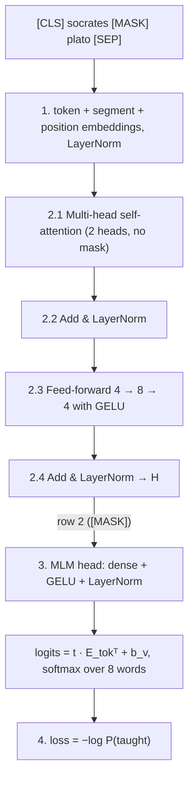

# BERT, pen and paper — Masked Language Modelling (MLM)

*A complete numerical walk-through of BERT's MLM pre-training task, from the raw sentence to the loss, for* **“socrates [MASK] plato”** *(original: “socrates taught plato”).*

> Every number is produced by [`bert_pen_and_paper.py`](bert_pen_and_paper.py); intermediate results are rounded to 4 decimals and the rounded value is used in the next step, so every entry can be checked with a calculator. The companion example is [NSP.md](NSP.md) (next sentence prediction) — same model, different head.

## Contents

0. [Setup](#0-setup) · 1. [Input representation](#1-input-representation) · 2. [Encoder layer](#2-the-encoder-layer) · 3. [MLM head](#3-the-mlm-head) · 4. [Loss and gradient](#4-loss-and-gradient) · [Summary](#summary) · [Exercises](#exercises)

## 0. Setup

### 0.1 What BERT is

BERT (Devlin et al., 2019, *“BERT: Pre-training of Deep Bidirectional Transformers for Language Understanding”*) is the **encoder** of the Transformer, without the decoder. Because there is no decoder there is **no causal mask**: every token attends to every other token, to its left *and* to its right (“bidirectional”). BERT is pre-trained with two self-supervised tasks that share one encoder and differ only in the small head on top:

| Task | Input | Read the output at | Head | Predicts |
|:--|:--|:--|:--|:--|
| **MLM** — masked language modelling | one sentence with ~15 % of the words hidden | each masked position | dense + GELU + LayerNorm, then $`\cdot E^{\top} + b`$ | the hidden word (softmax over the vocabulary) |
| **NSP** — next sentence prediction | a sentence pair `[CLS] A [SEP] B [SEP]` | the `[CLS]` position | pooler (dense + tanh), then a 2-way classifier | IsNext / NotNext |

During pre-training both losses are computed on the same batch and added: $`\mathcal L = \mathcal L_{\text{MLM}} + \mathcal L_{\text{NSP}}`$. The companion document covers the other head; the embedding and encoder weights are identical in both.

### 0.2 Hyperparameters

| Symbol | Meaning | BERT-base | This example |
|:--|:--|--:|--:|
| $`d_{\text{model}}`$ | hidden size | 768 | **4** |
| $`h`$ | attention heads | 12 | **2** |
| $`d_k = d_{\text{model}}/h`$ | width of one head | 64 | **2** |
| $`d_{ff}`$ | feed-forward hidden size | 3072 | **8** |
| $`L`$ | encoder layers | 12 | **1** |
| — | maximum sequence length | 512 | **8** |
| $`\lvert V\rvert`$ | vocabulary (WordPiece) | 30 522 | **8** |

Simplifications that do not change the mechanics: no dropout; the Q/K/V/O projections have no bias (real BERT has them); every LayerNorm uses $`\gamma = 1`$, $`\beta = 0`$, $`\epsilon \approx 0`$; whole words instead of WordPiece sub-words. All weights are made-up “untrained” values with one decimal.

### 0.3 Vocabulary

| id | 0 | 1 | 2 | 3 | 4 | 5 | 6 | 7 |
|:--|:-:|:-:|:-:|:-:|:-:|:-:|:-:|:-:|
| **token** | `[CLS]` | `[SEP]` | `[MASK]` | `socrates` | `taught` | `plato` | `wrote` | `met` |

`[CLS]` (classification) always starts the input, `[SEP]` (separator) ends each sentence, `[MASK]` replaces a hidden word in MLM.

### 0.4 This example

**Task.** Hide some words of a sentence and train the model to recover them from the context on *both* sides. BERT selects 15 % of the (non-special) tokens; each selected token is replaced by `[MASK]` 80 % of the time, by a random token 10 % of the time, and left unchanged 10 % of the time (so that the model cannot rely on `[MASK]` being present, which it never is when BERT is later fine-tuned). The loss is computed **only at the selected positions**.

Our sentence has three words, so 15 % rounds to one selected token: “taught”, and it falls in the 80 % `[MASK]` case. Predicting it needs the left context (“socrates”) and the right context (“plato”) — exactly what a left-to-right language model cannot do.

| pos | 0 | 1 | 2 | 3 | 4 |
|:--|:-:|:-:|:-:|:-:|:-:|
| **original** | `[CLS]` | `socrates` | `taught` | `plato` | `[SEP]` |
| **model input** | `[CLS]` | `socrates` | `[MASK]` | `plato` | `[SEP]` |
| **segment** | A | A | A | A | A |
| **MLM label** | — | — | `taught` | — | — |

A single sentence uses segment A everywhere.

### 0.5 Conventions

* **Row vectors.** Each token is a row; a sequence of $`n`$ tokens is an $`n \times 4`$ matrix, and a linear layer is $`XW + b`$.
* Positions, dimensions and ids are counted from 0; heads from 1. In formulas the first subscript is the **position** (e.g. $`q_{2,1}`$ = query of position 2, dimension 1; $`s_{2,4}`$ = score of query 2 against key 4).
* Every intermediate result is rounded to **4 decimals** and the rounded value is used in the next step.
* Weight tables: rows = input dimension (“in 0…3”), columns = output dimension.

### 0.6 Pipeline



---

## 1. Input representation

BERT's input vector for each token is the **sum of three learned embeddings**, followed by a LayerNorm:

```math
x_i = \operatorname{LayerNorm}\big(E^{\text{tok}}[\text{token}_i] + E^{\text{seg}}[\text{segment}_i] + E^{\text{pos}}[i]\big)
```

* **Token embedding** $`E^{\text{tok}}`$ (8×4): one row per vocabulary entry.
* **Segment embedding** $`E^{\text{seg}}`$ (2×4): row A for tokens of the first sentence (including `[CLS]` and the first `[SEP]`), row B for the second sentence.
* **Position embedding** $`E^{\text{pos}}`$ (8×4): unlike the original Transformer's fixed sinusoids, BERT *learns* one vector per position (up to 512).
* There is no $`\sqrt{d_{\text{model}}}`$ scaling.

**Parameters**

$`E^{\text{tok}}`$

| | dim 0 | dim 1 | dim 2 | dim 3 |
|:--|--:|--:|--:|--:|
| **0: [CLS]** | -0.2 | -0.4 | 0.5 | -0.2 |
| **1: [SEP]** | 0.6 | 0.2 | -0.8 | 0.0 |
| **2: [MASK]** | -0.2 | 0.1 | 0.2 | 0.1 |
| **3: socrates** | 0.2 | 0.8 | -0.3 | -0.9 |
| **4: taught** | 0.4 | 0.5 | -0.1 | 0.7 |
| **5: plato** | -0.5 | 0.4 | 0.3 | -0.2 |
| **6: wrote** | 0.6 | 0.9 | -0.5 | -1.0 |
| **7: met** | 0.3 | 0.6 | -0.8 | 0.2 |

$`E^{\text{seg}}`$

| | dim 0 | dim 1 | dim 2 | dim 3 |
|:--|--:|--:|--:|--:|
| **A (0)** | 0.5 | -1.0 | 0.3 | -0.4 |
| **B (1)** | -0.8 | -0.3 | 0.1 | -0.7 |

$`E^{\text{pos}}`$

| | dim 0 | dim 1 | dim 2 | dim 3 |
|:--|--:|--:|--:|--:|
| **pos 0** | -0.4 | 0.3 | -0.9 | -0.1 |
| **pos 1** | 0.7 | 0.5 | 0.8 | -0.3 |
| **pos 2** | 1.0 | -0.9 | -0.2 | 0.5 |
| **pos 3** | 0.7 | 0.5 | 0.5 | -0.9 |
| **pos 4** | -0.2 | -0.1 | 0.5 | -0.1 |
| **pos 5** | 0.3 | 0.9 | 0.1 | 0.2 |
| **pos 6** | 0.0 | -0.4 | -0.5 | 0.8 |
| **pos 7** | -0.3 | -0.4 | -0.2 | 0.5 |

#### Step 1 — look up the three embeddings

| pos | token | id | segment |
|:-:|:--|:-:|:-:|
| 0 | `[CLS]` | 0 | A |
| 1 | `socrates` | 3 | A |
| 2 | `[MASK]` | 2 | A |
| 3 | `plato` | 5 | A |
| 4 | `[SEP]` | 1 | A |

Token embeddings (row `id` of $`E^{\text{tok}}`$):

| | dim 0 | dim 1 | dim 2 | dim 3 |
|:--|--:|--:|--:|--:|
| **0: [CLS]** | -0.2 | -0.4 | 0.5 | -0.2 |
| **1: socrates** | 0.2 | 0.8 | -0.3 | -0.9 |
| **2: [MASK]** | -0.2 | 0.1 | 0.2 | 0.1 |
| **3: plato** | -0.5 | 0.4 | 0.3 | -0.2 |
| **4: [SEP]** | 0.6 | 0.2 | -0.8 | 0.0 |

Segment embeddings:

| | dim 0 | dim 1 | dim 2 | dim 3 |
|:--|--:|--:|--:|--:|
| **0: [CLS]** | 0.5 | -1.0 | 0.3 | -0.4 |
| **1: socrates** | 0.5 | -1.0 | 0.3 | -0.4 |
| **2: [MASK]** | 0.5 | -1.0 | 0.3 | -0.4 |
| **3: plato** | 0.5 | -1.0 | 0.3 | -0.4 |
| **4: [SEP]** | 0.5 | -1.0 | 0.3 | -0.4 |

Position embeddings (first rows of $`E^{\text{pos}}`$):

| | dim 0 | dim 1 | dim 2 | dim 3 |
|:--|--:|--:|--:|--:|
| **0: [CLS]** | -0.4 | 0.3 | -0.9 | -0.1 |
| **1: socrates** | 0.7 | 0.5 | 0.8 | -0.3 |
| **2: [MASK]** | 1.0 | -0.9 | -0.2 | 0.5 |
| **3: plato** | 0.7 | 0.5 | 0.5 | -0.9 |
| **4: [SEP]** | -0.2 | -0.1 | 0.5 | -0.1 |

#### Step 2 — add them

```math
\begin{aligned}
\text{pos }2\;(\texttt{[MASK]}):\;& \begin{bmatrix}-0.2 & 0.1 & 0.2 & 0.1\end{bmatrix} + \begin{bmatrix}0.5 & -1.0 & 0.3 & -0.4\end{bmatrix} + \begin{bmatrix}1.0 & -0.9 & -0.2 & 0.5\end{bmatrix} = \begin{bmatrix}1.3000 & -1.8000 & 0.3000 & 0.2000\end{bmatrix} \\
\text{pos }1\;(\texttt{socrates}):\;& \begin{bmatrix}0.2 & 0.8 & -0.3 & -0.9\end{bmatrix} + \begin{bmatrix}0.5 & -1.0 & 0.3 & -0.4\end{bmatrix} + \begin{bmatrix}0.7 & 0.5 & 0.8 & -0.3\end{bmatrix} = \begin{bmatrix}1.4000 & 0.3000 & 0.8000 & -1.6000\end{bmatrix} \\
\text{pos }3\;(\texttt{plato}):\;& \begin{bmatrix}-0.5 & 0.4 & 0.3 & -0.2\end{bmatrix} + \begin{bmatrix}0.5 & -1.0 & 0.3 & -0.4\end{bmatrix} + \begin{bmatrix}0.7 & 0.5 & 0.5 & -0.9\end{bmatrix} = \begin{bmatrix}0.7000 & -0.1000 & 1.1000 & -1.5000\end{bmatrix}
\end{aligned}
```

**Embedding sum**

| | dim 0 | dim 1 | dim 2 | dim 3 |
|:--|--:|--:|--:|--:|
| **0: [CLS]** | -0.1000 | -1.1000 | -0.1000 | -0.7000 |
| **1: socrates** | 1.4000 | 0.3000 | 0.8000 | -1.6000 |
| **2: [MASK]** | 1.3000 | -1.8000 | 0.3000 | 0.2000 |
| **3: plato** | 0.7000 | -0.1000 | 1.1000 | -1.5000 |
| **4: [SEP]** | 0.9000 | -0.9000 | 0.0000 | -0.5000 |

#### Step 3 — embedding LayerNorm

```math
X = \operatorname{LayerNorm}(E^{\text{tok}} + E^{\text{seg}} + E^{\text{pos}}),\qquad \operatorname{LayerNorm}(r) = \gamma \odot \frac{r - \mu}{\sqrt{\sigma^2 + \epsilon}} + \beta
```

$`\mu`$ and $`\sigma^2`$ are the mean and (population) variance of the 4 entries **of each row** — every token is normalised on its own.

Worked row **2: [MASK]**:

```math
\begin{aligned}
r &= \begin{bmatrix}1.3000 & -1.8000 & 0.3000 & 0.2000\end{bmatrix} \\
\mu &= \tfrac14(1.3000 + (-1.8000) + 0.3000 + 0.2000) = 0.0000 \\
\sigma^2 &= \tfrac14\left(1.3000^2 + (-1.8000)^2 + 0.3000^2 + 0.2000^2\right) = 1.2650 \\
\sigma &= \sqrt{1.2650} = 1.1247 \\
\hat r &= \frac{r - 0.0000}{1.1247} = \begin{bmatrix}1.1559 & -1.6004 & 0.2667 & 0.1778\end{bmatrix}
\end{aligned}
```

| | μ | σ² | σ |
|:--|--:|--:|--:|
| **0: [CLS]** | -0.5000 | 0.1800 | 0.4243 |
| **1: socrates** | 0.2250 | 1.2619 | 1.1233 |
| **2: [MASK]** | 0.0000 | 1.2650 | 1.1247 |
| **3: plato** | 0.0500 | 0.9875 | 0.9937 |
| **4: [SEP]** | -0.1250 | 0.4519 | 0.6722 |

$`X`$ (every row now has mean 0 and variance 1):

| | dim 0 | dim 1 | dim 2 | dim 3 |
|:--|--:|--:|--:|--:|
| **0: [CLS]** | 0.9427 | -1.4141 | 0.9427 | -0.4714 |
| **1: socrates** | 1.0460 | 0.0668 | 0.5119 | -1.6247 |
| **2: [MASK]** | 1.1559 | -1.6004 | 0.2667 | 0.1778 |
| **3: plato** | 0.6541 | -0.1510 | 1.0567 | -1.5598 |
| **4: [SEP]** | 1.5248 | -1.1529 | 0.1860 | -0.5579 |

Note that the `[MASK]` row carries no information about the hidden word — only its position and segment. Everything the model knows about “taught” must flow in from the other tokens through attention.

---


## 2. The encoder layer

One BERT layer = multi-head self-attention → Add & Norm → feed-forward → Add & Norm (BERT-base stacks 12 such layers, each with its own weights).

### 2.1 Multi-head self-attention

```math
\operatorname{MultiHead}(X) = \operatorname{Concat}(\text{head}_1, \text{head}_2)\,W^O,\qquad \text{head}_i = \operatorname{softmax}\!\left(\frac{Q_i K_i^{\top}}{\sqrt{d_k}}\right) V_i
```

Queries, keys and values all come from $`X`$ (**self**-attention) and there is **no mask**: the score matrix is full, so position 2 sees the tokens before *and* after it.

#### 2.1.1 Parameters

$`W^Q`$ (4×4)

| | dim 0 (head 1) | dim 1 (head 1) | dim 2 (head 2) | dim 3 (head 2) |
|:--|--:|--:|--:|--:|
| **in 0** | 0.4 | -0.7 | -1.0 | -0.6 |
| **in 1** | -1.0 | -0.7 | -0.1 | 0.7 |
| **in 2** | 0.5 | -0.6 | 0.4 | -0.5 |
| **in 3** | -0.1 | -0.6 | 0.6 | 0.6 |

$`W^K`$ (4×4)

| | dim 0 (head 1) | dim 1 (head 1) | dim 2 (head 2) | dim 3 (head 2) |
|:--|--:|--:|--:|--:|
| **in 0** | 0.5 | 0.0 | 0.6 | -0.6 |
| **in 1** | 0.8 | 0.9 | 1.0 | 0.7 |
| **in 2** | 0.0 | -0.4 | -0.5 | -0.4 |
| **in 3** | -0.3 | -0.8 | 0.3 | -0.8 |

$`W^V`$ (4×4)

| | dim 0 (head 1) | dim 1 (head 1) | dim 2 (head 2) | dim 3 (head 2) |
|:--|--:|--:|--:|--:|
| **in 0** | 0.6 | 0.5 | 0.6 | 0.7 |
| **in 1** | 0.6 | 0.4 | -0.5 | -0.5 |
| **in 2** | -0.8 | 0.7 | 1.0 | -0.5 |
| **in 3** | -0.5 | -0.5 | 0.9 | 0.3 |

$`W^O`$ (4×4)

| | dim 0 | dim 1 | dim 2 | dim 3 |
|:--|--:|--:|--:|--:|
| **in 0** | -0.2 | -0.5 | -0.2 | 0.6 |
| **in 1** | -0.2 | -0.4 | -0.6 | 0.7 |
| **in 2** | 0.1 | 0.7 | 0.2 | 0.2 |
| **in 3** | -0.4 | 0.8 | -0.8 | 0.3 |

#### 2.1.2 Queries, keys and values

```math
Q = X W^Q,\qquad K = X W^K,\qquad V = X W^V
```

Each is 5×4. Worked row **2: [MASK]** (row 2 of $`X`$ times each column):

```math
\begin{aligned}
q_{2,0} &= 1.1559\cdot 0.4 + (-1.6004)\cdot (-1.0) + 0.2667\cdot 0.5 + 0.1778\cdot (-0.1) = 2.1783 \\
q_{2,1} &= 1.1559\cdot (-0.7) + (-1.6004)\cdot (-0.7) + 0.2667\cdot (-0.6) + 0.1778\cdot (-0.6) = 0.0445 \\
q_{2,2} &= 1.1559\cdot (-1.0) + (-1.6004)\cdot (-0.1) + 0.2667\cdot 0.4 + 0.1778\cdot 0.6 = -0.7825 \\
q_{2,3} &= 1.1559\cdot (-0.6) + (-1.6004)\cdot 0.7 + 0.2667\cdot (-0.5) + 0.1778\cdot 0.6 = -1.8405 \\
k_{2,0} &= 1.1559\cdot 0.5 + (-1.6004)\cdot 0.8 + 0.2667\cdot 0.0 + 0.1778\cdot (-0.3) = -0.7557 \\
k_{2,1} &= 1.1559\cdot 0.0 + (-1.6004)\cdot 0.9 + 0.2667\cdot (-0.4) + 0.1778\cdot (-0.8) = -1.6893 \\
k_{2,2} &= 1.1559\cdot 0.6 + (-1.6004)\cdot 1.0 + 0.2667\cdot (-0.5) + 0.1778\cdot 0.3 = -0.9869 \\
k_{2,3} &= 1.1559\cdot (-0.6) + (-1.6004)\cdot 0.7 + 0.2667\cdot (-0.4) + 0.1778\cdot (-0.8) = -2.0627 \\
v_{2,0} &= 1.1559\cdot 0.6 + (-1.6004)\cdot 0.6 + 0.2667\cdot (-0.8) + 0.1778\cdot (-0.5) = -0.5690 \\
v_{2,1} &= 1.1559\cdot 0.5 + (-1.6004)\cdot 0.4 + 0.2667\cdot 0.7 + 0.1778\cdot (-0.5) = 0.0356 \\
v_{2,2} &= 1.1559\cdot 0.6 + (-1.6004)\cdot (-0.5) + 0.2667\cdot 1.0 + 0.1778\cdot 0.9 = 1.9205 \\
v_{2,3} &= 1.1559\cdot 0.7 + (-1.6004)\cdot (-0.5) + 0.2667\cdot (-0.5) + 0.1778\cdot 0.3 = 1.5293
\end{aligned}
```

**Q**

| | dim 0 (head 1) | dim 1 (head 1) | dim 2 (head 2) | dim 3 (head 2) |
|:--|--:|--:|--:|--:|
| **0: [CLS]** | 2.3097 | 0.0472 | -0.7070 | -2.3097 |
| **1: socrates** | 0.7700 | -0.1113 | -1.8227 | -1.8116 |
| **2: [MASK]** | 2.1783 | 0.0445 | -0.7825 | -1.8405 |
| **3: plato** | 1.0970 | -0.0503 | -1.1522 | -1.9624 |
| **4: [SEP]** | 1.9116 | -0.0372 | -1.6698 | -2.1496 |

**K**

| | dim 0 (head 1) | dim 1 (head 1) | dim 2 (head 2) | dim 3 (head 2) |
|:--|--:|--:|--:|--:|
| **0: [CLS]** | -0.5185 | -1.2726 | -1.4612 | -1.5554 |
| **1: socrates** | 1.0638 | 1.1551 | -0.0490 | 0.5142 |
| **2: [MASK]** | -0.7557 | -1.6893 | -0.9869 | -2.0627 |
| **3: plato** | 0.6742 | 0.6893 | -0.7548 | 0.3270 |
| **4: [SEP]** | 0.0074 | -0.6657 | -0.4984 | -1.3500 |

**V**

| | dim 0 (head 1) | dim 1 (head 1) | dim 2 (head 2) | dim 3 (head 2) |
|:--|--:|--:|--:|--:|
| **0: [CLS]** | -0.8013 | 0.8013 | 1.7911 | 0.7542 |
| **1: socrates** | 1.0705 | 1.7204 | -0.3561 | -0.0446 |
| **2: [MASK]** | -0.5690 | 0.0356 | 1.9205 | 1.5293 |
| **3: plato** | 0.2364 | 1.7862 | 0.1208 | -0.4629 |
| **4: [SEP]** | 0.3533 | 0.7104 | 1.1752 | 1.3834 |

#### 2.1.3 Split into 2 heads

Head 1 uses columns 0–1 of $`Q, K, V`$ and head 2 uses columns 2–3, so each head works in its own $`d_k = 2`$-dimensional subspace; scores are divided by $`\sqrt{d_k} = \sqrt 2 \approx 1.4142`$.

#### 2.1.4 Head 1

$`Q_1, K_1, V_1`$ (columns 0–1):

| | Q1[0] | Q1[1] | K1[0] | K1[1] | V1[0] | V1[1] |
|:--|--:|--:|--:|--:|--:|--:|
| **0: [CLS]** | 2.3097 | 0.0472 | -0.5185 | -1.2726 | -0.8013 | 0.8013 |
| **1: socrates** | 0.7700 | -0.1113 | 1.0638 | 1.1551 | 1.0705 | 1.7204 |
| **2: [MASK]** | 2.1783 | 0.0445 | -0.7557 | -1.6893 | -0.5690 | 0.0356 |
| **3: plato** | 1.0970 | -0.0503 | 0.6742 | 0.6893 | 0.2364 | 1.7862 |
| **4: [SEP]** | 1.9116 | -0.0372 | 0.0074 | -0.6657 | 0.3533 | 0.7104 |

**Step 1 – scores** $`S_1 = Q_1K_1^{\top}`$ (5×5). Worked row **2: [MASK]** (query 2 against every key $`j`$):

```math
\begin{aligned}
s_{2,0} &= 2.1783\cdot (-0.5185) + 0.0445\cdot (-1.2726) = -1.1861 \\
s_{2,1} &= 2.1783\cdot 1.0638 + 0.0445\cdot 1.1551 = 2.3687 \\
s_{2,2} &= 2.1783\cdot (-0.7557) + 0.0445\cdot (-1.6893) = -1.7213 \\
s_{2,3} &= 2.1783\cdot 0.6742 + 0.0445\cdot 0.6893 = 1.4993 \\
s_{2,4} &= 2.1783\cdot 0.0074 + 0.0445\cdot (-0.6657) = -0.0135
\end{aligned}
```

| | 0: [CLS] | 1: socrates | 2: [MASK] | 3: plato | 4: [SEP] |
|:--|--:|--:|--:|--:|--:|
| **0: [CLS]** | -1.2576 | 2.5116 | -1.8252 | 1.5897 | -0.0143 |
| **1: socrates** | -0.2576 | 0.6906 | -0.3939 | 0.4424 | 0.0798 |
| **2: [MASK]** | -1.1861 | 2.3687 | -1.7213 | 1.4993 | -0.0135 |
| **3: plato** | -0.5048 | 1.1089 | -0.7440 | 0.7049 | 0.0416 |
| **4: [SEP]** | -0.9438 | 1.9906 | -1.3818 | 1.2632 | 0.0389 |

**Step 2 – scale** by $`1.4142`$ (e.g. $`(-1.1861) / 1.4142 = -0.8387`$):

| | 0: [CLS] | 1: socrates | 2: [MASK] | 3: plato | 4: [SEP] |
|:--|--:|--:|--:|--:|--:|
| **0: [CLS]** | -0.8893 | 1.7760 | -1.2906 | 1.1241 | -0.0101 |
| **1: socrates** | -0.1822 | 0.4883 | -0.2785 | 0.3128 | 0.0564 |
| **2: [MASK]** | -0.8387 | 1.6749 | -1.2172 | 1.0602 | -0.0095 |
| **3: plato** | -0.3570 | 0.7841 | -0.5261 | 0.4984 | 0.0294 |
| **4: [SEP]** | -0.6674 | 1.4076 | -0.9771 | 0.8932 | 0.0275 |

**Step 3 – softmax of each row.** Worked row **2: [MASK]**:

```math
\begin{aligned}
&e^{-0.8387} = 0.4323,\quad e^{1.6749} = 5.3383,\quad e^{-1.2172} = 0.2961,\quad e^{1.0602} = 2.8869 \\
&e^{-0.0095} = 0.9905 \\
&\textstyle\sum = 0.4323 + 5.3383 + 0.2961 + 2.8869 + 0.9905 = 9.9441 \\
&a_{2,\cdot} = \frac{1}{9.9441}\,\begin{bmatrix}0.4323 & 5.3383 & 0.2961 & 2.8869 & 0.9905\end{bmatrix} = \begin{bmatrix}0.0435 & 0.5368 & 0.0298 & 0.2903 & 0.0996\end{bmatrix}
\end{aligned}
```

**Attention weights** $`A_1`$ (row = query, column = key; rows sum to 1 up to rounding):

| | 0: [CLS] | 1: socrates | 2: [MASK] | 3: plato | 4: [SEP] |
|:--|--:|--:|--:|--:|--:|
| **0: [CLS]** | 0.0385 | 0.5541 | 0.0258 | 0.2887 | 0.0929 |
| **1: socrates** | 0.1476 | 0.2887 | 0.1341 | 0.2422 | 0.1874 |
| **2: [MASK]** | 0.0435 | 0.5368 | 0.0298 | 0.2903 | 0.0996 |
| **3: plato** | 0.1137 | 0.3558 | 0.0960 | 0.2674 | 0.1673 |
| **4: [SEP]** | 0.0607 | 0.4838 | 0.0446 | 0.2892 | 0.1217 |

Strongest link per query: 0: [CLS] → **1: socrates** (0.5541); 1: socrates → **1: socrates** (0.2887); 2: [MASK] → **1: socrates** (0.5368); 3: plato → **1: socrates** (0.3558); 4: [SEP] → **1: socrates** (0.4838).

**Step 4 – weighted sum of values** $`Z_1 = A_1V_1`$ (5×2). Worked row **2: [MASK]**:

```math
\begin{aligned}
z_{2,0} &= 0.0435\cdot (-0.8013) + 0.5368\cdot 1.0705 + 0.0298\cdot (-0.5690) + 0.2903\cdot 0.2364 + 0.0996\cdot 0.3533 = 0.6266 \\
z_{2,1} &= 0.0435\cdot 0.8013 + 0.5368\cdot 1.7204 + 0.0298\cdot 0.0356 + 0.2903\cdot 1.7862 + 0.0996\cdot 0.7104 = 1.5487
\end{aligned}
```

| | dim 0 | dim 1 |
|:--|--:|--:|
| **0: [CLS]** | 0.6487 | 1.5667 |
| **1: socrates** | 0.2379 | 1.1855 |
| **2: [MASK]** | 0.6266 | 1.5487 |
| **3: plato** | 0.3575 | 1.3031 |
| **4: [SEP]** | 0.5553 | 1.4856 |

#### 2.1.5 Head 2

$`Q_2, K_2, V_2`$ (columns 2–3):

| | Q2[0] | Q2[1] | K2[0] | K2[1] | V2[0] | V2[1] |
|:--|--:|--:|--:|--:|--:|--:|
| **0: [CLS]** | -0.7070 | -2.3097 | -1.4612 | -1.5554 | 1.7911 | 0.7542 |
| **1: socrates** | -1.8227 | -1.8116 | -0.0490 | 0.5142 | -0.3561 | -0.0446 |
| **2: [MASK]** | -0.7825 | -1.8405 | -0.9869 | -2.0627 | 1.9205 | 1.5293 |
| **3: plato** | -1.1522 | -1.9624 | -0.7548 | 0.3270 | 0.1208 | -0.4629 |
| **4: [SEP]** | -1.6698 | -2.1496 | -0.4984 | -1.3500 | 1.1752 | 1.3834 |

**Step 1 – scores** $`S_2 = Q_2K_2^{\top}`$ (5×5). Worked row **2: [MASK]** (query 2 against every key $`j`$):

```math
\begin{aligned}
s_{2,0} &= (-0.7825)\cdot (-1.4612) + (-1.8405)\cdot (-1.5554) = 4.0061 \\
s_{2,1} &= (-0.7825)\cdot (-0.0490) + (-1.8405)\cdot 0.5142 = -0.9080 \\
s_{2,2} &= (-0.7825)\cdot (-0.9869) + (-1.8405)\cdot (-2.0627) = 4.5686 \\
s_{2,3} &= (-0.7825)\cdot (-0.7548) + (-1.8405)\cdot 0.3270 = -0.0112 \\
s_{2,4} &= (-0.7825)\cdot (-0.4984) + (-1.8405)\cdot (-1.3500) = 2.8747
\end{aligned}
```

| | 0: [CLS] | 1: socrates | 2: [MASK] | 3: plato | 4: [SEP] |
|:--|--:|--:|--:|--:|--:|
| **0: [CLS]** | 4.6256 | -1.1530 | 5.4620 | -0.2216 | 3.4705 |
| **1: socrates** | 5.4811 | -0.8422 | 5.5356 | 0.7834 | 3.3541 |
| **2: [MASK]** | 4.0061 | -0.9080 | 4.5686 | -0.0112 | 2.8747 |
| **3: plato** | 4.7359 | -0.9526 | 5.1849 | 0.2280 | 3.2235 |
| **4: [SEP]** | 5.7834 | -1.0235 | 6.0819 | 0.5574 | 3.7342 |

**Step 2 – scale** by $`1.4142`$ (e.g. $`4.0061 / 1.4142 = 2.8328`$):

| | 0: [CLS] | 1: socrates | 2: [MASK] | 3: plato | 4: [SEP] |
|:--|--:|--:|--:|--:|--:|
| **0: [CLS]** | 3.2708 | -0.8153 | 3.8623 | -0.1567 | 2.4540 |
| **1: socrates** | 3.8758 | -0.5955 | 3.9143 | 0.5540 | 2.3717 |
| **2: [MASK]** | 2.8328 | -0.6421 | 3.2305 | -0.0079 | 2.0327 |
| **3: plato** | 3.3488 | -0.6736 | 3.6663 | 0.1612 | 2.2794 |
| **4: [SEP]** | 4.0895 | -0.7237 | 4.3006 | 0.3941 | 2.6405 |

**Step 3 – softmax of each row.** Worked row **2: [MASK]**:

```math
\begin{aligned}
&e^{2.8328} = 16.9930,\quad e^{-0.6421} = 0.5262,\quad e^{3.2305} = 25.2923,\quad e^{-0.0079} = 0.9921 \\
&e^{2.0327} = 7.6347 \\
&\textstyle\sum = 16.9930 + 0.5262 + 25.2923 + 0.9921 + 7.6347 = 51.4383 \\
&a_{2,\cdot} = \frac{1}{51.4383}\,\begin{bmatrix}16.9930 & 0.5262 & 25.2923 & 0.9921 & 7.6347\end{bmatrix} = \begin{bmatrix}0.3304 & 0.0102 & 0.4917 & 0.0193 & 0.1484\end{bmatrix}
\end{aligned}
```

**Attention weights** $`A_2`$ (row = query, column = key; rows sum to 1 up to rounding):

| | 0: [CLS] | 1: socrates | 2: [MASK] | 3: plato | 4: [SEP] |
|:--|--:|--:|--:|--:|--:|
| **0: [CLS]** | 0.3032 | 0.0051 | 0.5478 | 0.0098 | 0.1340 |
| **1: socrates** | 0.4331 | 0.0050 | 0.4501 | 0.0156 | 0.0962 |
| **2: [MASK]** | 0.3304 | 0.0102 | 0.4917 | 0.0193 | 0.1484 |
| **3: plato** | 0.3602 | 0.0065 | 0.4948 | 0.0149 | 0.1236 |
| **4: [SEP]** | 0.3996 | 0.0032 | 0.4935 | 0.0099 | 0.0938 |

Strongest link per query: 0: [CLS] → **2: [MASK]** (0.5478); 1: socrates → **2: [MASK]** (0.4501); 2: [MASK] → **2: [MASK]** (0.4917); 3: plato → **2: [MASK]** (0.4948); 4: [SEP] → **2: [MASK]** (0.4935).

**Step 4 – weighted sum of values** $`Z_2 = A_2V_2`$ (5×2). Worked row **2: [MASK]**:

```math
\begin{aligned}
z_{2,0} &= 0.3304\cdot 1.7911 + 0.0102\cdot (-0.3561) + 0.4917\cdot 1.9205 + 0.0193\cdot 0.1208 + 0.1484\cdot 1.1752 = 1.7092 \\
z_{2,1} &= 0.3304\cdot 0.7542 + 0.0102\cdot (-0.0446) + 0.4917\cdot 1.5293 + 0.0193\cdot (-0.4629) + 0.1484\cdot 1.3834 = 1.1971
\end{aligned}
```

| | dim 0 | dim 1 |
|:--|--:|--:|
| **0: [CLS]** | 1.7520 | 1.2470 |
| **1: socrates** | 1.7533 | 1.1406 |
| **2: [MASK]** | 1.7092 | 1.1971 |
| **3: plato** | 1.7402 | 1.1922 |
| **4: [SEP]** | 1.7738 | 1.1811 |

#### 2.1.6 Concatenate and project

| | dim 0 (head 1) | dim 1 (head 1) | dim 2 (head 2) | dim 3 (head 2) |
|:--|--:|--:|--:|--:|
| **0: [CLS]** | 0.6487 | 1.5667 | 1.7520 | 1.2470 |
| **1: socrates** | 0.2379 | 1.1855 | 1.7533 | 1.1406 |
| **2: [MASK]** | 0.6266 | 1.5487 | 1.7092 | 1.1971 |
| **3: plato** | 0.3575 | 1.3031 | 1.7402 | 1.1922 |
| **4: [SEP]** | 0.5553 | 1.4856 | 1.7738 | 1.1811 |

Worked row **2: [MASK]** of $`\operatorname{Concat}(Z_1, Z_2)\,W^O`$:

```math
\begin{aligned}
o_{2,0} &= 0.6266\cdot (-0.2) + 1.5487\cdot (-0.2) + 1.7092\cdot 0.1 + 1.1971\cdot (-0.4) = -0.7430 \\
o_{2,1} &= 0.6266\cdot (-0.5) + 1.5487\cdot (-0.4) + 1.7092\cdot 0.7 + 1.1971\cdot 0.8 = 1.2213 \\
o_{2,2} &= 0.6266\cdot (-0.2) + 1.5487\cdot (-0.6) + 1.7092\cdot 0.2 + 1.1971\cdot (-0.8) = -1.6704 \\
o_{2,3} &= 0.6266\cdot 0.6 + 1.5487\cdot 0.7 + 1.7092\cdot 0.2 + 1.1971\cdot 0.3 = 2.1610
\end{aligned}
```

**Multi-head attention output**

| | dim 0 | dim 1 | dim 2 | dim 3 |
|:--|--:|--:|--:|--:|
| **0: [CLS]** | -0.7667 | 1.2730 | -1.7170 | 2.2104 |
| **1: socrates** | -0.5656 | 1.5466 | -1.3207 | 1.6654 |
| **2: [MASK]** | -0.7430 | 1.2213 | -1.6704 | 2.1610 |
| **3: plato** | -0.6350 | 1.4719 | -1.4591 | 1.8324 |
| **4: [SEP]** | -0.7032 | 1.3146 | -1.5925 | 2.0822 |

### 2.2 Add & Norm (1)

```math
X_1 = \operatorname{LayerNorm}(X + \operatorname{MultiHead}(X)),\qquad \operatorname{LayerNorm}(r) = \gamma \odot \frac{r - \mu}{\sqrt{\sigma^2 + \epsilon}} + \beta
```

$`\mu`$ and $`\sigma^2`$ are the mean and (population) variance of the 4 entries **of each row** — every token is normalised on its own.

Worked row **2: [MASK]**:

```math
\begin{aligned}
r &= \begin{bmatrix}1.1559 & -1.6004 & 0.2667 & 0.1778\end{bmatrix} + \begin{bmatrix}-0.7430 & 1.2213 & -1.6704 & 2.1610\end{bmatrix} = \begin{bmatrix}0.4129 & -0.3791 & -1.4037 & 2.3388\end{bmatrix} \\
\mu &= \tfrac14(0.4129 + (-0.3791) + (-1.4037) + 2.3388) = 0.2422 \\
\sigma^2 &= \tfrac14\left(0.1707^2 + (-0.6213)^2 + (-1.6459)^2 + 2.0966^2\right) = 1.8800 \\
\sigma &= \sqrt{1.8800} = 1.3711 \\
\hat r &= \frac{r - 0.2422}{1.3711} = \begin{bmatrix}0.1245 & -0.4531 & -1.2004 & 1.5291\end{bmatrix}
\end{aligned}
```

| | μ | σ² | σ |
|:--|--:|--:|--:|
| **0: [CLS]** | 0.2499 | 0.8562 | 0.9253 |
| **1: socrates** | 0.3314 | 0.7626 | 0.8733 |
| **2: [MASK]** | 0.2422 | 1.8800 | 1.3711 |
| **3: plato** | 0.3026 | 0.4038 | 0.6355 |
| **4: [SEP]** | 0.2753 | 1.1750 | 1.0840 |

$`X_1`$ (every row now has mean 0 and variance 1):

| | dim 0 | dim 1 | dim 2 | dim 3 |
|:--|--:|--:|--:|--:|
| **0: [CLS]** | -0.0799 | -0.4226 | -1.1069 | 1.6093 |
| **1: socrates** | 0.1706 | 1.4680 | -1.3056 | -0.3329 |
| **2: [MASK]** | 0.1245 | -0.4531 | -1.2004 | 1.5291 |
| **3: plato** | -0.4461 | 1.6024 | -1.1094 | -0.0472 |
| **4: [SEP]** | 0.5040 | -0.1048 | -1.5515 | 1.1522 |

### 2.3 Feed-forward network with GELU

```math
\operatorname{FFN}(x) = \operatorname{GELU}(x W_1 + b_1)\, W_2 + b_2
```

Same position-wise two-layer network as in the Transformer, but BERT uses **GELU** instead of ReLU. GELU is a smooth ReLU: $`\text{GELU}(x) = x\,\Phi(x)`$ with $`\Phi`$ the standard normal CDF; large positive inputs pass almost unchanged, large negative inputs give ≈ 0, and small negative inputs give small *negative* outputs. We use the tanh approximation from the original BERT code:

```math
\operatorname{GELU}(x) \approx \tfrac12\, x \left(1 + \tanh\!\left[\sqrt{2/\pi}\,\left(x + 0.044715\, x^3\right)\right]\right),\qquad \sqrt{2/\pi} \approx 0.7979
```

**Parameters**

$`W_1`$ (4×8)

| | u0 | u1 | u2 | u3 | u4 | u5 | u6 | u7 |
|:--|--:|--:|--:|--:|--:|--:|--:|--:|
| **in 0** | 0.6 | -0.3 | -0.2 | -0.5 | 0.6 | 0.6 | 0.7 | -0.8 |
| **in 1** | -1.0 | 0.5 | -0.8 | 0.1 | -0.7 | -1.0 | 0.3 | -0.6 |
| **in 2** | 0.5 | 0.0 | 0.0 | -0.6 | 1.0 | 0.4 | -0.1 | 0.5 |
| **in 3** | 1.0 | 1.0 | 0.9 | 0.8 | -0.9 | 0.3 | -0.2 | 0.3 |

$`b_1`$

| | u0 | u1 | u2 | u3 | u4 | u5 | u6 | u7 |
|:--|--:|--:|--:|--:|--:|--:|--:|--:|
| **b1** | -0.5 | 0.4 | 0.2 | -0.8 | 1.0 | -0.9 | -0.8 | 0.8 |

$`W_2`$ (8×4)

| | dim 0 | dim 1 | dim 2 | dim 3 |
|:--|--:|--:|--:|--:|
| **u0** | -0.9 | 0.7 | -0.4 | -0.1 |
| **u1** | 0.5 | -0.6 | -0.8 | -0.9 |
| **u2** | 0.1 | 0.6 | 0.7 | -0.4 |
| **u3** | -0.6 | 0.2 | 0.0 | -0.2 |
| **u4** | 0.6 | -0.1 | -0.2 | -0.1 |
| **u5** | -1.0 | -0.4 | -0.7 | 0.2 |
| **u6** | 0.4 | 0.1 | -0.9 | -0.7 |
| **u7** | -0.8 | 0.5 | 0.5 | 0.7 |

$`b_2`$

| | dim 0 | dim 1 | dim 2 | dim 3 |
|:--|--:|--:|--:|--:|
| **b2** | -0.7 | 0.1 | -1.0 | 0.4 |

**Step 1 – expand:** $`U = X_1W_1 + b_1`$. Worked row **2: [MASK]**:

```math
\begin{aligned}
u_{2,0} &= 0.1245\cdot 0.6 + (-0.4531)\cdot (-1.0) + (-1.2004)\cdot 0.5 + 1.5291\cdot 1.0 + (-0.5) = 0.9567 \\
u_{2,1} &= 0.1245\cdot (-0.3) + (-0.4531)\cdot 0.5 + (-1.2004)\cdot 0.0 + 1.5291\cdot 1.0 + 0.4 = 1.6652 \\
u_{2,2} &= 0.1245\cdot (-0.2) + (-0.4531)\cdot (-0.8) + (-1.2004)\cdot 0.0 + 1.5291\cdot 0.9 + 0.2 = 1.9138 \\
u_{2,3} &= 0.1245\cdot (-0.5) + (-0.4531)\cdot 0.1 + (-1.2004)\cdot (-0.6) + 1.5291\cdot 0.8 + (-0.8) = 1.0360 \\
u_{2,4} &= 0.1245\cdot 0.6 + (-0.4531)\cdot (-0.7) + (-1.2004)\cdot 1.0 + 1.5291\cdot (-0.9) + 1.0 = -1.1847 \\
u_{2,5} &= 0.1245\cdot 0.6 + (-0.4531)\cdot (-1.0) + (-1.2004)\cdot 0.4 + 1.5291\cdot 0.3 + (-0.9) = -0.3936 \\
u_{2,6} &= 0.1245\cdot 0.7 + (-0.4531)\cdot 0.3 + (-1.2004)\cdot (-0.1) + 1.5291\cdot (-0.2) + (-0.8) = -1.0346 \\
u_{2,7} &= 0.1245\cdot (-0.8) + (-0.4531)\cdot (-0.6) + (-1.2004)\cdot 0.5 + 1.5291\cdot 0.3 + 0.8 = 0.8308
\end{aligned}
```

| | u0 | u1 | u2 | u3 | u4 | u5 | u6 | u7 |
|:--|--:|--:|--:|--:|--:|--:|--:|--:|
| **0: [CLS]** | 0.9305 | 1.8220 | 2.0024 | 1.1493 | -1.3074 | -0.4853 | -1.1939 | 1.0468 |
| **1: socrates** | -2.8513 | 0.7499 | -1.3081 | -0.2215 | -0.9312 | -2.8878 | -0.0430 | -0.9699 |
| **2: [MASK]** | 0.9567 | 1.6652 | 1.9138 | 1.0360 | -1.1847 | -0.3936 | -1.0346 | 0.8308 |
| **3: plato** | -2.9720 | 1.2878 | -1.0352 | 0.2112 | -1.4563 | -3.2280 | -0.5112 | -0.3734 |
| **4: [SEP]** | 0.2836 | 1.3486 | 1.2200 | 0.7902 | -1.2127 | -0.7677 | -0.5539 | 0.0296 |

**Step 2 – GELU.** Worked row **2: [MASK]**, step by step:

| | u0 | u1 | u2 | u3 | u4 | u5 | u6 | u7 |
|:--|--:|--:|--:|--:|--:|--:|--:|--:|
| $`x`$ | 0.9567 | 1.6652 | 1.9138 | 1.0360 | -1.1847 | -0.3936 | -1.0346 | 0.8308 |
| $`a = x + 0.044715x^3`$ | 0.9959 | 1.8717 | 2.2272 | 1.0857 | -1.2590 | -0.3963 | -1.0841 | 0.8564 |
| $`0.7979\,a`$ | 0.7946 | 1.4934 | 1.7771 | 0.8663 | -1.0046 | -0.3162 | -0.8650 | 0.6833 |
| $`\tanh(\cdot)`$ | 0.6610 | 0.9039 | 0.9444 | 0.6995 | -0.7635 | -0.3061 | -0.6988 | 0.5937 |
| $`\text{GELU} = \tfrac12 x(1+\tanh)`$ | 0.7945 | 1.5852 | 1.8606 | 0.8803 | -0.1401 | -0.1366 | -0.1558 | 0.6620 |

$`\operatorname{GELU}(U)`$ for all positions:

| | u0 | u1 | u2 | u3 | u4 | u5 | u6 | u7 |
|:--|--:|--:|--:|--:|--:|--:|--:|--:|
| **0: [CLS]** | 0.7665 | 1.7596 | 1.9572 | 1.0052 | -0.1251 | -0.1523 | -0.1390 | 0.8921 |
| **1: socrates** | -0.0057 | 0.5799 | -0.1251 | -0.0913 | -0.1639 | -0.0052 | -0.0208 | -0.1612 |
| **2: [MASK]** | 0.7945 | 1.5852 | 1.8606 | 0.8803 | -0.1401 | -0.1366 | -0.1558 | 0.6620 |
| **3: plato** | -0.0040 | 1.1602 | -0.1557 | 0.1233 | -0.1060 | -0.0018 | -0.1557 | -0.1324 |
| **4: [SEP]** | 0.1735 | 1.2287 | 1.0841 | 0.6205 | -0.1368 | -0.1700 | -0.1605 | 0.0151 |

**Step 3 – project back:** $`\operatorname{GELU}(U)W_2 + b_2`$. Worked row **2: [MASK]** (unlike ReLU, GELU leaves no exact zeros, so all 8 units contribute):

```math
\begin{aligned}
\text{ffn}_{2,0} &= 0.7945\cdot (-0.9) + 1.5852\cdot 0.5 + 1.8606\cdot 0.1 + 0.8803\cdot (-0.6) + (-0.1401)\cdot 0.6 + (-0.1366)\cdot (-1.0) + (-0.1558)\cdot 0.4 + 0.6620\cdot (-0.8) + (-0.7) = -1.5040 \\
\text{ffn}_{2,1} &= 0.7945\cdot 0.7 + 1.5852\cdot (-0.6) + 1.8606\cdot 0.6 + 0.8803\cdot 0.2 + (-0.1401)\cdot (-0.1) + (-0.1366)\cdot (-0.4) + (-0.1558)\cdot 0.1 + 0.6620\cdot 0.5 + 0.1 = 1.3815 \\
\text{ffn}_{2,2} &= 0.7945\cdot (-0.4) + 1.5852\cdot (-0.8) + 1.8606\cdot 0.7 + 0.8803\cdot 0.0 + (-0.1401)\cdot (-0.2) + (-0.1366)\cdot (-0.7) + (-0.1558)\cdot (-0.9) + 0.6620\cdot 0.5 + (-1.0) = -0.6887 \\
\text{ffn}_{2,3} &= 0.7945\cdot (-0.1) + 1.5852\cdot (-0.9) + 1.8606\cdot (-0.4) + 0.8803\cdot (-0.2) + (-0.1401)\cdot (-0.1) + (-0.1366)\cdot 0.2 + (-0.1558)\cdot (-0.7) + 0.6620\cdot 0.7 + 0.4 = -1.4673
\end{aligned}
```

**FFN output**

| | dim 0 | dim 1 | dim 2 | dim 3 |
|:--|--:|--:|--:|--:|
| **0: [CLS]** | -1.6095 | 1.4617 | -0.6415 | -1.5404 |
| **1: socrates** | -0.3351 | -0.4095 | -1.5747 | -0.1360 |
| **2: [MASK]** | -1.5040 | 1.3815 | -0.6887 | -1.4673 |
| **3: plato** | -0.2240 | -0.7381 | -1.9392 | -0.5796 |
| **4: [SEP]** | -0.4940 | 0.3320 | -0.9951 | -1.1783 |

### 2.4 Add & Norm (2) → final hidden states $`H`$

```math
H = \operatorname{LayerNorm}(X_1 + \operatorname{FFN}(X_1)),\qquad \operatorname{LayerNorm}(r) = \gamma \odot \frac{r - \mu}{\sqrt{\sigma^2 + \epsilon}} + \beta
```

$`\mu`$ and $`\sigma^2`$ are the mean and (population) variance of the 4 entries **of each row** — every token is normalised on its own.

Worked row **2: [MASK]**:

```math
\begin{aligned}
r &= \begin{bmatrix}0.1245 & -0.4531 & -1.2004 & 1.5291\end{bmatrix} + \begin{bmatrix}-1.5040 & 1.3815 & -0.6887 & -1.4673\end{bmatrix} = \begin{bmatrix}-1.3795 & 0.9284 & -1.8891 & 0.0618\end{bmatrix} \\
\mu &= \tfrac14((-1.3795) + 0.9284 + (-1.8891) + 0.0618) = -0.5696 \\
\sigma^2 &= \tfrac14\left((-0.8099)^2 + 1.4980^2 + (-1.3195)^2 + 0.6314^2\right) = 1.2599 \\
\sigma &= \sqrt{1.2599} = 1.1225 \\
\hat r &= \frac{r - (-0.5696)}{1.1225} = \begin{bmatrix}-0.7215 & 1.3345 & -1.1755 & 0.5625\end{bmatrix}
\end{aligned}
```

| | μ | σ² | σ |
|:--|--:|--:|--:|
| **0: [CLS]** | -0.5824 | 1.4096 | 1.1873 |
| **1: socrates** | -0.6138 | 2.0391 | 1.4280 |
| **2: [MASK]** | -0.5696 | 1.2599 | 1.1225 |
| **3: plato** | -0.8703 | 1.9633 | 1.4012 |
| **4: [SEP]** | -0.5839 | 1.2935 | 1.1373 |

$`H`$ (every row now has mean 0 and variance 1):

| | dim 0 | dim 1 | dim 2 | dim 3 |
|:--|--:|--:|--:|--:|
| **0: [CLS]** | -0.9324 | 1.3657 | -0.9821 | 0.5486 |
| **1: socrates** | 0.3146 | 1.1711 | -1.5872 | 0.1015 |
| **2: [MASK]** | -0.7215 | 1.3345 | -1.1755 | 0.5625 |
| **3: plato** | 0.1429 | 1.2379 | -1.5546 | 0.1738 |
| **4: [SEP]** | 0.5222 | 0.7132 | -1.7258 | 0.4905 |

$`H`$ holds one contextual vector per input token — this is what “BERT embeddings” are. The pre-training head below reads from it.

Compare row 2 of $`H`$ with row 2 of $`X`$: after attention the `[MASK]` position has absorbed information from “socrates” and “plato”.

---

## 3. The MLM head

Only the hidden state of the masked position, $`h = H_{2}`$, is needed (in practice the masked positions of a batch are gathered and the head runs on them only). The head is a small transform followed by a projection onto the vocabulary that is **tied to the token embedding matrix**:

```math
\begin{aligned}t &= \operatorname{LayerNorm}\big(\operatorname{GELU}(h\,W_t + b_t)\big) \\
\text{logits} &= t\,(E^{\text{tok}})^{\top} + b_v \qquad (8 \text{ scores, one per word}) \\
P &= \operatorname{softmax}(\text{logits})\end{aligned}
```

**Parameters**

$`W_t`$ (4×4)

| | dim 0 | dim 1 | dim 2 | dim 3 |
|:--|--:|--:|--:|--:|
| **in 0** | 0.2 | -0.5 | 0.9 | -1.0 |
| **in 1** | 0.7 | 0.3 | -0.5 | 0.5 |
| **in 2** | -0.2 | 0.7 | 1.0 | -0.5 |
| **in 3** | -0.1 | -0.6 | 0.4 | 0.3 |

$`b_t`$

| | dim 0 | dim 1 | dim 2 | dim 3 |
|:--|--:|--:|--:|--:|
| **bt** | 0.7 | 0.6 | 1.0 | 1.0 |

$`b_v`$ (one bias per vocabulary word)

| | [CLS] | [SEP] | [MASK] | socrates | taught | plato | wrote | met |
|:--|--:|--:|--:|--:|--:|--:|--:|--:|
| **bv** | 0.7 | 0.3 | -1.0 | -0.3 | 0.2 | 0.5 | -0.5 | 0.8 |

### 3.1 Dense layer

$`h = H_2 = \begin{bmatrix}-0.7215 & 1.3345 & -1.1755 & 0.5625\end{bmatrix}`$

```math
\begin{aligned}
(hW_t + b_t)_{0} &= (-0.7215)\cdot 0.2 + 1.3345\cdot 0.7 + (-1.1755)\cdot (-0.2) + 0.5625\cdot (-0.1) + 0.7 = 1.6687 \\
(hW_t + b_t)_{1} &= (-0.7215)\cdot (-0.5) + 1.3345\cdot 0.3 + (-1.1755)\cdot 0.7 + 0.5625\cdot (-0.6) + 0.6 = 0.2008 \\
(hW_t + b_t)_{2} &= (-0.7215)\cdot 0.9 + 1.3345\cdot (-0.5) + (-1.1755)\cdot 1.0 + 0.5625\cdot 0.4 + 1.0 = -1.2671 \\
(hW_t + b_t)_{3} &= (-0.7215)\cdot (-1.0) + 1.3345\cdot 0.5 + (-1.1755)\cdot (-0.5) + 0.5625\cdot 0.3 + 1.0 = 3.1452
\end{aligned}
```

### 3.2 GELU

| | dim 0 | dim 1 | dim 2 | dim 3 |
|:--|--:|--:|--:|--:|
| $`x`$ | 1.6687 | 0.2008 | -1.2671 | 3.1452 |
| $`a = x + 0.044715x^3`$ | 1.8765 | 0.2012 | -1.3581 | 4.5364 |
| $`0.7979\,a`$ | 1.4973 | 0.1605 | -1.0836 | 3.6196 |
| $`\tanh(\cdot)`$ | 0.9047 | 0.1591 | -0.7945 | 0.9986 |
| $`\text{GELU} = \tfrac12 x(1+\tanh)`$ | 1.5892 | 0.1164 | -0.1302 | 3.1430 |

### 3.3 LayerNorm

```math
t = \operatorname{LayerNorm}(\operatorname{GELU}(hW_t + b_t)),\qquad \operatorname{LayerNorm}(r) = \gamma \odot \frac{r - \mu}{\sqrt{\sigma^2 + \epsilon}} + \beta
```

$`\mu`$ and $`\sigma^2`$ are the mean and (population) variance of the 4 entries **of each row** — every token is normalised on its own.

Worked row **t**:

```math
\begin{aligned}
r &= \begin{bmatrix}1.5892 & 0.1164 & -0.1302 & 3.1430\end{bmatrix} \\
\mu &= \tfrac14(1.5892 + 0.1164 + (-0.1302) + 3.1430) = 1.1796 \\
\sigma^2 &= \tfrac14\left(0.4096^2 + (-1.0632)^2 + (-1.3098)^2 + 1.9634^2\right) = 1.7172 \\
\sigma &= \sqrt{1.7172} = 1.3104 \\
\hat r &= \frac{r - 1.1796}{1.3104} = \begin{bmatrix}0.3126 & -0.8114 & -0.9995 & 1.4983\end{bmatrix}
\end{aligned}
```

### 3.4 Scores for every vocabulary word

With weight tying, the score of word $`w`$ is the dot product of $`t`$ with that word's *input* embedding, plus its bias — words whose embedding points in the same direction as $`t`$ get high scores.

```math
\begin{aligned}
\ell_{\texttt{[CLS]}} &= 0.3126\cdot (-0.2) + (-0.8114)\cdot (-0.4) + (-0.9995)\cdot 0.5 + 1.4983\cdot (-0.2) + 0.7 = 0.1626 \\
\ell_{\texttt{[SEP]}} &= 0.3126\cdot 0.6 + (-0.8114)\cdot 0.2 + (-0.9995)\cdot (-0.8) + 1.4983\cdot 0.0 + 0.3 = 1.1249 \\
\ell_{\texttt{[MASK]}} &= 0.3126\cdot (-0.2) + (-0.8114)\cdot 0.1 + (-0.9995)\cdot 0.2 + 1.4983\cdot 0.1 + (-1.0) = -1.1937 \\
\ell_{\texttt{socrates}} &= 0.3126\cdot 0.2 + (-0.8114)\cdot 0.8 + (-0.9995)\cdot (-0.3) + 1.4983\cdot (-0.9) + (-0.3) = -1.9352 \\
\ell_{\texttt{taught}} &= 0.3126\cdot 0.4 + (-0.8114)\cdot 0.5 + (-0.9995)\cdot (-0.1) + 1.4983\cdot 0.7 + 0.2 = 1.0681 \\
\ell_{\texttt{plato}} &= 0.3126\cdot (-0.5) + (-0.8114)\cdot 0.4 + (-0.9995)\cdot 0.3 + 1.4983\cdot (-0.2) + 0.5 = -0.5804 \\
\ell_{\texttt{wrote}} &= 0.3126\cdot 0.6 + (-0.8114)\cdot 0.9 + (-0.9995)\cdot (-0.5) + 1.4983\cdot (-1.0) + (-0.5) = -2.0412 \\
\ell_{\texttt{met}} &= 0.3126\cdot 0.3 + (-0.8114)\cdot 0.6 + (-0.9995)\cdot (-0.8) + 1.4983\cdot 0.2 + 0.8 = 1.5062
\end{aligned}
```

### 3.5 Softmax

```math
\begin{aligned}
&e^{0.1626} = 1.1766,\quad e^{1.1249} = 3.0799,\quad e^{-1.1937} = 0.3031,\quad e^{-1.9352} = 0.1444 \\
&e^{1.0681} = 2.9098,\quad e^{-0.5804} = 0.5597,\quad e^{-2.0412} = 0.1299,\quad e^{1.5062} = 4.5096 \\
&\textstyle\sum = 1.1766 + 3.0799 + 0.3031 + 0.1444 + 2.9098 + 0.5597 + 0.1299 + 4.5096 = 12.8130
\end{aligned}
```


| | `[CLS]` | `[SEP]` | `[MASK]` | `socrates` | `taught` | `plato` | `wrote` | `met` |
|:--|--:|--:|--:|--:|--:|--:|--:|--:|
| **logit** | 0.1626 | 1.1249 | -1.1937 | -1.9352 | 1.0681 | -0.5804 | -2.0412 | 1.5062 |
| **exp** | 1.1766 | 3.0799 | 0.3031 | 0.1444 | 2.9098 | 0.5597 | 0.1299 | 4.5096 |
| **P (softmax)** | 0.0918 | 0.2404 | 0.0237 | 0.0113 | 0.2271 | 0.0437 | 0.0101 | 0.3520 |

The untrained model's top guess is **`met`** (P = 0.3520); the correct word `taught` gets only P = 0.2271. (“socrates met plato” is a perfectly sensible sentence — but it is not the one in the training data.) Training will fix this.

## 4. Loss and gradient

Cross-entropy at the masked position (averaged over all masked positions when there are several; unmasked positions contribute nothing):

```math
\mathcal L_{\text{MLM}} = -\ln P(\texttt{taught}) = -\ln 0.2271 = 1.4824
```

For reference, uniform guessing over 8 words gives $`\ln 8 = 2.0794`$.

Back-propagation starts from the gradient of the loss with respect to the logits, $`P - \text{onehot}(y)`$:

```math
\frac{\partial \mathcal L}{\partial\,\text{logits}} = \begin{bmatrix}0.0918 & 0.2404 & 0.0237 & 0.0113 & 0.2271 & 0.0437 & 0.0101 & 0.3520\end{bmatrix} - \begin{bmatrix}0 & 0 & 0 & 0 & 1 & 0 & 0 & 0\end{bmatrix} = \begin{bmatrix}0.0918 & 0.2404 & 0.0237 & 0.0113 & -0.7729 & 0.0437 & 0.0101 & 0.3520\end{bmatrix}
```

Only the entry of `taught` is negative, so gradient descent raises its score and lowers all others. Because the output matrix is tied to $`E^{\text{tok}}`$, this gradient also moves the *input* embedding of `taught` towards $`t`$; it then flows back through the head, the encoder layer and into the embeddings of “socrates” and “plato”, teaching them to carry information that predicts the missing verb.

---

## Summary

| Step | Computation | Shape |
|:--|:--|:-:|
| Input | `[CLS] socrates [MASK] plato [SEP]` | 5 tokens |
| Embeddings | $`E^{\text{tok}} + E^{\text{seg}} + E^{\text{pos}}`$, LayerNorm | 5×4 |
| Q, K, V | $`XW^Q,\;XW^K,\;XW^V`$ | 5×4 each |
| Attention per head | $`\operatorname{softmax}(Q_iK_i^{\top}/\sqrt2)\,V_i`$ | 5×5 → 5×2 |
| Multi-head output, Add & Norm | $`\operatorname{LN}(X + [Z_1\,Z_2]W^O)`$ | 5×4 |
| FFN, Add & Norm | $`\operatorname{LN}(X_1 + \operatorname{GELU}(X_1W_1+b_1)W_2+b_2)`$ | 5×8 → 5×4 |
| Masked hidden state | $`h = H_2`$ | 1×4 |
| MLM transform | $`\operatorname{LN}(\operatorname{GELU}(hW_t+b_t))`$ | 1×4 |
| Vocabulary scores | $`t\,(E^{\text{tok}})^{\top} + b_v`$, softmax | 1×8 |
| Loss | $`-\ln P(\texttt{taught})`$ = 1.4824 | scalar |

## Exercises

1. Verify row 1 (“socrates”) of the head-1 attention weights by hand.
2. Suppose the selected token had fallen in the 10 % “random token” case and been replaced by `wrote`. Which token-embedding row would be looked up at position 2? Is the MLM label different?
3. Why does BERT not simply compute the loss at *every* position, like a language model? (Hint: what would the model see at an unmasked position?)
4. Compute GELU and ReLU of $`-0.5`$, $`0`$ and $`2`$. Where do they differ most?
5. Which logits in 3.4 are larger than that of `taught`? By how much would the output bias $`b_v`$ of `taught` have to grow for it to become the top prediction?
6. The attention has no causal mask. Which entries of the head-1 weight matrix would be forced to zero in a left-to-right model, and why would that make this prediction harder?

