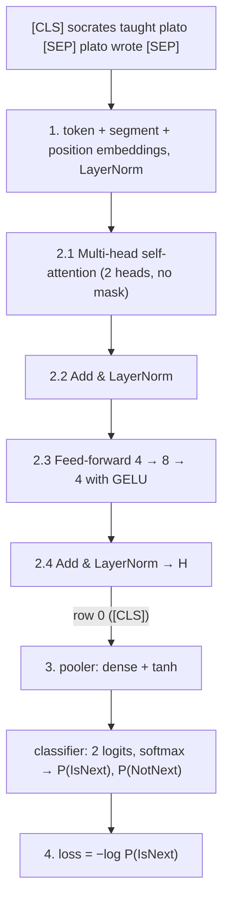

# BERT, pen and paper — Next Sentence Prediction (NSP)

*A complete numerical walk-through of BERT's NSP pre-training task, from the raw sentence pair to the loss, for* **A = “socrates taught plato”**, **B = “plato wrote”**.

> Every number is produced by [`bert_pen_and_paper.py`](bert_pen_and_paper.py); intermediate results are rounded to 4 decimals and the rounded value is used in the next step, so every entry can be checked with a calculator. The companion example is [MLM.md](MLM.md) (masked language modelling) — same model, different head.

## Contents

0. [Setup](#0-setup) · 1. [Input representation](#1-input-representation) · 2. [Encoder layer](#2-the-encoder-layer) · 3. [NSP head](#3-the-nsp-head) · 4. [Loss and gradient](#4-loss-and-gradient) · [Summary](#summary) · [Exercises](#exercises)

## 0. Setup

### 0.1 What BERT is

BERT (Devlin et al., 2019, *“BERT: Pre-training of Deep Bidirectional Transformers for Language Understanding”*) is the **encoder** of the Transformer, without the decoder. Because there is no decoder there is **no causal mask**: every token attends to every other token, to its left *and* to its right (“bidirectional”). BERT is pre-trained with two self-supervised tasks that share one encoder and differ only in the small head on top:

| Task | Input | Read the output at | Head | Predicts |
|:--|:--|:--|:--|:--|
| **MLM** — masked language modelling | one sentence with ~15 % of the words hidden | each masked position | dense + GELU + LayerNorm, then $`\cdot E^{\top} + b`$ | the hidden word (softmax over the vocabulary) |
| **NSP** — next sentence prediction | a sentence pair `[CLS] A [SEP] B [SEP]` | the `[CLS]` position | pooler (dense + tanh), then a 2-way classifier | IsNext / NotNext |

During pre-training both losses are computed on the same batch and added: $`\mathcal L = \mathcal L_{\text{MLM}} + \mathcal L_{\text{NSP}}`$. The companion document covers the other head; the embedding and encoder weights are identical in both.

### 0.2 Hyperparameters

| Symbol | Meaning | BERT-base | This example |
|:--|:--|--:|--:|
| $`d_{\text{model}}`$ | hidden size | 768 | **4** |
| $`h`$ | attention heads | 12 | **2** |
| $`d_k = d_{\text{model}}/h`$ | width of one head | 64 | **2** |
| $`d_{ff}`$ | feed-forward hidden size | 3072 | **8** |
| $`L`$ | encoder layers | 12 | **1** |
| — | maximum sequence length | 512 | **8** |
| $`\lvert V\rvert`$ | vocabulary (WordPiece) | 30 522 | **8** |

Simplifications that do not change the mechanics: no dropout; the Q/K/V/O projections have no bias (real BERT has them); every LayerNorm uses $`\gamma = 1`$, $`\beta = 0`$, $`\epsilon \approx 0`$; whole words instead of WordPiece sub-words. All weights are made-up “untrained” values with one decimal.

### 0.3 Vocabulary

| id | 0 | 1 | 2 | 3 | 4 | 5 | 6 | 7 |
|:--|:-:|:-:|:-:|:-:|:-:|:-:|:-:|:-:|
| **token** | `[CLS]` | `[SEP]` | `[MASK]` | `socrates` | `taught` | `plato` | `wrote` | `met` |

`[CLS]` (classification) always starts the input, `[SEP]` (separator) ends each sentence, `[MASK]` replaces a hidden word in MLM.

### 0.4 This example

**Task.** Given two sentences A and B, decide whether B is the sentence that actually follows A in the corpus (**IsNext**) or a random sentence from elsewhere (**NotNext**). Training pairs are built 50 % / 50 %. The goal is to make BERT model relationships *between* sentences, which helps downstream tasks such as question answering and natural language inference.

Both sentences are packed into one input, separated by `[SEP]`; **segment embeddings** tell the model which token belongs to which sentence; the decision is read from the `[CLS]` position.

| pos | 0 | 1 | 2 | 3 | 4 | 5 | 6 | 7 |
|:--|:-:|:-:|:-:|:-:|:-:|:-:|:-:|:-:|
| **token** | `[CLS]` | `socrates` | `taught` | `plato` | `[SEP]` | `plato` | `wrote` | `[SEP]` |
| **segment** | A | A | A | A | A | B | B | B |

Label: **IsNext** (B really follows A). A NotNext example would be, e.g., `[CLS] socrates taught plato [SEP] socrates met [SEP]` with B drawn at random. To isolate NSP we do not mask any token here; in real pre-training the same input would also carry MLM masks.

### 0.5 Conventions

* **Row vectors.** Each token is a row; a sequence of $`n`$ tokens is an $`n \times 4`$ matrix, and a linear layer is $`XW + b`$.
* Positions, dimensions and ids are counted from 0; heads from 1. In formulas the first subscript is the **position** (e.g. $`q_{2,1}`$ = query of position 2, dimension 1; $`s_{2,4}`$ = score of query 2 against key 4).
* Every intermediate result is rounded to **4 decimals** and the rounded value is used in the next step.
* Weight tables: rows = input dimension (“in 0…3”), columns = output dimension.

### 0.6 Pipeline



---

## 1. Input representation

BERT's input vector for each token is the **sum of three learned embeddings**, followed by a LayerNorm:

```math
x_i = \operatorname{LayerNorm}\big(E^{\text{tok}}[\text{token}_i] + E^{\text{seg}}[\text{segment}_i] + E^{\text{pos}}[i]\big)
```

* **Token embedding** $`E^{\text{tok}}`$ (8×4): one row per vocabulary entry.
* **Segment embedding** $`E^{\text{seg}}`$ (2×4): row A for tokens of the first sentence (including `[CLS]` and the first `[SEP]`), row B for the second sentence.
* **Position embedding** $`E^{\text{pos}}`$ (8×4): unlike the original Transformer's fixed sinusoids, BERT *learns* one vector per position (up to 512).
* There is no $`\sqrt{d_{\text{model}}}`$ scaling.

**Parameters**

$`E^{\text{tok}}`$

| | dim 0 | dim 1 | dim 2 | dim 3 |
|:--|--:|--:|--:|--:|
| **0: [CLS]** | -0.2 | -0.4 | 0.5 | -0.2 |
| **1: [SEP]** | 0.6 | 0.2 | -0.8 | 0.0 |
| **2: [MASK]** | -0.2 | 0.1 | 0.2 | 0.1 |
| **3: socrates** | 0.2 | 0.8 | -0.3 | -0.9 |
| **4: taught** | 0.4 | 0.5 | -0.1 | 0.7 |
| **5: plato** | -0.5 | 0.4 | 0.3 | -0.2 |
| **6: wrote** | 0.6 | 0.9 | -0.5 | -1.0 |
| **7: met** | 0.3 | 0.6 | -0.8 | 0.2 |

$`E^{\text{seg}}`$

| | dim 0 | dim 1 | dim 2 | dim 3 |
|:--|--:|--:|--:|--:|
| **A (0)** | 0.5 | -1.0 | 0.3 | -0.4 |
| **B (1)** | -0.8 | -0.3 | 0.1 | -0.7 |

$`E^{\text{pos}}`$

| | dim 0 | dim 1 | dim 2 | dim 3 |
|:--|--:|--:|--:|--:|
| **pos 0** | -0.4 | 0.3 | -0.9 | -0.1 |
| **pos 1** | 0.7 | 0.5 | 0.8 | -0.3 |
| **pos 2** | 1.0 | -0.9 | -0.2 | 0.5 |
| **pos 3** | 0.7 | 0.5 | 0.5 | -0.9 |
| **pos 4** | -0.2 | -0.1 | 0.5 | -0.1 |
| **pos 5** | 0.3 | 0.9 | 0.1 | 0.2 |
| **pos 6** | 0.0 | -0.4 | -0.5 | 0.8 |
| **pos 7** | -0.3 | -0.4 | -0.2 | 0.5 |

#### Step 1 — look up the three embeddings

| pos | token | id | segment |
|:-:|:--|:-:|:-:|
| 0 | `[CLS]` | 0 | A |
| 1 | `socrates` | 3 | A |
| 2 | `taught` | 4 | A |
| 3 | `plato` | 5 | A |
| 4 | `[SEP]` | 1 | A |
| 5 | `plato` | 5 | B |
| 6 | `wrote` | 6 | B |
| 7 | `[SEP]` | 1 | B |

Token embeddings (row `id` of $`E^{\text{tok}}`$):

| | dim 0 | dim 1 | dim 2 | dim 3 |
|:--|--:|--:|--:|--:|
| **0: [CLS]** | -0.2 | -0.4 | 0.5 | -0.2 |
| **1: socrates** | 0.2 | 0.8 | -0.3 | -0.9 |
| **2: taught** | 0.4 | 0.5 | -0.1 | 0.7 |
| **3: plato** | -0.5 | 0.4 | 0.3 | -0.2 |
| **4: [SEP]** | 0.6 | 0.2 | -0.8 | 0.0 |
| **5: plato** | -0.5 | 0.4 | 0.3 | -0.2 |
| **6: wrote** | 0.6 | 0.9 | -0.5 | -1.0 |
| **7: [SEP]** | 0.6 | 0.2 | -0.8 | 0.0 |

Segment embeddings:

| | dim 0 | dim 1 | dim 2 | dim 3 |
|:--|--:|--:|--:|--:|
| **0: [CLS]** | 0.5 | -1.0 | 0.3 | -0.4 |
| **1: socrates** | 0.5 | -1.0 | 0.3 | -0.4 |
| **2: taught** | 0.5 | -1.0 | 0.3 | -0.4 |
| **3: plato** | 0.5 | -1.0 | 0.3 | -0.4 |
| **4: [SEP]** | 0.5 | -1.0 | 0.3 | -0.4 |
| **5: plato** | -0.8 | -0.3 | 0.1 | -0.7 |
| **6: wrote** | -0.8 | -0.3 | 0.1 | -0.7 |
| **7: [SEP]** | -0.8 | -0.3 | 0.1 | -0.7 |

Position embeddings (first rows of $`E^{\text{pos}}`$):

| | dim 0 | dim 1 | dim 2 | dim 3 |
|:--|--:|--:|--:|--:|
| **0: [CLS]** | -0.4 | 0.3 | -0.9 | -0.1 |
| **1: socrates** | 0.7 | 0.5 | 0.8 | -0.3 |
| **2: taught** | 1.0 | -0.9 | -0.2 | 0.5 |
| **3: plato** | 0.7 | 0.5 | 0.5 | -0.9 |
| **4: [SEP]** | -0.2 | -0.1 | 0.5 | -0.1 |
| **5: plato** | 0.3 | 0.9 | 0.1 | 0.2 |
| **6: wrote** | 0.0 | -0.4 | -0.5 | 0.8 |
| **7: [SEP]** | -0.3 | -0.4 | -0.2 | 0.5 |

#### Step 2 — add them

```math
\begin{aligned}
\text{pos }0\;(\texttt{[CLS]}):\;& \begin{bmatrix}-0.2 & -0.4 & 0.5 & -0.2\end{bmatrix} + \begin{bmatrix}0.5 & -1.0 & 0.3 & -0.4\end{bmatrix} + \begin{bmatrix}-0.4 & 0.3 & -0.9 & -0.1\end{bmatrix} = \begin{bmatrix}-0.1000 & -1.1000 & -0.1000 & -0.7000\end{bmatrix} \\
\text{pos }3\;(\texttt{plato}):\;& \begin{bmatrix}-0.5 & 0.4 & 0.3 & -0.2\end{bmatrix} + \begin{bmatrix}0.5 & -1.0 & 0.3 & -0.4\end{bmatrix} + \begin{bmatrix}0.7 & 0.5 & 0.5 & -0.9\end{bmatrix} = \begin{bmatrix}0.7000 & -0.1000 & 1.1000 & -1.5000\end{bmatrix} \\
\text{pos }5\;(\texttt{plato}):\;& \begin{bmatrix}-0.5 & 0.4 & 0.3 & -0.2\end{bmatrix} + \begin{bmatrix}-0.8 & -0.3 & 0.1 & -0.7\end{bmatrix} + \begin{bmatrix}0.3 & 0.9 & 0.1 & 0.2\end{bmatrix} = \begin{bmatrix}-1.0000 & 1.0000 & 0.5000 & -0.7000\end{bmatrix}
\end{aligned}
```

**Embedding sum**

| | dim 0 | dim 1 | dim 2 | dim 3 |
|:--|--:|--:|--:|--:|
| **0: [CLS]** | -0.1000 | -1.1000 | -0.1000 | -0.7000 |
| **1: socrates** | 1.4000 | 0.3000 | 0.8000 | -1.6000 |
| **2: taught** | 1.9000 | -1.4000 | 0.0000 | 0.8000 |
| **3: plato** | 0.7000 | -0.1000 | 1.1000 | -1.5000 |
| **4: [SEP]** | 0.9000 | -0.9000 | 0.0000 | -0.5000 |
| **5: plato** | -1.0000 | 1.0000 | 0.5000 | -0.7000 |
| **6: wrote** | -0.2000 | 0.2000 | -0.9000 | -0.9000 |
| **7: [SEP]** | -0.5000 | -0.5000 | -0.9000 | -0.2000 |

#### Step 3 — embedding LayerNorm

```math
X = \operatorname{LayerNorm}(E^{\text{tok}} + E^{\text{seg}} + E^{\text{pos}}),\qquad \operatorname{LayerNorm}(r) = \gamma \odot \frac{r - \mu}{\sqrt{\sigma^2 + \epsilon}} + \beta
```

$`\mu`$ and $`\sigma^2`$ are the mean and (population) variance of the 4 entries **of each row** — every token is normalised on its own.

Worked row **0: [CLS]**:

```math
\begin{aligned}
r &= \begin{bmatrix}-0.1000 & -1.1000 & -0.1000 & -0.7000\end{bmatrix} \\
\mu &= \tfrac14((-0.1000) + (-1.1000) + (-0.1000) + (-0.7000)) = -0.5000 \\
\sigma^2 &= \tfrac14\left(0.4000^2 + (-0.6000)^2 + 0.4000^2 + (-0.2000)^2\right) = 0.1800 \\
\sigma &= \sqrt{0.1800} = 0.4243 \\
\hat r &= \frac{r - (-0.5000)}{0.4243} = \begin{bmatrix}0.9427 & -1.4141 & 0.9427 & -0.4714\end{bmatrix}
\end{aligned}
```

| | μ | σ² | σ |
|:--|--:|--:|--:|
| **0: [CLS]** | -0.5000 | 0.1800 | 0.4243 |
| **1: socrates** | 0.2250 | 1.2619 | 1.1233 |
| **2: taught** | 0.3250 | 1.4469 | 1.2029 |
| **3: plato** | 0.0500 | 0.9875 | 0.9937 |
| **4: [SEP]** | -0.1250 | 0.4519 | 0.6722 |
| **5: plato** | -0.0500 | 0.6825 | 0.8261 |
| **6: wrote** | -0.4500 | 0.2225 | 0.4717 |
| **7: [SEP]** | -0.5250 | 0.0619 | 0.2488 |

$`X`$ (every row now has mean 0 and variance 1):

| | dim 0 | dim 1 | dim 2 | dim 3 |
|:--|--:|--:|--:|--:|
| **0: [CLS]** | 0.9427 | -1.4141 | 0.9427 | -0.4714 |
| **1: socrates** | 1.0460 | 0.0668 | 0.5119 | -1.6247 |
| **2: taught** | 1.3093 | -1.4340 | -0.2702 | 0.3949 |
| **3: plato** | 0.6541 | -0.1510 | 1.0567 | -1.5598 |
| **4: [SEP]** | 1.5248 | -1.1529 | 0.1860 | -0.5579 |
| **5: plato** | -1.1500 | 1.2710 | 0.6658 | -0.7868 |
| **6: wrote** | 0.5300 | 1.3780 | -0.9540 | -0.9540 |
| **7: [SEP]** | 0.1005 | 0.1005 | -1.5072 | 1.3063 |

Positions 3 and 5 are both `plato`: they share the token embedding but get different segment and position embeddings, so the model can tell the “plato” of sentence A from the “plato” of sentence B.

---


## 2. The encoder layer

One BERT layer = multi-head self-attention → Add & Norm → feed-forward → Add & Norm (BERT-base stacks 12 such layers, each with its own weights).

### 2.1 Multi-head self-attention

```math
\operatorname{MultiHead}(X) = \operatorname{Concat}(\text{head}_1, \text{head}_2)\,W^O,\qquad \text{head}_i = \operatorname{softmax}\!\left(\frac{Q_i K_i^{\top}}{\sqrt{d_k}}\right) V_i
```

Queries, keys and values all come from $`X`$ (**self**-attention) and there is **no mask**: the score matrix is full, so position 0 sees the tokens before *and* after it.

#### 2.1.1 Parameters

$`W^Q`$ (4×4)

| | dim 0 (head 1) | dim 1 (head 1) | dim 2 (head 2) | dim 3 (head 2) |
|:--|--:|--:|--:|--:|
| **in 0** | 0.4 | -0.7 | -1.0 | -0.6 |
| **in 1** | -1.0 | -0.7 | -0.1 | 0.7 |
| **in 2** | 0.5 | -0.6 | 0.4 | -0.5 |
| **in 3** | -0.1 | -0.6 | 0.6 | 0.6 |

$`W^K`$ (4×4)

| | dim 0 (head 1) | dim 1 (head 1) | dim 2 (head 2) | dim 3 (head 2) |
|:--|--:|--:|--:|--:|
| **in 0** | 0.5 | 0.0 | 0.6 | -0.6 |
| **in 1** | 0.8 | 0.9 | 1.0 | 0.7 |
| **in 2** | 0.0 | -0.4 | -0.5 | -0.4 |
| **in 3** | -0.3 | -0.8 | 0.3 | -0.8 |

$`W^V`$ (4×4)

| | dim 0 (head 1) | dim 1 (head 1) | dim 2 (head 2) | dim 3 (head 2) |
|:--|--:|--:|--:|--:|
| **in 0** | 0.6 | 0.5 | 0.6 | 0.7 |
| **in 1** | 0.6 | 0.4 | -0.5 | -0.5 |
| **in 2** | -0.8 | 0.7 | 1.0 | -0.5 |
| **in 3** | -0.5 | -0.5 | 0.9 | 0.3 |

$`W^O`$ (4×4)

| | dim 0 | dim 1 | dim 2 | dim 3 |
|:--|--:|--:|--:|--:|
| **in 0** | -0.2 | -0.5 | -0.2 | 0.6 |
| **in 1** | -0.2 | -0.4 | -0.6 | 0.7 |
| **in 2** | 0.1 | 0.7 | 0.2 | 0.2 |
| **in 3** | -0.4 | 0.8 | -0.8 | 0.3 |

#### 2.1.2 Queries, keys and values

```math
Q = X W^Q,\qquad K = X W^K,\qquad V = X W^V
```

Each is 8×4. Worked row **0: [CLS]** (row 0 of $`X`$ times each column):

```math
\begin{aligned}
q_{0,0} &= 0.9427\cdot 0.4 + (-1.4141)\cdot (-1.0) + 0.9427\cdot 0.5 + (-0.4714)\cdot (-0.1) = 2.3097 \\
q_{0,1} &= 0.9427\cdot (-0.7) + (-1.4141)\cdot (-0.7) + 0.9427\cdot (-0.6) + (-0.4714)\cdot (-0.6) = 0.0472 \\
q_{0,2} &= 0.9427\cdot (-1.0) + (-1.4141)\cdot (-0.1) + 0.9427\cdot 0.4 + (-0.4714)\cdot 0.6 = -0.7070 \\
q_{0,3} &= 0.9427\cdot (-0.6) + (-1.4141)\cdot 0.7 + 0.9427\cdot (-0.5) + (-0.4714)\cdot 0.6 = -2.3097 \\
k_{0,0} &= 0.9427\cdot 0.5 + (-1.4141)\cdot 0.8 + 0.9427\cdot 0.0 + (-0.4714)\cdot (-0.3) = -0.5185 \\
k_{0,1} &= 0.9427\cdot 0.0 + (-1.4141)\cdot 0.9 + 0.9427\cdot (-0.4) + (-0.4714)\cdot (-0.8) = -1.2726 \\
k_{0,2} &= 0.9427\cdot 0.6 + (-1.4141)\cdot 1.0 + 0.9427\cdot (-0.5) + (-0.4714)\cdot 0.3 = -1.4612 \\
k_{0,3} &= 0.9427\cdot (-0.6) + (-1.4141)\cdot 0.7 + 0.9427\cdot (-0.4) + (-0.4714)\cdot (-0.8) = -1.5554 \\
v_{0,0} &= 0.9427\cdot 0.6 + (-1.4141)\cdot 0.6 + 0.9427\cdot (-0.8) + (-0.4714)\cdot (-0.5) = -0.8013 \\
v_{0,1} &= 0.9427\cdot 0.5 + (-1.4141)\cdot 0.4 + 0.9427\cdot 0.7 + (-0.4714)\cdot (-0.5) = 0.8013 \\
v_{0,2} &= 0.9427\cdot 0.6 + (-1.4141)\cdot (-0.5) + 0.9427\cdot 1.0 + (-0.4714)\cdot 0.9 = 1.7911 \\
v_{0,3} &= 0.9427\cdot 0.7 + (-1.4141)\cdot (-0.5) + 0.9427\cdot (-0.5) + (-0.4714)\cdot 0.3 = 0.7542
\end{aligned}
```

**Q**

| | dim 0 (head 1) | dim 1 (head 1) | dim 2 (head 2) | dim 3 (head 2) |
|:--|--:|--:|--:|--:|
| **0: [CLS]** | 2.3097 | 0.0472 | -0.7070 | -2.3097 |
| **1: socrates** | 0.7700 | -0.1113 | -1.8227 | -1.8116 |
| **2: taught** | 1.7831 | 0.0125 | -1.0370 | -1.4173 |
| **3: plato** | 1.0970 | -0.0503 | -1.1522 | -1.9624 |
| **4: [SEP]** | 1.9116 | -0.0372 | -1.6698 | -2.1496 |
| **5: plato** | -1.3194 | -0.0121 | 0.8171 | 0.7747 |
| **6: wrote** | -1.5476 | -0.1908 | -1.6218 | 0.5512 |
| **7: [SEP]** | -0.9445 | -0.0202 | 0.0703 | 1.5474 |

**K**

| | dim 0 (head 1) | dim 1 (head 1) | dim 2 (head 2) | dim 3 (head 2) |
|:--|--:|--:|--:|--:|
| **0: [CLS]** | -0.5185 | -1.2726 | -1.4612 | -1.5554 |
| **1: socrates** | 1.0638 | 1.1551 | -0.0490 | 0.5142 |
| **2: taught** | -0.6110 | -1.4984 | -0.3949 | -1.9972 |
| **3: plato** | 0.6742 | 0.6893 | -0.7548 | 0.3270 |
| **4: [SEP]** | 0.0074 | -0.6657 | -0.4984 | -1.3500 |
| **5: plato** | 0.6778 | 1.5070 | 0.0121 | 1.9428 |
| **6: wrote** | 1.6536 | 2.3850 | 1.8868 | 1.7914 |
| **7: [SEP]** | -0.2612 | -0.3517 | 1.3063 | -0.4321 |

**V**

| | dim 0 (head 1) | dim 1 (head 1) | dim 2 (head 2) | dim 3 (head 2) |
|:--|--:|--:|--:|--:|
| **0: [CLS]** | -0.8013 | 0.8013 | 1.7911 | 0.7542 |
| **1: socrates** | 1.0705 | 1.7204 | -0.3561 | -0.0446 |
| **2: taught** | -0.0561 | -0.3055 | 1.5878 | 1.8871 |
| **3: plato** | 0.2364 | 1.7862 | 0.1208 | -0.4629 |
| **4: [SEP]** | 0.3533 | 0.7104 | 1.1752 | 1.3834 |
| **5: plato** | -0.0666 | 0.7929 | -1.3678 | -2.0094 |
| **6: wrote** | 2.3850 | 0.6254 | -2.1836 | -0.1272 |
| **7: [SEP]** | 0.6732 | -1.6177 | -0.3215 | 1.1656 |

#### 2.1.3 Split into 2 heads

Head 1 uses columns 0–1 of $`Q, K, V`$ and head 2 uses columns 2–3, so each head works in its own $`d_k = 2`$-dimensional subspace; scores are divided by $`\sqrt{d_k} = \sqrt 2 \approx 1.4142`$.

#### 2.1.4 Head 1

$`Q_1, K_1, V_1`$ (columns 0–1):

| | Q1[0] | Q1[1] | K1[0] | K1[1] | V1[0] | V1[1] |
|:--|--:|--:|--:|--:|--:|--:|
| **0: [CLS]** | 2.3097 | 0.0472 | -0.5185 | -1.2726 | -0.8013 | 0.8013 |
| **1: socrates** | 0.7700 | -0.1113 | 1.0638 | 1.1551 | 1.0705 | 1.7204 |
| **2: taught** | 1.7831 | 0.0125 | -0.6110 | -1.4984 | -0.0561 | -0.3055 |
| **3: plato** | 1.0970 | -0.0503 | 0.6742 | 0.6893 | 0.2364 | 1.7862 |
| **4: [SEP]** | 1.9116 | -0.0372 | 0.0074 | -0.6657 | 0.3533 | 0.7104 |
| **5: plato** | -1.3194 | -0.0121 | 0.6778 | 1.5070 | -0.0666 | 0.7929 |
| **6: wrote** | -1.5476 | -0.1908 | 1.6536 | 2.3850 | 2.3850 | 0.6254 |
| **7: [SEP]** | -0.9445 | -0.0202 | -0.2612 | -0.3517 | 0.6732 | -1.6177 |

**Step 1 – scores** $`S_1 = Q_1K_1^{\top}`$ (8×8). Worked row **0: [CLS]** (query 0 against every key $`j`$):

```math
\begin{aligned}
s_{0,0} &= 2.3097\cdot (-0.5185) + 0.0472\cdot (-1.2726) = -1.2576 \\
s_{0,1} &= 2.3097\cdot 1.0638 + 0.0472\cdot 1.1551 = 2.5116 \\
s_{0,2} &= 2.3097\cdot (-0.6110) + 0.0472\cdot (-1.4984) = -1.4820 \\
s_{0,3} &= 2.3097\cdot 0.6742 + 0.0472\cdot 0.6893 = 1.5897 \\
s_{0,4} &= 2.3097\cdot 0.0074 + 0.0472\cdot (-0.6657) = -0.0143 \\
s_{0,5} &= 2.3097\cdot 0.6778 + 0.0472\cdot 1.5070 = 1.6366 \\
s_{0,6} &= 2.3097\cdot 1.6536 + 0.0472\cdot 2.3850 = 3.9319 \\
s_{0,7} &= 2.3097\cdot (-0.2612) + 0.0472\cdot (-0.3517) = -0.6199
\end{aligned}
```

| | 0: [CLS] | 1: socrates | 2: taught | 3: plato | 4: [SEP] | 5: plato | 6: wrote | 7: [SEP] |
|:--|--:|--:|--:|--:|--:|--:|--:|--:|
| **0: [CLS]** | -1.2576 | 2.5116 | -1.4820 | 1.5897 | -0.0143 | 1.6366 | 3.9319 | -0.6199 |
| **1: socrates** | -0.2576 | 0.6906 | -0.3037 | 0.4424 | 0.0798 | 0.3542 | 1.0078 | -0.1620 |
| **2: taught** | -0.9404 | 1.9113 | -1.1082 | 1.2108 | 0.0049 | 1.2274 | 2.9783 | -0.4701 |
| **3: plato** | -0.5048 | 1.1089 | -0.5949 | 0.7049 | 0.0416 | 0.6677 | 1.6940 | -0.2688 |
| **4: [SEP]** | -0.9438 | 1.9906 | -1.1122 | 1.2632 | 0.0389 | 1.2396 | 3.0723 | -0.4862 |
| **5: plato** | 0.6995 | -1.4176 | 0.8243 | -0.8979 | -0.0017 | -0.9125 | -2.2106 | 0.3489 |
| **6: wrote** | 1.0452 | -1.8667 | 1.2315 | -1.1749 | 0.1156 | -1.3365 | -3.0142 | 0.4713 |
| **7: [SEP]** | 0.5154 | -1.0281 | 0.6074 | -0.6507 | 0.0065 | -0.6706 | -1.6100 | 0.2538 |

**Step 2 – scale** by $`1.4142`$ (e.g. $`(-1.2576) / 1.4142 = -0.8893`$):

| | 0: [CLS] | 1: socrates | 2: taught | 3: plato | 4: [SEP] | 5: plato | 6: wrote | 7: [SEP] |
|:--|--:|--:|--:|--:|--:|--:|--:|--:|
| **0: [CLS]** | -0.8893 | 1.7760 | -1.0479 | 1.1241 | -0.0101 | 1.1573 | 2.7803 | -0.4383 |
| **1: socrates** | -0.1822 | 0.4883 | -0.2148 | 0.3128 | 0.0564 | 0.2505 | 0.7126 | -0.1146 |
| **2: taught** | -0.6650 | 1.3515 | -0.7836 | 0.8562 | 0.0035 | 0.8679 | 2.1060 | -0.3324 |
| **3: plato** | -0.3570 | 0.7841 | -0.4207 | 0.4984 | 0.0294 | 0.4721 | 1.1979 | -0.1901 |
| **4: [SEP]** | -0.6674 | 1.4076 | -0.7865 | 0.8932 | 0.0275 | 0.8765 | 2.1725 | -0.3438 |
| **5: plato** | 0.4946 | -1.0024 | 0.5829 | -0.6349 | -0.0012 | -0.6452 | -1.5631 | 0.2467 |
| **6: wrote** | 0.7391 | -1.3200 | 0.8708 | -0.8308 | 0.0817 | -0.9451 | -2.1314 | 0.3333 |
| **7: [SEP]** | 0.3644 | -0.7270 | 0.4295 | -0.4601 | 0.0046 | -0.4742 | -1.1385 | 0.1795 |

**Step 3 – softmax of each row.** Worked row **0: [CLS]**:

```math
\begin{aligned}
&e^{-0.8893} = 0.4109,\quad e^{1.7760} = 5.9062,\quad e^{-1.0479} = 0.3507,\quad e^{1.1241} = 3.0774 \\
&e^{-0.0101} = 0.9900,\quad e^{1.1573} = 3.1813,\quad e^{2.7803} = 16.1239,\quad e^{-0.4383} = 0.6451 \\
&\textstyle\sum = 0.4109 + 5.9062 + 0.3507 + 3.0774 + 0.9900 + 3.1813 + 16.1239 + 0.6451 = 30.6855 \\
&a_{0,\cdot} = \frac{1}{30.6855}\,\begin{bmatrix}0.4109 & 5.9062 & 0.3507 & 3.0774 & 0.9900 & 3.1813 & 16.1239 & 0.6451\end{bmatrix} = \begin{bmatrix}0.0134 & 0.1925 & 0.0114 & 0.1003 & 0.0323 & 0.1037 & 0.5255 & 0.0210\end{bmatrix}
\end{aligned}
```

**Attention weights** $`A_1`$ (row = query, column = key; rows sum to 1 up to rounding):

| | 0: [CLS] | 1: socrates | 2: taught | 3: plato | 4: [SEP] | 5: plato | 6: wrote | 7: [SEP] |
|:--|--:|--:|--:|--:|--:|--:|--:|--:|
| **0: [CLS]** | 0.0134 | 0.1925 | 0.0114 | 0.1003 | 0.0323 | 0.1037 | 0.5255 | 0.0210 |
| **1: socrates** | 0.0841 | 0.1644 | 0.0814 | 0.1380 | 0.1068 | 0.1296 | 0.2058 | 0.0900 |
| **2: taught** | 0.0264 | 0.1980 | 0.0234 | 0.1207 | 0.0514 | 0.1221 | 0.4212 | 0.0368 |
| **3: plato** | 0.0585 | 0.1830 | 0.0549 | 0.1376 | 0.0861 | 0.1340 | 0.2769 | 0.0691 |
| **4: [SEP]** | 0.0251 | 0.2001 | 0.0223 | 0.1196 | 0.0503 | 0.1177 | 0.4300 | 0.0347 |
| **5: plato** | 0.2234 | 0.0500 | 0.2440 | 0.0722 | 0.1361 | 0.0715 | 0.0285 | 0.1743 |
| **6: wrote** | 0.2562 | 0.0327 | 0.2923 | 0.0533 | 0.1328 | 0.0475 | 0.0145 | 0.1707 |
| **7: [SEP]** | 0.1990 | 0.0668 | 0.2124 | 0.0872 | 0.1389 | 0.0860 | 0.0443 | 0.1654 |

Strongest link per query: 0: [CLS] → **6: wrote** (0.5255); 1: socrates → **6: wrote** (0.2058); 2: taught → **6: wrote** (0.4212); 3: plato → **6: wrote** (0.2769); 4: [SEP] → **6: wrote** (0.4300); 5: plato → **2: taught** (0.2440); 6: wrote → **2: taught** (0.2923); 7: [SEP] → **2: taught** (0.2124).

**Step 4 – weighted sum of values** $`Z_1 = A_1V_1`$ (8×2). Worked row **0: [CLS]**:

```math
\begin{aligned}
z_{0,0} &= 0.0134\cdot (-0.8013) + 0.1925\cdot 1.0705 + 0.0114\cdot (-0.0561) + 0.1003\cdot 0.2364 + 0.0323\cdot 0.3533 + 0.1037\cdot (-0.0666) + 0.5255\cdot 2.3850 + 0.0210\cdot 0.6732 = 1.4904 \\
z_{0,1} &= 0.0134\cdot 0.8013 + 0.1925\cdot 1.7204 + 0.0114\cdot (-0.3055) + 0.1003\cdot 1.7862 + 0.0323\cdot 0.7104 + 0.1037\cdot 0.7929 + 0.5255\cdot 0.6254 + 0.0210\cdot (-1.6177) = 0.9174
\end{aligned}
```

| | dim 0 | dim 1 |
|:--|--:|--:|
| **0: [CLS]** | 1.4904 | 0.9174 |
| **1: socrates** | 0.7172 | 0.7336 |
| **2: taught** | 1.2574 | 0.9075 |
| **3: plato** | 0.9069 | 0.8195 |
| **4: [SEP]** | 1.2800 | 0.9130 |
| **5: plato** | 0.1065 | 0.2087 |
| **6: wrote** | 0.0192 | 0.1324 |
| **7: [SEP]** | 0.1811 | 0.2923 |

#### 2.1.5 Head 2

$`Q_2, K_2, V_2`$ (columns 2–3):

| | Q2[0] | Q2[1] | K2[0] | K2[1] | V2[0] | V2[1] |
|:--|--:|--:|--:|--:|--:|--:|
| **0: [CLS]** | -0.7070 | -2.3097 | -1.4612 | -1.5554 | 1.7911 | 0.7542 |
| **1: socrates** | -1.8227 | -1.8116 | -0.0490 | 0.5142 | -0.3561 | -0.0446 |
| **2: taught** | -1.0370 | -1.4173 | -0.3949 | -1.9972 | 1.5878 | 1.8871 |
| **3: plato** | -1.1522 | -1.9624 | -0.7548 | 0.3270 | 0.1208 | -0.4629 |
| **4: [SEP]** | -1.6698 | -2.1496 | -0.4984 | -1.3500 | 1.1752 | 1.3834 |
| **5: plato** | 0.8171 | 0.7747 | 0.0121 | 1.9428 | -1.3678 | -2.0094 |
| **6: wrote** | -1.6218 | 0.5512 | 1.8868 | 1.7914 | -2.1836 | -0.1272 |
| **7: [SEP]** | 0.0703 | 1.5474 | 1.3063 | -0.4321 | -0.3215 | 1.1656 |

**Step 1 – scores** $`S_2 = Q_2K_2^{\top}`$ (8×8). Worked row **0: [CLS]** (query 0 against every key $`j`$):

```math
\begin{aligned}
s_{0,0} &= (-0.7070)\cdot (-1.4612) + (-2.3097)\cdot (-1.5554) = 4.6256 \\
s_{0,1} &= (-0.7070)\cdot (-0.0490) + (-2.3097)\cdot 0.5142 = -1.1530 \\
s_{0,2} &= (-0.7070)\cdot (-0.3949) + (-2.3097)\cdot (-1.9972) = 4.8921 \\
s_{0,3} &= (-0.7070)\cdot (-0.7548) + (-2.3097)\cdot 0.3270 = -0.2216 \\
s_{0,4} &= (-0.7070)\cdot (-0.4984) + (-2.3097)\cdot (-1.3500) = 3.4705 \\
s_{0,5} &= (-0.7070)\cdot 0.0121 + (-2.3097)\cdot 1.9428 = -4.4958 \\
s_{0,6} &= (-0.7070)\cdot 1.8868 + (-2.3097)\cdot 1.7914 = -5.4716 \\
s_{0,7} &= (-0.7070)\cdot 1.3063 + (-2.3097)\cdot (-0.4321) = 0.0745
\end{aligned}
```

| | 0: [CLS] | 1: socrates | 2: taught | 3: plato | 4: [SEP] | 5: plato | 6: wrote | 7: [SEP] |
|:--|--:|--:|--:|--:|--:|--:|--:|--:|
| **0: [CLS]** | 4.6256 | -1.1530 | 4.8921 | -0.2216 | 3.4705 | -4.4958 | -5.4716 | 0.0745 |
| **1: socrates** | 5.4811 | -0.8422 | 4.3379 | 0.7834 | 3.3541 | -3.5416 | -6.6844 | -1.5982 |
| **2: taught** | 3.7197 | -0.6780 | 3.2401 | 0.3193 | 2.4302 | -2.7661 | -4.4956 | -0.7422 |
| **3: plato** | 4.7359 | -0.9526 | 4.3743 | 0.2280 | 3.2235 | -3.8265 | -5.6894 | -0.6572 |
| **4: [SEP]** | 5.7834 | -1.0235 | 4.9526 | 0.5574 | 3.7342 | -4.1964 | -7.0014 | -1.2524 |
| **5: plato** | -2.3989 | 0.3583 | -1.8699 | -0.3634 | -1.4531 | 1.5150 | 2.9295 | 0.7326 |
| **6: wrote** | 1.5124 | 0.3629 | -0.4604 | 1.4044 | 0.0642 | 1.0512 | -2.0726 | -2.3567 |
| **7: [SEP]** | -2.5095 | 0.7922 | -3.1182 | 0.4529 | -2.1240 | 3.0071 | 2.9047 | -0.5768 |

**Step 2 – scale** by $`1.4142`$ (e.g. $`4.6256 / 1.4142 = 3.2708`$):

| | 0: [CLS] | 1: socrates | 2: taught | 3: plato | 4: [SEP] | 5: plato | 6: wrote | 7: [SEP] |
|:--|--:|--:|--:|--:|--:|--:|--:|--:|
| **0: [CLS]** | 3.2708 | -0.8153 | 3.4593 | -0.1567 | 2.4540 | -3.1790 | -3.8690 | 0.0527 |
| **1: socrates** | 3.8758 | -0.5955 | 3.0674 | 0.5540 | 2.3717 | -2.5043 | -4.7266 | -1.1301 |
| **2: taught** | 2.6303 | -0.4794 | 2.2911 | 0.2258 | 1.7184 | -1.9559 | -3.1789 | -0.5248 |
| **3: plato** | 3.3488 | -0.6736 | 3.0931 | 0.1612 | 2.2794 | -2.7058 | -4.0231 | -0.4647 |
| **4: [SEP]** | 4.0895 | -0.7237 | 3.5021 | 0.3941 | 2.6405 | -2.9673 | -4.9508 | -0.8856 |
| **5: plato** | -1.6963 | 0.2534 | -1.3222 | -0.2570 | -1.0275 | 1.0713 | 2.0715 | 0.5180 |
| **6: wrote** | 1.0694 | 0.2566 | -0.3256 | 0.9931 | 0.0454 | 0.7433 | -1.4656 | -1.6665 |
| **7: [SEP]** | -1.7745 | 0.5602 | -2.2049 | 0.3203 | -1.5019 | 2.1264 | 2.0540 | -0.4079 |

**Step 3 – softmax of each row.** Worked row **0: [CLS]**:

```math
\begin{aligned}
&e^{3.2708} = 26.3324,\quad e^{-0.8153} = 0.4425,\quad e^{3.4593} = 31.7947,\quad e^{-0.1567} = 0.8550 \\
&e^{2.4540} = 11.6348,\quad e^{-3.1790} = 0.0416,\quad e^{-3.8690} = 0.0209,\quad e^{0.0527} = 1.0541 \\
&\textstyle\sum = 26.3324 + 0.4425 + 31.7947 + 0.8550 + 11.6348 + 0.0416 + 0.0209 + 1.0541 = 72.1760 \\
&a_{0,\cdot} = \frac{1}{72.1760}\,\begin{bmatrix}26.3324 & 0.4425 & 31.7947 & 0.8550 & 11.6348 & 0.0416 & 0.0209 & 1.0541\end{bmatrix} = \begin{bmatrix}0.3648 & 0.0061 & 0.4405 & 0.0118 & 0.1612 & 0.0006 & 0.0003 & 0.0146\end{bmatrix}
\end{aligned}
```

**Attention weights** $`A_2`$ (row = query, column = key; rows sum to 1 up to rounding):

| | 0: [CLS] | 1: socrates | 2: taught | 3: plato | 4: [SEP] | 5: plato | 6: wrote | 7: [SEP] |
|:--|--:|--:|--:|--:|--:|--:|--:|--:|
| **0: [CLS]** | 0.3648 | 0.0061 | 0.4405 | 0.0118 | 0.1612 | 0.0006 | 0.0003 | 0.0146 |
| **1: socrates** | 0.5801 | 0.0066 | 0.2585 | 0.0209 | 0.1289 | 0.0010 | 0.0001 | 0.0039 |
| **2: taught** | 0.4339 | 0.0194 | 0.3091 | 0.0392 | 0.1743 | 0.0044 | 0.0013 | 0.0185 |
| **3: plato** | 0.4542 | 0.0081 | 0.3517 | 0.0187 | 0.1559 | 0.0011 | 0.0003 | 0.0100 |
| **4: [SEP]** | 0.5460 | 0.0044 | 0.3035 | 0.0136 | 0.1282 | 0.0005 | 0.0001 | 0.0038 |
| **5: plato** | 0.0119 | 0.0836 | 0.0173 | 0.0502 | 0.0232 | 0.1895 | 0.5152 | 0.1090 |
| **6: wrote** | 0.2602 | 0.1154 | 0.0645 | 0.2411 | 0.0935 | 0.1878 | 0.0206 | 0.0169 |
| **7: [SEP]** | 0.0083 | 0.0855 | 0.0054 | 0.0673 | 0.0109 | 0.4094 | 0.3808 | 0.0325 |

Strongest link per query: 0: [CLS] → **2: taught** (0.4405); 1: socrates → **0: [CLS]** (0.5801); 2: taught → **0: [CLS]** (0.4339); 3: plato → **0: [CLS]** (0.4542); 4: [SEP] → **0: [CLS]** (0.5460); 5: plato → **6: wrote** (0.5152); 6: wrote → **0: [CLS]** (0.2602); 7: [SEP] → **5: plato** (0.4094).

**Step 4 – weighted sum of values** $`Z_2 = A_2V_2`$ (8×2). Worked row **0: [CLS]**:

```math
\begin{aligned}
z_{0,0} &= 0.3648\cdot 1.7911 + 0.0061\cdot (-0.3561) + 0.4405\cdot 1.5878 + 0.0118\cdot 0.1208 + 0.1612\cdot 1.1752 + 0.0006\cdot (-1.3678) + 0.0003\cdot (-2.1836) + 0.0146\cdot (-0.3215) = 1.5353 \\
z_{0,1} &= 0.3648\cdot 0.7542 + 0.0061\cdot (-0.0446) + 0.4405\cdot 1.8871 + 0.0118\cdot (-0.4629) + 0.1612\cdot 1.3834 + 0.0006\cdot (-2.0094) + 0.0003\cdot (-0.1272) + 0.0146\cdot 1.1656 = 1.3394
\end{aligned}
```

| | dim 0 | dim 1 |
|:--|--:|--:|
| **0: [CLS]** | 1.5353 | 1.3394 |
| **1: socrates** | 1.5983 | 1.0962 |
| **2: taught** | 1.4558 | 1.1452 |
| **3: plato** | 1.5492 | 1.2223 |
| **4: [SEP]** | 1.6085 | 1.1588 |
| **5: plato** | -1.3669 | -0.2725 |
| **6: wrote** | 0.3591 | -0.0297 |
| **7: [SEP]** | -1.3880 | -0.8366 |

#### 2.1.6 Concatenate and project

| | dim 0 (head 1) | dim 1 (head 1) | dim 2 (head 2) | dim 3 (head 2) |
|:--|--:|--:|--:|--:|
| **0: [CLS]** | 1.4904 | 0.9174 | 1.5353 | 1.3394 |
| **1: socrates** | 0.7172 | 0.7336 | 1.5983 | 1.0962 |
| **2: taught** | 1.2574 | 0.9075 | 1.4558 | 1.1452 |
| **3: plato** | 0.9069 | 0.8195 | 1.5492 | 1.2223 |
| **4: [SEP]** | 1.2800 | 0.9130 | 1.6085 | 1.1588 |
| **5: plato** | 0.1065 | 0.2087 | -1.3669 | -0.2725 |
| **6: wrote** | 0.0192 | 0.1324 | 0.3591 | -0.0297 |
| **7: [SEP]** | 0.1811 | 0.2923 | -1.3880 | -0.8366 |

Worked row **0: [CLS]** of $`\operatorname{Concat}(Z_1, Z_2)\,W^O`$:

```math
\begin{aligned}
o_{0,0} &= 1.4904\cdot (-0.2) + 0.9174\cdot (-0.2) + 1.5353\cdot 0.1 + 1.3394\cdot (-0.4) = -0.8638 \\
o_{0,1} &= 1.4904\cdot (-0.5) + 0.9174\cdot (-0.4) + 1.5353\cdot 0.7 + 1.3394\cdot 0.8 = 1.0341 \\
o_{0,2} &= 1.4904\cdot (-0.2) + 0.9174\cdot (-0.6) + 1.5353\cdot 0.2 + 1.3394\cdot (-0.8) = -1.6130 \\
o_{0,3} &= 1.4904\cdot 0.6 + 0.9174\cdot 0.7 + 1.5353\cdot 0.2 + 1.3394\cdot 0.3 = 2.2453
\end{aligned}
```

**Multi-head attention output**

| | dim 0 | dim 1 | dim 2 | dim 3 |
|:--|--:|--:|--:|--:|
| **0: [CLS]** | -0.8638 | 1.0341 | -1.6130 | 2.2453 |
| **1: socrates** | -0.5688 | 1.3437 | -1.1409 | 1.5924 |
| **2: taught** | -0.7455 | 0.9435 | -1.4210 | 2.0244 |
| **3: plato** | -0.6793 | 1.2810 | -1.3411 | 1.7943 |
| **4: [SEP]** | -0.7413 | 1.0478 | -1.4091 | 2.0764 |
| **5: plato** | -0.0907 | -1.3116 | -0.2019 | -0.1451 |
| **6: wrote** | 0.0175 | 0.1650 | 0.0123 | 0.1671 |
| **7: [SEP]** | 0.1012 | -1.8484 | 0.1801 | -0.2153 |

### 2.2 Add & Norm (1)

```math
X_1 = \operatorname{LayerNorm}(X + \operatorname{MultiHead}(X)),\qquad \operatorname{LayerNorm}(r) = \gamma \odot \frac{r - \mu}{\sqrt{\sigma^2 + \epsilon}} + \beta
```

$`\mu`$ and $`\sigma^2`$ are the mean and (population) variance of the 4 entries **of each row** — every token is normalised on its own.

Worked row **0: [CLS]**:

```math
\begin{aligned}
r &= \begin{bmatrix}0.9427 & -1.4141 & 0.9427 & -0.4714\end{bmatrix} + \begin{bmatrix}-0.8638 & 1.0341 & -1.6130 & 2.2453\end{bmatrix} = \begin{bmatrix}0.0789 & -0.3800 & -0.6703 & 1.7739\end{bmatrix} \\
\mu &= \tfrac14(0.0789 + (-0.3800) + (-0.6703) + 1.7739) = 0.2006 \\
\sigma^2 &= \tfrac14\left((-0.1217)^2 + (-0.5806)^2 + (-0.8709)^2 + 1.5733^2\right) = 0.8964 \\
\sigma &= \sqrt{0.8964} = 0.9468 \\
\hat r &= \frac{r - 0.2006}{0.9468} = \begin{bmatrix}-0.1285 & -0.6132 & -0.9198 & 1.6617\end{bmatrix}
\end{aligned}
```

| | μ | σ² | σ |
|:--|--:|--:|--:|
| **0: [CLS]** | 0.2006 | 0.8964 | 0.9468 |
| **1: socrates** | 0.3066 | 0.5595 | 0.7480 |
| **2: taught** | 0.2003 | 2.2778 | 1.5092 |
| **3: plato** | 0.2637 | 0.2838 | 0.5327 |
| **4: [SEP]** | 0.2434 | 1.0474 | 1.0234 |
| **5: plato** | -0.4373 | 0.4649 | 0.6818 |
| **6: wrote** | 0.0905 | 1.0385 | 1.0191 |
| **7: [SEP]** | -0.4456 | 1.3133 | 1.1460 |

$`X_1`$ (every row now has mean 0 and variance 1):

| | dim 0 | dim 1 | dim 2 | dim 3 |
|:--|--:|--:|--:|--:|
| **0: [CLS]** | -0.1285 | -0.6132 | -0.9198 | 1.6617 |
| **1: socrates** | 0.2281 | 1.4758 | -1.2508 | -0.4531 |
| **2: taught** | 0.2409 | -0.4577 | -1.2533 | 1.4703 |
| **3: plato** | -0.5423 | 1.6262 | -1.0289 | -0.0548 |
| **4: [SEP]** | 0.5278 | -0.3405 | -1.4330 | 1.2459 |
| **5: plato** | -1.1784 | 0.5818 | 1.3218 | -0.7254 |
| **6: wrote** | 0.4484 | 1.4253 | -1.0129 | -0.8610 |
| **7: [SEP]** | 0.5648 | -1.1364 | -0.7692 | 1.3408 |

### 2.3 Feed-forward network with GELU

```math
\operatorname{FFN}(x) = \operatorname{GELU}(x W_1 + b_1)\, W_2 + b_2
```

Same position-wise two-layer network as in the Transformer, but BERT uses **GELU** instead of ReLU. GELU is a smooth ReLU: $`\text{GELU}(x) = x\,\Phi(x)`$ with $`\Phi`$ the standard normal CDF; large positive inputs pass almost unchanged, large negative inputs give ≈ 0, and small negative inputs give small *negative* outputs. We use the tanh approximation from the original BERT code:

```math
\operatorname{GELU}(x) \approx \tfrac12\, x \left(1 + \tanh\!\left[\sqrt{2/\pi}\,\left(x + 0.044715\, x^3\right)\right]\right),\qquad \sqrt{2/\pi} \approx 0.7979
```

**Parameters**

$`W_1`$ (4×8)

| | u0 | u1 | u2 | u3 | u4 | u5 | u6 | u7 |
|:--|--:|--:|--:|--:|--:|--:|--:|--:|
| **in 0** | 0.6 | -0.3 | -0.2 | -0.5 | 0.6 | 0.6 | 0.7 | -0.8 |
| **in 1** | -1.0 | 0.5 | -0.8 | 0.1 | -0.7 | -1.0 | 0.3 | -0.6 |
| **in 2** | 0.5 | 0.0 | 0.0 | -0.6 | 1.0 | 0.4 | -0.1 | 0.5 |
| **in 3** | 1.0 | 1.0 | 0.9 | 0.8 | -0.9 | 0.3 | -0.2 | 0.3 |

$`b_1`$

| | u0 | u1 | u2 | u3 | u4 | u5 | u6 | u7 |
|:--|--:|--:|--:|--:|--:|--:|--:|--:|
| **b1** | -0.5 | 0.4 | 0.2 | -0.8 | 1.0 | -0.9 | -0.8 | 0.8 |

$`W_2`$ (8×4)

| | dim 0 | dim 1 | dim 2 | dim 3 |
|:--|--:|--:|--:|--:|
| **u0** | -0.9 | 0.7 | -0.4 | -0.1 |
| **u1** | 0.5 | -0.6 | -0.8 | -0.9 |
| **u2** | 0.1 | 0.6 | 0.7 | -0.4 |
| **u3** | -0.6 | 0.2 | 0.0 | -0.2 |
| **u4** | 0.6 | -0.1 | -0.2 | -0.1 |
| **u5** | -1.0 | -0.4 | -0.7 | 0.2 |
| **u6** | 0.4 | 0.1 | -0.9 | -0.7 |
| **u7** | -0.8 | 0.5 | 0.5 | 0.7 |

$`b_2`$

| | dim 0 | dim 1 | dim 2 | dim 3 |
|:--|--:|--:|--:|--:|
| **b2** | -0.7 | 0.1 | -1.0 | 0.4 |

**Step 1 – expand:** $`U = X_1W_1 + b_1`$. Worked row **0: [CLS]**:

```math
\begin{aligned}
u_{0,0} &= (-0.1285)\cdot 0.6 + (-0.6132)\cdot (-1.0) + (-0.9198)\cdot 0.5 + 1.6617\cdot 1.0 + (-0.5) = 1.2379 \\
u_{0,1} &= (-0.1285)\cdot (-0.3) + (-0.6132)\cdot 0.5 + (-0.9198)\cdot 0.0 + 1.6617\cdot 1.0 + 0.4 = 1.7936 \\
u_{0,2} &= (-0.1285)\cdot (-0.2) + (-0.6132)\cdot (-0.8) + (-0.9198)\cdot 0.0 + 1.6617\cdot 0.9 + 0.2 = 2.2118 \\
u_{0,3} &= (-0.1285)\cdot (-0.5) + (-0.6132)\cdot 0.1 + (-0.9198)\cdot (-0.6) + 1.6617\cdot 0.8 + (-0.8) = 1.0842 \\
u_{0,4} &= (-0.1285)\cdot 0.6 + (-0.6132)\cdot (-0.7) + (-0.9198)\cdot 1.0 + 1.6617\cdot (-0.9) + 1.0 = -1.0632 \\
u_{0,5} &= (-0.1285)\cdot 0.6 + (-0.6132)\cdot (-1.0) + (-0.9198)\cdot 0.4 + 1.6617\cdot 0.3 + (-0.9) = -0.2333 \\
u_{0,6} &= (-0.1285)\cdot 0.7 + (-0.6132)\cdot 0.3 + (-0.9198)\cdot (-0.1) + 1.6617\cdot (-0.2) + (-0.8) = -1.3143 \\
u_{0,7} &= (-0.1285)\cdot (-0.8) + (-0.6132)\cdot (-0.6) + (-0.9198)\cdot 0.5 + 1.6617\cdot 0.3 + 0.8 = 1.3093
\end{aligned}
```

| | u0 | u1 | u2 | u3 | u4 | u5 | u6 | u7 |
|:--|--:|--:|--:|--:|--:|--:|--:|--:|
| **0: [CLS]** | 1.2379 | 1.7936 | 2.2118 | 1.0842 | -1.0632 | -0.2333 | -1.3143 | 1.3093 |
| **1: socrates** | -2.9174 | 0.6164 | -1.4341 | -0.3785 | -0.7392 | -2.8752 | 0.0181 | -1.0293 |
| **2: taught** | 0.9459 | 1.5692 | 1.8412 | 0.9620 | -1.1116 | -0.3580 | -0.9374 | 0.6963 |
| **3: plato** | -3.0208 | 1.3210 | -1.0418 | 0.2073 | -1.4433 | -3.2796 | -0.5779 | -0.2728 |
| **4: [SEP]** | 0.6866 | 1.3173 | 1.4882 | 0.7586 | -0.9993 | -0.4422 | -0.6386 | 0.2393 |
| **5: plato** | -1.8533 | 0.3190 | -0.6826 | -1.5260 | 1.8604 | -1.8777 | -1.4374 | 1.8369 |
| **6: wrote** | -3.0237 | 0.1171 | -1.8048 | -0.9627 | 0.0333 | -2.7197 | 0.2150 | -1.1786 |
| **7: [SEP]** | 1.9315 | 1.0032 | 2.2029 | 0.3381 | 0.1584 | 0.6698 | -0.9368 | 1.0476 |

**Step 2 – GELU.** Worked row **0: [CLS]**, step by step:

| | u0 | u1 | u2 | u3 | u4 | u5 | u6 | u7 |
|:--|--:|--:|--:|--:|--:|--:|--:|--:|
| $`x`$ | 1.2379 | 1.7936 | 2.2118 | 1.0842 | -1.0632 | -0.2333 | -1.3143 | 1.3093 |
| $`a = x + 0.044715x^3`$ | 1.3227 | 2.0516 | 2.6956 | 1.1412 | -1.1169 | -0.2339 | -1.4158 | 1.4097 |
| $`0.7979\,a`$ | 1.0554 | 1.6370 | 2.1508 | 0.9106 | -0.8912 | -0.1866 | -1.1297 | 1.1248 |
| $`\tanh(\cdot)`$ | 0.7839 | 0.9271 | 0.9733 | 0.7214 | -0.7120 | -0.1845 | -0.8109 | 0.8092 |
| $`\text{GELU} = \tfrac12 x(1+\tanh)`$ | 1.1041 | 1.7282 | 2.1823 | 0.9332 | -0.1531 | -0.0951 | -0.1243 | 1.1844 |

$`\operatorname{GELU}(U)`$ for all positions:

| | u0 | u1 | u2 | u3 | u4 | u5 | u6 | u7 |
|:--|--:|--:|--:|--:|--:|--:|--:|--:|
| **0: [CLS]** | 1.1041 | 1.7282 | 2.1823 | 0.9332 | -0.1531 | -0.0951 | -0.1243 | 1.1844 |
| **1: socrates** | -0.0047 | 0.4507 | -0.1089 | -0.1334 | -0.1700 | -0.0053 | 0.0092 | -0.1562 |
| **2: taught** | 0.7830 | 1.4775 | 1.7808 | 0.8002 | -0.1482 | -0.1290 | -0.1635 | 0.5270 |
| **3: plato** | -0.0035 | 1.1976 | -0.1551 | 0.1207 | -0.1077 | -0.0015 | -0.1628 | -0.1071 |
| **4: [SEP]** | 0.5175 | 1.1934 | 1.3863 | 0.5886 | -0.1589 | -0.1456 | -0.1671 | 0.1423 |
| **5: plato** | -0.0592 | 0.1994 | -0.1689 | -0.0971 | 1.8019 | -0.0567 | -0.1085 | 1.7760 |
| **6: wrote** | -0.0033 | 0.0640 | -0.0643 | -0.1617 | 0.0171 | -0.0084 | 0.1258 | -0.1408 |
| **7: [SEP]** | 1.8799 | 0.8446 | 2.1727 | 0.2138 | 0.0892 | 0.5013 | -0.1635 | 0.8930 |

**Step 3 – project back:** $`\operatorname{GELU}(U)W_2 + b_2`$. Worked row **0: [CLS]** (unlike ReLU, GELU leaves no exact zeros, so all 8 units contribute):

```math
\begin{aligned}
\text{ffn}_{0,0} &= 1.1041\cdot (-0.9) + 1.7282\cdot 0.5 + 2.1823\cdot 0.1 + 0.9332\cdot (-0.6) + (-0.1531)\cdot 0.6 + (-0.0951)\cdot (-1.0) + (-0.1243)\cdot 0.4 + 1.1844\cdot (-0.8) + (-0.7) = -2.1653 \\
\text{ffn}_{0,1} &= 1.1041\cdot 0.7 + 1.7282\cdot (-0.6) + 2.1823\cdot 0.6 + 0.9332\cdot 0.2 + (-0.1531)\cdot (-0.1) + (-0.0951)\cdot (-0.4) + (-0.1243)\cdot 0.1 + 1.1844\cdot 0.5 + 0.1 = 1.9651 \\
\text{ffn}_{0,2} &= 1.1041\cdot (-0.4) + 1.7282\cdot (-0.8) + 2.1823\cdot 0.7 + 0.9332\cdot 0.0 + (-0.1531)\cdot (-0.2) + (-0.0951)\cdot (-0.7) + (-0.1243)\cdot (-0.9) + 1.1844\cdot 0.5 + (-1.0) = -0.4953 \\
\text{ffn}_{0,3} &= 1.1041\cdot (-0.1) + 1.7282\cdot (-0.9) + 2.1823\cdot (-0.4) + 0.9332\cdot (-0.2) + (-0.1531)\cdot (-0.1) + (-0.0951)\cdot 0.2 + (-0.1243)\cdot (-0.7) + 1.1844\cdot 0.7 + 0.4 = -1.4130
\end{aligned}
```

**FFN output**

| | dim 0 | dim 1 | dim 2 | dim 3 |
|:--|--:|--:|--:|--:|
| **0: [CLS]** | -2.1653 | 1.9651 | -0.4953 | -1.4130 |
| **1: socrates** | -0.3693 | -0.3238 | -1.4836 | -0.0348 |
| **2: taught** | -1.4149 | 1.3037 | -0.7181 | -1.4080 |
| **3: plato** | -0.2285 | -0.7484 | -1.9497 | -0.5901 |
| **4: [SEP]** | -0.9140 | 0.8243 | -0.8361 | -1.1947 |
| **5: plato** | -0.8320 | 0.5378 | -0.5891 | 1.4411 |
| **6: wrote** | -0.3928 | -0.0678 | -1.2761 | 0.2108 |
| **7: [SEP]** | -3.1082 | 2.4763 | -0.6819 | -0.6291 |

### 2.4 Add & Norm (2) → final hidden states $`H`$

```math
H = \operatorname{LayerNorm}(X_1 + \operatorname{FFN}(X_1)),\qquad \operatorname{LayerNorm}(r) = \gamma \odot \frac{r - \mu}{\sqrt{\sigma^2 + \epsilon}} + \beta
```

$`\mu`$ and $`\sigma^2`$ are the mean and (population) variance of the 4 entries **of each row** — every token is normalised on its own.

Worked row **0: [CLS]**:

```math
\begin{aligned}
r &= \begin{bmatrix}-0.1285 & -0.6132 & -0.9198 & 1.6617\end{bmatrix} + \begin{bmatrix}-2.1653 & 1.9651 & -0.4953 & -1.4130\end{bmatrix} = \begin{bmatrix}-2.2938 & 1.3519 & -1.4151 & 0.2487\end{bmatrix} \\
\mu &= \tfrac14((-2.2938) + 1.3519 + (-1.4151) + 0.2487) = -0.5271 \\
\sigma^2 &= \tfrac14\left((-1.7667)^2 + 1.8790^2 + (-0.8880)^2 + 0.7758^2\right) = 2.0106 \\
\sigma &= \sqrt{2.0106} = 1.4180 \\
\hat r &= \frac{r - (-0.5271)}{1.4180} = \begin{bmatrix}-1.2459 & 1.3251 & -0.6262 & 0.5471\end{bmatrix}
\end{aligned}
```

| | μ | σ² | σ |
|:--|--:|--:|--:|
| **0: [CLS]** | -0.5271 | 2.0106 | 1.4180 |
| **1: socrates** | -0.5529 | 1.9598 | 1.3999 |
| **2: taught** | -0.5593 | 1.1833 | 1.0878 |
| **3: plato** | -0.8791 | 1.8903 | 1.3749 |
| **4: [SEP]** | -0.5301 | 1.1027 | 1.0501 |
| **5: plato** | 0.1394 | 1.5666 | 1.2516 |
| **6: wrote** | -0.3815 | 1.7315 | 1.3159 |
| **7: [SEP]** | -0.4857 | 2.4832 | 1.5758 |

$`H`$ (every row now has mean 0 and variance 1):

| | dim 0 | dim 1 | dim 2 | dim 3 |
|:--|--:|--:|--:|--:|
| **0: [CLS]** | -1.2459 | 1.3251 | -0.6262 | 0.5471 |
| **1: socrates** | 0.2941 | 1.2179 | -1.5583 | 0.0464 |
| **2: taught** | -0.5651 | 1.2919 | -1.2981 | 0.5714 |
| **3: plato** | 0.0788 | 1.2778 | -1.5270 | 0.1703 |
| **4: [SEP]** | 0.1370 | 0.9655 | -1.6560 | 0.5536 |
| **5: plato** | -1.7176 | 0.7832 | 0.4740 | 0.4605 |
| **6: wrote** | 0.3322 | 1.3215 | -1.4496 | -0.2042 |
| **7: [SEP]** | -1.3058 | 1.1585 | -0.6126 | 0.7599 |

$`H`$ holds one contextual vector per input token — this is what “BERT embeddings” are. The pre-training head below reads from it.

### 2.5 How much attention crosses the sentence boundary?

For NSP the model must compare the two sentences, so attention between segments matters. Share of each query's attention that lands on segment-A keys (positions 0–4) vs segment-B keys (positions 5–7):

| query | its segment | head 1 → A | head 1 → B | head 2 → A | head 2 → B |
|:--|:-:|--:|--:|--:|--:|
| **0: [CLS]** | A | 0.3499 | 0.6502 | 0.9844 | 0.0155 |
| **1: socrates** | A | 0.5747 | 0.4254 | 0.9950 | 0.0050 |
| **2: taught** | A | 0.4199 | 0.5801 | 0.9759 | 0.0242 |
| **3: plato** | A | 0.5201 | 0.4800 | 0.9886 | 0.0114 |
| **4: [SEP]** | A | 0.4174 | 0.5824 | 0.9957 | 0.0044 |
| **5: plato** | B | 0.7257 | 0.2743 | 0.1862 | 0.8137 |
| **6: wrote** | B | 0.7673 | 0.2327 | 0.7747 | 0.2253 |
| **7: [SEP]** | B | 0.7043 | 0.2957 | 0.1774 | 0.8227 |

On average a query sends 0.6144 of its head-1 attention and 0.1499 of its head-2 attention to the *other* sentence: the heads differ in how much they mix the two segments, which is possible only because the segment embeddings make the two sentences distinguishable. The `[CLS]` row — the only one the NSP head reads — collects information from both sentences.

---

## 3. The NSP head

The head reads only the final hidden state of `[CLS]`, $`c = H_0`$. BERT first passes it through the **pooler** (a dense layer with tanh), then a 2-way linear classifier:

```math
\begin{aligned}p &= \tanh(c\,W_p + b_p) \qquad (\text{the “pooled output”}) \\
\text{logits} &= p\,W_c + b_c = [\ell_{\text{IsNext}},\; \ell_{\text{NotNext}}] \\
P &= \operatorname{softmax}(\text{logits})\end{aligned}
```

Why `[CLS]`? It has no meaning of its own and sits at the same position in every input, so through attention it can become a summary of the whole pair. The pooled output $`p`$ is also what is used when BERT is later fine-tuned for sentence(-pair) classification.

**Parameters**

$`W_p`$ (4×4)

| | dim 0 | dim 1 | dim 2 | dim 3 |
|:--|--:|--:|--:|--:|
| **in 0** | 0.5 | -0.3 | -1.0 | -0.2 |
| **in 1** | 0.0 | -0.6 | 1.0 | -0.8 |
| **in 2** | -0.7 | 0.1 | 0.5 | 0.8 |
| **in 3** | 0.3 | 0.6 | -0.8 | -0.2 |

$`b_p`$

| | dim 0 | dim 1 | dim 2 | dim 3 |
|:--|--:|--:|--:|--:|
| **bp** | 0.9 | -0.1 | -0.3 | -0.1 |

$`W_c`$ (4×2)

| | IsNext | NotNext |
|:--|--:|--:|
| **in 0** | 0.5 | 0.1 |
| **in 1** | 0.0 | -1.0 |
| **in 2** | -0.3 | 0.2 |
| **in 3** | 0.1 | -0.6 |

$`b_c`$

| | IsNext | NotNext |
|:--|--:|--:|
| **bc** | -0.8 | -0.7 |

### 3.1 Pooler

$`c = H_0 = \begin{bmatrix}-1.2459 & 1.3251 & -0.6262 & 0.5471\end{bmatrix}`$

```math
\begin{aligned}
(cW_p + b_p)_{0} &= (-1.2459)\cdot 0.5 + 1.3251\cdot 0.0 + (-0.6262)\cdot (-0.7) + 0.5471\cdot 0.3 + 0.9 = 0.8795 \\
(cW_p + b_p)_{1} &= (-1.2459)\cdot (-0.3) + 1.3251\cdot (-0.6) + (-0.6262)\cdot 0.1 + 0.5471\cdot 0.6 + (-0.1) = -0.2557 \\
(cW_p + b_p)_{2} &= (-1.2459)\cdot (-1.0) + 1.3251\cdot 1.0 + (-0.6262)\cdot 0.5 + 0.5471\cdot (-0.8) + (-0.3) = 1.5202 \\
(cW_p + b_p)_{3} &= (-1.2459)\cdot (-0.2) + 1.3251\cdot (-0.8) + (-0.6262)\cdot 0.8 + 0.5471\cdot (-0.2) + (-0.1) = -1.5213
\end{aligned}
```

```math
\begin{aligned}
p_{0} &= \tanh(0.8795) = 0.7062 \\
p_{1} &= \tanh(-0.2557) = -0.2503 \\
p_{2} &= \tanh(1.5202) = 0.9087 \\
p_{3} &= \tanh(-1.5213) = -0.9089
\end{aligned}
```

### 3.2 Classifier

```math
\begin{aligned}
\ell_{\text{IsNext}} &= 0.7062\cdot 0.5 + (-0.2503)\cdot 0.0 + 0.9087\cdot (-0.3) + (-0.9089)\cdot 0.1 + (-0.8) = -0.8104 \\
\ell_{\text{NotNext}} &= 0.7062\cdot 0.1 + (-0.2503)\cdot (-1.0) + 0.9087\cdot 0.2 + (-0.9089)\cdot (-0.6) + (-0.7) = 0.3480
\end{aligned}
```

### 3.3 Softmax

```math
\begin{aligned}
&e^{-0.8104} = 0.4447,\quad e^{0.3480} = 1.4162,\quad \textstyle\sum = 1.8609 \\
&P(\text{IsNext}) = 0.4447 / 1.8609 = 0.2390,\qquad P(\text{NotNext}) = 1.4162 / 1.8609 = 0.7610
\end{aligned}
```

With only two classes this is the same as a logistic sigmoid of the logit difference: $`\sigma(\ell_{\text{IsNext}} - \ell_{\text{NotNext}}) = \sigma(-1.1584) \approx 0.2390`$.

The untrained model predicts **NotNext** (P = 0.7610); the true label is **IsNext**.

## 4. Loss and gradient

```math
\mathcal L_{\text{NSP}} = -\ln P(\text{IsNext}) = -\ln 0.2390 = 1.4313
```

(Guessing 50/50 would give $`\ln 2 = 0.6931`$.) The gradient with respect to the logits is again $`P - \text{onehot}(y)`$:

```math
\frac{\partial \mathcal L}{\partial\,\text{logits}} = \begin{bmatrix}0.2390 & 0.7610\end{bmatrix} - \begin{bmatrix}1 & 0\end{bmatrix} = \begin{bmatrix}-0.7610 & 0.7610\end{bmatrix}
```

Gradient descent raises $`\ell_{\text{IsNext}}`$ and lowers $`\ell_{\text{NotNext}}`$. Going backwards, the gradient passes through the classifier and the pooler (scaled by $`1 - p_j^2`$, the derivative of tanh) into $`H_0`$, and from there through attention into **every** token of both sentences — this is how the `[CLS]` vector learns to summarise the pair.

In real pre-training this loss is added to the MLM loss of the same input ($`\mathcal L = \mathcal L_{\text{MLM}} + \mathcal L_{\text{NSP}}`$). Later work (RoBERTa, 2019) found that dropping NSP and training on longer contiguous text works as well or better, and ALBERT replaced it with sentence-order prediction — a good discussion point on what the task really teaches.

---

## Summary

| Step | Computation | Shape |
|:--|:--|:-:|
| Input | `[CLS] socrates taught plato [SEP] plato wrote [SEP]` | 8 tokens |
| Embeddings | $`E^{\text{tok}} + E^{\text{seg}} + E^{\text{pos}}`$, LayerNorm | 8×4 |
| Q, K, V | $`XW^Q,\;XW^K,\;XW^V`$ | 8×4 each |
| Attention per head | $`\operatorname{softmax}(Q_iK_i^{\top}/\sqrt2)\,V_i`$ | 8×8 → 8×2 |
| Multi-head output, Add & Norm | $`\operatorname{LN}(X + [Z_1\,Z_2]W^O)`$ | 8×4 |
| FFN, Add & Norm | $`\operatorname{LN}(X_1 + \operatorname{GELU}(X_1W_1+b_1)W_2+b_2)`$ | 8×8 → 8×4 |
| `[CLS]` hidden state | $`c = H_0`$ | 1×4 |
| Pooler | $`\tanh(cW_p + b_p)`$ | 1×4 |
| Classifier | $`pW_c + b_c`$, softmax | 1×2 |
| Loss | $`-\ln P(\text{IsNext})`$ = 1.4313 | scalar |

## Exercises

1. Verify row 0 (`[CLS]`) of the head-2 attention weights by hand.
2. Recompute the embedding sum of position 5 if `plato` were in segment A. Which later quantities would change?
3. Build the NotNext input `[CLS] socrates taught plato [SEP] socrates met [SEP]`. Which rows of the token/segment/position lookup tables differ from this example?
4. Show that for two classes, softmax cross-entropy equals binary cross-entropy with $`\sigma(\ell_{\text{IsNext}} - \ell_{\text{NotNext}})`$.
5. Compute $`\partial \mathcal L / \partial p`$ (the gradient at the pooled output) and then $`\partial \mathcal L / \partial (cW_p + b_p)`$ using $`\tanh' = 1 - \tanh^2`$.
6. If a batch also contained a shorter pair padded with `[PAD]` tokens, how would you change the attention scores so that no token attends to padding?

