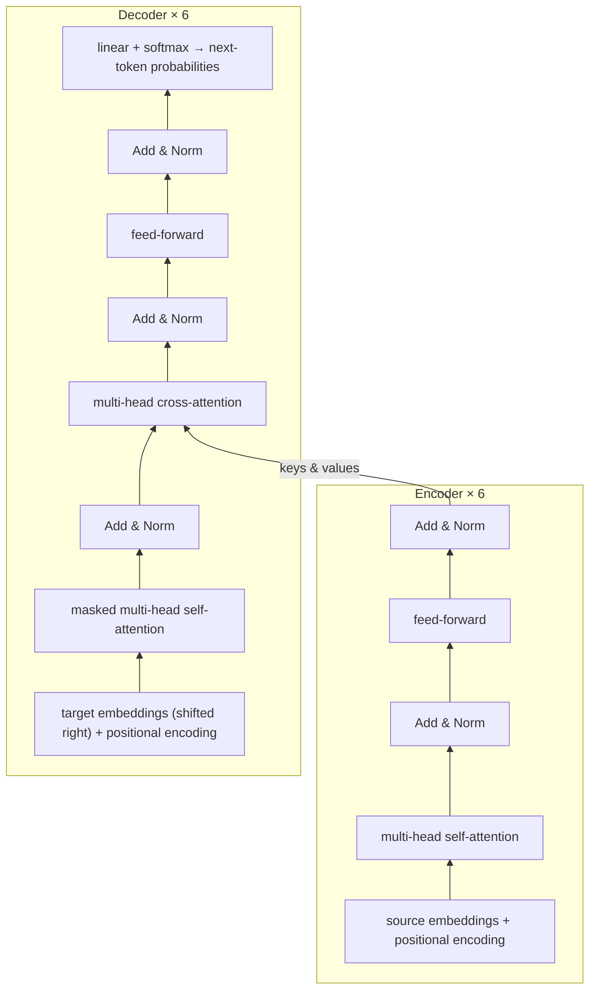

# Attention Is All You Need (2017)

**Ashish Vaswani, Noam Shazeer, Niki Parmar, Jakob Uszkoreit, Llion Jones, Aidan N. Gomez, Łukasz Kaiser, Illia Polosukhin** — NeurIPS 2017 · [arXiv:1706.03762](https://arxiv.org/abs/1706.03762)

> **In one sentence:** the paper throws away recurrence and convolution completely and builds a translation model out of nothing but *attention* layers, which turns out to be more accurate, much faster to train, and — as the following years showed — the foundation of almost every modern language, vision and multimodal model.

---

## Contents

1. [TL;DR](#1-tldr)
2. [The problem: why RNNs were a bottleneck](#2-the-problem-why-rnns-were-a-bottleneck)
3. [The big idea in plain words](#3-the-big-idea-in-plain-words)
4. [Attention, from scratch](#4-attention-from-scratch)
5. [Multi-head attention](#5-multi-head-attention)
6. [The full architecture](#6-the-full-architecture)
7. [Positional encoding](#7-positional-encoding-giving-the-model-a-sense-of-order)
8. [Why self-attention? The complexity argument](#8-why-self-attention-the-complexity-argument)
9. [Training](#9-training)
10. [Results](#10-results)
11. [What matters: the ablations](#11-what-matters-the-ablations)
12. [Limitations and legacy](#12-limitations-and-legacy)
13. [Equation cheat sheet](#13-equation-cheat-sheet)
14. [Check your understanding](#14-check-your-understanding)

A fully worked numerical example of every step described here is in [`../../transformer-pen-and-paper/`](../../transformer-pen-and-paper/).

---

## 1. TL;DR

* **Task:** machine translation (English→German, English→French), framed as sequence-to-sequence: read a source sentence, generate a target sentence.
* **Architecture:** an **encoder** (6 identical layers) turns the source into context-aware vectors; a **decoder** (6 identical layers) generates the translation one token at a time while looking at the encoder output. Every layer is built from **multi-head attention** and a small **feed-forward network**, glued with **residual connections** and **layer normalisation**.
* **Key trick:** *scaled dot-product attention*, $`\operatorname{softmax}(QK^\top/\sqrt{d_k})\,V`$ — every token directly looks at every other token in one step.
* **Order** is injected with **sinusoidal positional encodings**, since attention by itself ignores word order.
* **Result:** new state of the art on WMT 2014 (28.4 BLEU En→De, 41.8 BLEU En→Fr) at a fraction of the training cost of previous models; the base model trains in 12 hours on 8 GPUs.

---

## 2. The problem: why RNNs were a bottleneck

Before 2017 the best translation systems were **recurrent neural networks** (LSTMs/GRUs) with an attention mechanism added on top. An RNN reads a sentence one word at a time and keeps a running summary, the hidden state:

```math
h_t = f(h_{t-1},\, x_t)
```

This simple recursion causes two problems:

1. **No parallelism within a sentence.** To compute $`h_{50}`$ you must first compute $`h_{49}`$, which needs $`h_{48}`$, … GPUs are good at doing thousands of things *at once*, and an RNN forces them to wait. Training is slow, and longer sentences make it worse.
2. **Long paths between words.** For word 1 to influence word 50, its information must survive 49 consecutive updates of $`h`$. Signals (and gradients) fade along the way, so long-range dependencies are hard to learn.

Convolutional models (ByteNet, ConvS2S) fixed the parallelism problem, but two distant words still needed many stacked layers to "meet": the path length grows with the distance.

**The question the paper asks:** can we get rid of recurrence entirely and let *every* word interact with *every* other word directly, in a single, fully parallel step?

---

## 3. The big idea in plain words

Think of reading the sentence

> *The animal didn't cross the street because **it** was too tired.*

To understand **it**, you glance back at the other words and decide which ones matter: *animal* matters a lot, *street* a little, *the* not at all. You then build your understanding of **it** as a *blend* of what those words mean, weighted by how relevant they are.

That is exactly what an attention layer does — for every word at the same time:

1. each word asks a question (**query**),
2. each word advertises what it contains (**key**),
3. the match between a query and each key gives a relevance score,
4. the scores become weights (they are positive and sum to 1),
5. the word's new representation is the weighted average of the other words' content (**values**).

Stack several such layers and the representations become increasingly contextual: *bank* next to *river* ends up with a different vector from *bank* next to *money*.

---

## 4. Attention, from scratch

### 4.1 Ingredients: dot products and softmax

Two pieces of math do all the work.

**Dot product = similarity.** For two vectors $`q, k \in \mathbb R^d`$,

```math
q \cdot k = \sum_{i=1}^{d} q_i k_i
```

It is large and positive when the vectors point in the same direction, about zero when they are unrelated (perpendicular), and negative when they point in opposite directions.

**Softmax = turn scores into weights.** For scores $`s_1, \dots, s_n`$,

```math
\operatorname{softmax}(s)_j = \frac{e^{s_j}}{\sum_{m=1}^{n} e^{s_m}}
```

The exponential makes everything positive and exaggerates differences; dividing by the sum makes the weights add up to 1. For example $`\operatorname{softmax}(1, 0, -1) = (0.665,\ 0.245,\ 0.090)`$: the largest score gets the most weight, but the others still get some. It is a "soft" version of picking the maximum.

### 4.2 Attention as a soft dictionary lookup

A Python dictionary returns the value whose key *exactly* equals your query. Attention is the differentiable version: it returns a *weighted mix of all values*, where the weight of each value depends on how well its key matches the query.

| Python dictionary | Attention |
|:--|:--|
| query must equal a key | query is compared with **every** key (dot product) |
| returns exactly one value | returns a **weighted average** of all values |
| not differentiable | differentiable → the queries, keys and values can be *learned* |

### 4.3 Where do Q, K, V come from?

Each token starts as a vector $`x_i \in \mathbb R^{d_{\text{model}}}`$ (its embedding). Three learned matrices produce three different "views" of it:

```math
q_i = x_i W^Q, \qquad k_i = x_i W^K, \qquad v_i = x_i W^V
```

Stacking all tokens as rows gives matrices $`Q, K, V`$. Why three different projections instead of using $`x_i`$ directly? Because the role of a word as a *question* ("I am a pronoun, who do I refer to?") differs from its role as an *answer* ("I am a noun that can be referred to") and from the *content* it should pass on. Separate projections let the model learn each role.

### 4.4 Scaled dot-product attention

```math
\boxed{\;\operatorname{Attention}(Q, K, V) = \operatorname{softmax}\!\left(\frac{QK^{\top}}{\sqrt{d_k}}\right) V\;}
```

Read it from the inside out:

| Piece | Shape (n tokens) | Meaning |
|:--|:-:|:--|
| $`QK^\top`$ | $`n \times n`$ | entry $`(i, j)`$ = how well query $`i`$ matches key $`j`$ |
| $`/\sqrt{d_k}`$ | $`n \times n`$ | rescale (explained next) |
| $`\operatorname{softmax}`$ (per row) | $`n \times n`$ | row $`i`$ = how much token $`i`$ attends to each token; sums to 1 |
| $`\times V`$ | $`n \times d_v`$ | row $`i`$ = weighted average of the value vectors |

**A tiny example.** One query $`q = (1, 0)`$ and three tokens with keys $`k_1 = (2, 0)`$, $`k_2 = (0, 1)`$, $`k_3 = (1, 1)`$ and values $`v_1 = (1, 0)`$, $`v_2 = (0, 1)`$, $`v_3 = (0.5, 0.5)`$; here $`d_k = 2`$.

```math
\begin{aligned}
\text{scores} &= (q\cdot k_1,\ q\cdot k_2,\ q\cdot k_3) = (2,\ 0,\ 1) \\
\text{scaled} &= (2,\ 0,\ 1)/\sqrt 2 = (1.414,\ 0,\ 0.707) \\
\text{weights} &= \operatorname{softmax}(1.414,\ 0,\ 0.707) = (0.576,\ 0.140,\ 0.284) \\
\text{output} &= 0.576\,v_1 + 0.140\,v_2 + 0.284\,v_3 = (0.718,\ 0.282)
\end{aligned}
```

Token 1, whose key points in the same direction as the query, dominates the result.

### 4.5 Why divide by $`\sqrt{d_k}`$?

This one-line trick has a neat statistical justification. Suppose the components of $`q`$ and $`k`$ are independent with mean 0 and variance 1. Each product $`q_i k_i`$ then has mean 0 and variance 1, and the dot product is a sum of $`d_k`$ of them, so

```math
\mathbb E[q\cdot k] = 0, \qquad \operatorname{Var}(q\cdot k) = d_k, \qquad \text{std}(q\cdot k) = \sqrt{d_k}.
```

With $`d_k = 64`$ the scores typically have size around $`\pm 8`$. Softmax of such large numbers is almost a hard maximum:

```math
\operatorname{softmax}(8, 0, -8) \approx (0.9997,\ 0.0003,\ 0.0000) \quad\text{vs.}\quad \operatorname{softmax}(1, 0, -1) = (0.665,\ 0.245,\ 0.090).
```

When softmax is saturated like this its gradients are nearly zero, so learning stalls. Dividing by $`\sqrt{d_k}`$ brings the variance back to 1, whatever the dimension. (The authors note that *additive* attention, an older alternative, does not suffer from this, and that unscaled dot-product attention falls behind it for large $`d_k`$; with the scaling, dot-product attention is as good and much faster, because it is just matrix multiplication.)

### 4.6 Masking

Sometimes a token must not see certain other tokens — most importantly, in the decoder, a word must not peek at the *future* words it is supposed to predict. This is done by adding $`-\infty`$ to the forbidden scores before the softmax:

```math
\operatorname{softmax}\!\left(\frac{QK^\top}{\sqrt{d_k}} + M\right), \qquad M_{ij} = \begin{cases} 0 & j \le i \\ -\infty & j > i \end{cases}
```

Since $`e^{-\infty} = 0`$, forbidden positions get exactly zero weight, and the remaining weights still sum to 1.

---

## 5. Multi-head attention

One attention layer produces one set of weights per token: a single notion of "relevance". But words relate to each other in several ways at once — grammatical subject, coreference, adjacent words, semantic similarity. Averaging all of these into one weight pattern blurs them.

**Solution:** run $`h`$ attention operations ("heads") in parallel, each with its own smaller projections, then combine:

```math
\begin{aligned}
\text{head}_i &= \operatorname{Attention}(QW_i^Q,\ KW_i^K,\ VW_i^V), \qquad W_i^Q, W_i^K \in \mathbb R^{d_{\text{model}}\times d_k},\ W_i^V \in \mathbb R^{d_{\text{model}}\times d_v}\\
\operatorname{MultiHead}(Q, K, V) &= \operatorname{Concat}(\text{head}_1, \dots, \text{head}_h)\, W^O, \qquad W^O \in \mathbb R^{h d_v \times d_{\text{model}}}
\end{aligned}
```

The paper uses $`h = 8`$ heads with $`d_k = d_v = d_{\text{model}}/h = 512/8 = 64`$.

**Intuition:** each head projects the tokens into its own 64-dimensional subspace, where it can specialise in one kind of relation; $`W^O`$ then mixes the findings back together. Because each head is 8 times smaller, the **total cost is about the same as one full-size head** — you get several perspectives for free. The paper's attention visualisations show heads that track long-distance dependencies (e.g. *making … more difficult*) and heads that resolve pronouns (*its* → *Law*).

---

## 6. The full architecture



### 6.1 Three kinds of attention

| Where | Queries from | Keys & values from | Mask | Purpose |
|:--|:--|:--|:--|:--|
| Encoder self-attention | source tokens | source tokens | none | every source word looks at the whole source sentence |
| Decoder self-attention | target tokens | target tokens | causal | each target word looks at the words already generated |
| Encoder–decoder (cross) attention | target tokens | encoder output | none | each target word looks at the whole source sentence — this is where "translation" happens |

### 6.2 Position-wise feed-forward network

After attention has *mixed* information across tokens, each token is processed *on its own* by the same small two-layer network:

```math
\operatorname{FFN}(x) = \max(0,\ xW_1 + b_1)\,W_2 + b_2, \qquad W_1 \in \mathbb R^{512\times 2048},\ W_2 \in \mathbb R^{2048\times 512}
```

Intuition: attention decides *what information to gather*; the FFN *processes* the gathered information (the inner layer is 4× wider, giving room for non-linear feature combinations). Roughly two-thirds of the parameters of each encoder layer live here ($`2\cdot512\cdot2048 \approx 2.1`$ M, versus $`4\cdot512^2 \approx 1.05`$ M for the four attention matrices).

### 6.3 Residual connections and layer normalisation

Every sub-layer (attention or FFN) is wrapped as

```math
\operatorname{LayerNorm}\big(x + \operatorname{Sublayer}(x)\big)
```

* **Residual connection** $`x + \operatorname{Sublayer}(x)`$: the sub-layer only has to learn a *correction* to its input. It also gives gradients a direct path through all layers, which makes deep stacks trainable.
* **Layer normalisation** rescales each token vector to mean 0 and variance 1 (then applies a learned scale $`\gamma`$ and shift $`\beta`$):

  ```math
  \operatorname{LayerNorm}(x) = \gamma \odot \frac{x - \mu}{\sqrt{\sigma^2 + \epsilon}} + \beta, \qquad \mu = \frac1d\sum_i x_i,\quad \sigma^2 = \frac1d\sum_i (x_i - \mu)^2
  ```

  It keeps the numbers in a stable range no matter how many layers are stacked.

To make the residual additions possible, every sub-layer and embedding has the same width, $`d_{\text{model}} = 512`$.

### 6.4 Embeddings and output layer

Tokens are mapped to vectors by a learned embedding matrix, multiplied by $`\sqrt{d_{\text{model}}}`$ (so that they are not dwarfed by the positional encodings). The decoder output is turned into next-token probabilities by a linear layer and a softmax. The **same matrix** is shared between the two embedding layers and the output layer (weight tying), which saves parameters and ties input and output word meanings together.

### 6.5 Generating a translation

At training time the decoder receives the correct target sentence shifted right by one position (*teacher forcing*) and predicts every next word in parallel; the causal mask guarantees it never cheats. At test time it generates autoregressively: predict a word, append it, predict the next, … using **beam search** (beam size 4, length penalty $`\alpha = 0.6`$).

---

## 7. Positional encoding: giving the model a sense of order

Attention compares tokens by content only. If you shuffle the input words, each output vector is shuffled the same way but otherwise unchanged — the model literally cannot tell *"dog bites man"* from *"man bites dog"*. Order has to be added to the input.

The paper adds to each embedding a vector that depends only on its position $`pos`$:

```math
PE_{(pos,\,2i)} = \sin\!\left(\frac{pos}{10000^{2i/d_{\text{model}}}}\right), \qquad PE_{(pos,\,2i+1)} = \cos\!\left(\frac{pos}{10000^{2i/d_{\text{model}}}}\right)
```

**How to picture it: clock hands.** Each pair of dimensions $`(2i, 2i+1)`$ is a point $`(\sin\theta, \cos\theta)`$ moving around a circle as the position increases — a clock hand. The first pair turns fast (one radian per position), later pairs turn slower and slower; the wavelengths form a geometric progression from $`2\pi`$ to $`10000\cdot 2\pi`$. Like the hands of a clock (seconds, minutes, hours) or the digits of a binary counter, the *combination* of all hands identifies every position uniquely.

**Why sines and cosines? Relative positions become linear.** Moving $`k`$ positions ahead turns every clock hand by a fixed angle, and a turn is a matrix multiplication. With frequency $`\omega`$:

```math
\begin{pmatrix} \sin(\omega(pos+k)) \\ \cos(\omega(pos+k)) \end{pmatrix} = \begin{pmatrix} \cos \omega k & \sin \omega k \\ -\sin \omega k & \cos \omega k \end{pmatrix} \begin{pmatrix} \sin(\omega\, pos) \\ \cos(\omega\, pos) \end{pmatrix}
```

The rotation matrix depends on the offset $`k`$ but **not on $`pos`$**, so "the word 3 positions back" is the same linear transformation everywhere in the sentence — easy for the learned projections $`W^Q, W^K`$ to exploit. The authors also hoped this would let the model handle sentences longer than any seen in training.

They tried learned positional embeddings too and got nearly identical results; they kept the sinusoids for their potential to extrapolate. (BERT and ViT later chose learned embeddings.)

---

## 8. Why self-attention? The complexity argument

The paper compares layer types on three criteria: total computation, how much can run in parallel (minimum number of *sequential* steps), and the longest path a signal must travel between two positions. For a sequence of length $`n`$, width $`d`$ and convolution kernel $`k`$:

| Layer type | Computation per layer | Sequential steps | Max path length |
|:--|:-:|:-:|:-:|
| **Self-attention** | $`O(n^2 \cdot d)`$ | $`O(1)`$ | $`O(1)`$ |
| Recurrent | $`O(n \cdot d^2)`$ | $`O(n)`$ | $`O(n)`$ |
| Convolutional | $`O(k \cdot n \cdot d^2)`$ | $`O(1)`$ | $`O(\log_k n)`$ |
| Self-attention restricted to a window of size $`r`$ | $`O(r \cdot n \cdot d)`$ | $`O(1)`$ | $`O(n/r)`$ |

How to read it:

* **Path length $`O(1)`$:** any two words are connected *directly* in every layer. Short paths make long-range dependencies much easier to learn.
* **Sequential steps $`O(1)`$:** all positions are processed at once — ideal for GPUs.
* **Computation:** self-attention costs $`n^2 d`$ (every pair of tokens), recurrence costs $`n d^2`$ (a $`d\times d`$ matrix per step). Self-attention is cheaper whenever $`n < d`$, which holds for typical sentences (tens of tokens) with $`d = 512`$. For very long sequences the $`n^2`$ term becomes the bottleneck — the main weakness of the design (see §12).
* A bonus: attention weights can be **inspected**, giving some insight into what the model does.

---

## 9. Training

### 9.1 Data and hardware

| | English→German | English→French |
|:--|:--|:--|
| Data | WMT 2014, ~4.5 M sentence pairs | WMT 2014, ~36 M sentence pairs |
| Tokens | byte-pair encoding, ~37 k shared source/target vocabulary | 32 k word-piece vocabulary |

Sentence pairs were batched by length, about 25 000 source and 25 000 target tokens per batch. Training ran on one machine with **8 NVIDIA P100 GPUs**: the base model for 100 k steps (~0.4 s/step, **12 hours**), the big model for 300 k steps (~1 s/step, **3.5 days**).

### 9.2 Model sizes

| | $`N`$ | $`d_{\text{model}}`$ | $`d_{ff}`$ | $`h`$ | $`d_k = d_v`$ | dropout | params |
|:--|:-:|:-:|:-:|:-:|:-:|:-:|:-:|
| Base | 6 | 512 | 2048 | 8 | 64 | 0.1 | 65 M |
| Big | 6 | 1024 | 4096 | 16 | 64 | 0.3 | 213 M |

### 9.3 Optimiser and the warm-up schedule

Adam with $`\beta_1 = 0.9`$, $`\beta_2 = 0.98`$, $`\epsilon = 10^{-9}`$ and a learning rate that changes every step:

```math
\text{lrate} = d_{\text{model}}^{-0.5} \cdot \min\!\left(\text{step}^{-0.5},\ \text{step}\cdot \text{warmup}^{-1.5}\right), \qquad \text{warmup} = 4000
```

The two terms of the `min` cross exactly at step 4000, so the schedule has two phases:

* **Warm-up (steps 1–4000):** the second term wins and the rate grows *linearly*. Early on the weights are random and Adam's gradient statistics are unreliable; big steps would throw the model into a bad region.
* **Decay (after 4000):** the first term wins and the rate shrinks like $`1/\sqrt{\text{step}}`$, allowing finer and finer adjustments.

For the base model the peak is $`512^{-0.5}\cdot 4000^{-0.5} \approx 7.0\times 10^{-4}`$; it is $`1.7\times10^{-4}`$ at step 1000 and $`1.4\times10^{-4}`$ at step 100 000. Warm-up became standard practice for training Transformers.

### 9.4 Regularisation

* **Residual dropout** ($`P_{\text{drop}} = 0.1`$ for base): applied to the output of every sub-layer before it is added to the residual, and to the sums of embeddings and positional encodings.
* **Label smoothing** ($`\epsilon_{ls} = 0.1`$): instead of training towards a one-hot target (100 % on the correct word), the target puts $`1 - \epsilon_{ls}`$ on the correct word and spreads $`\epsilon_{ls}`$ over the vocabulary. The model is discouraged from becoming over-confident. This *hurts* perplexity (the model is deliberately less sure) but *improves* accuracy and BLEU.

At test time the authors average the weights of the last checkpoints (5 for base, 20 for big), a cheap form of ensembling.

---

## 10. Results

### Machine translation (WMT 2014 newstest, BLEU — higher is better)

| Model | En→De | En→Fr | Training cost (FLOPs) |
|:--|--:|--:|--:|
| ConvS2S (previous strong CNN) | 25.2 | 40.5 | — |
| GNMT + RL (Google's production RNN) | 24.6 | 39.9 | — |
| Best previous **ensembles** | 26.4 | 41.3 | — |
| **Transformer (base)** | 27.3 | 38.1 | $`3.3 \times 10^{18}`$ |
| **Transformer (big)** | **28.4** | **41.8** | $`2.3 \times 10^{19}`$ |

* A *single* big Transformer beat all previous models **including ensembles** on En→De by more than 2 BLEU.
* On En→Fr it set a new single-model record while costing less than a quarter of the training compute of the previous best model.
* Even the base model, trained in half a day, beat every previously published model and ensemble on En→De.

### Generalisation: English constituency parsing

To show the architecture is not specific to translation, a 4-layer Transformer was trained to output parse trees (Penn Treebank WSJ). With almost no task-specific tuning it reached **91.3 F1** using only the 40 k WSJ training sentences and **92.7 F1** semi-supervised, outperforming most previous models — surprising for a task with strong structural constraints and long outputs.

---

## 11. What matters: the ablations

The authors varied the base model on En→De (development set, Table 3 of the paper):

| Change | Effect | Lesson |
|:--|:--|:--|
| 1 head instead of 8 (same total compute) | −0.9 BLEU | multiple perspectives help |
| 16 or 32 heads (tiny $`d_k`$) | slightly worse | heads need enough dimensions each |
| smaller $`d_k`$ only | worse | judging compatibility is not trivial; a richer comparison than a dot product might help |
| bigger models ($`d_{\text{model}}`$, $`d_{ff}`$, layers) | better | scale helps — a theme that would dominate the next years |
| no dropout | worse | regularisation matters even with 4.5 M sentences |
| learned instead of sinusoidal positions | nearly identical | the exact encoding is not critical |

---

## 12. Limitations and legacy

**Limitations acknowledged or apparent:**

* **Quadratic cost in sequence length.** The $`n\times n`$ attention matrix makes very long inputs (documents, high-resolution images, audio) expensive. The paper itself suggests restricting attention to local neighbourhoods; many later "efficient attention" methods address this.
* **Order only through positional encodings** — the architecture has no built-in notion of locality or sequence, which must be learned (or encoded) instead.
* **Autoregressive decoding is still sequential** at inference time, even though training is parallel.

**Legacy.** The Transformer quickly replaced RNNs in NLP and then spread far beyond it:

* **encoder-only** models such as **BERT** (2018) — see [`../02-bert/`](../02-bert/);
* **decoder-only** models such as the GPT family, the basis of today's large language models;
* **Vision Transformers** (2020), which apply the same encoder to image patches — see [`../03-vit/`](../03-vit/);
* and audio, protein structure, multimodal models and more.

A notable later refinement: placing LayerNorm *before* each sub-layer ("pre-norm", $`x + \operatorname{Sublayer}(\operatorname{LayerNorm}(x))`$) instead of after it, as in this paper, makes deep Transformers easier to train; ViT uses this variant.

---

## 13. Equation cheat sheet

| Concept | Equation |
|:--|:--|
| Projections | $`Q = XW^Q,\; K = XW^K,\; V = XW^V`$ |
| Scaled dot-product attention | $`\operatorname{softmax}(QK^\top/\sqrt{d_k})\,V`$ |
| Causal mask | add $`-\infty`$ to scores with $`j > i`$ |
| Multi-head | $`\operatorname{Concat}(\text{head}_1,\dots,\text{head}_h)W^O`$, $`\text{head}_i = \operatorname{Attention}(QW_i^Q, KW_i^K, VW_i^V)`$ |
| Feed-forward | $`\max(0, xW_1 + b_1)W_2 + b_2`$ |
| Sub-layer wrapper | $`\operatorname{LayerNorm}(x + \operatorname{Sublayer}(x))`$ |
| Positional encoding | $`PE_{(pos,2i)} = \sin(pos/10000^{2i/d})`$, $`PE_{(pos,2i+1)} = \cos(pos/10000^{2i/d})`$ |
| Learning rate | $`d^{-0.5}\min(\text{step}^{-0.5}, \text{step}\cdot\text{warmup}^{-1.5})`$ |

---

## 14. Check your understanding

1. Why can an RNN not be parallelised across the positions of one sentence, while self-attention can?
2. Show that if $`q, k \in \mathbb R^{d_k}`$ have independent components with mean 0 and variance 1, then $`\operatorname{Var}(q\cdot k) = d_k`$. What goes wrong with softmax if we do not rescale?
3. A model has $`d_{\text{model}} = 512`$ and 8 heads. What is $`d_k`$? Why is the cost of multi-head attention similar to that of a single head?
4. Without positional encodings, what happens to the encoder output if the input words are permuted?
5. Using the rotation-matrix identity, explain why "attend to the word two positions to the left" is equally easy at position 3 and at position 30.
6. For a sequence of 1000 tokens and $`d = 512`$, which is cheaper per layer: self-attention or a recurrent layer?
7. What is the learning rate at step 2000 and at step 16 000 for the base model?
8. Why does the decoder need a mask during training but the encoder does not?
