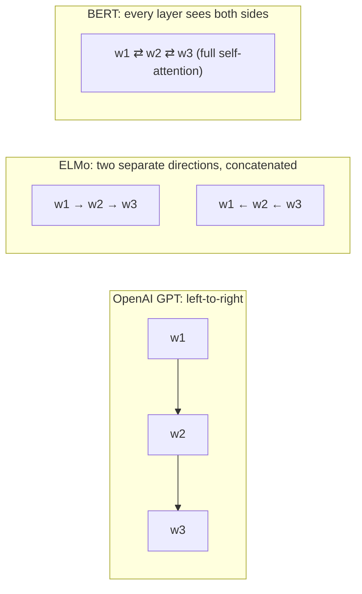

# BERT: Pre-training of Deep Bidirectional Transformers for Language Understanding (2018)

**Jacob Devlin, Ming-Wei Chang, Kenton Lee, Kristina Toutanova** (Google AI Language) — NAACL 2019 · [arXiv:1810.04805](https://arxiv.org/abs/1810.04805)

> **In one sentence:** pre-train a Transformer *encoder* on huge amounts of unlabelled text by having it fill in hidden words using context from **both** sides, then fine-tune the same network, with one tiny extra layer, on almost any language-understanding task — setting new records on eleven of them.

---

## Contents

1. [TL;DR](#1-tldr)
2. [The problem: pre-training was one-directional](#2-the-problem-pre-training-was-one-directional)
3. [The big idea in plain words](#3-the-big-idea-in-plain-words)
4. [Model architecture](#4-model-architecture)
5. [Input representation](#5-input-representation)
6. [Pre-training task 1: Masked Language Model](#6-pre-training-task-1-masked-language-model-mlm)
7. [Pre-training task 2: Next Sentence Prediction](#7-pre-training-task-2-next-sentence-prediction-nsp)
8. [Pre-training data and procedure](#8-pre-training-data-and-procedure)
9. [Fine-tuning: one model, many tasks](#9-fine-tuning-one-model-many-tasks)
10. [Results](#10-results)
11. [What matters: the ablations](#11-what-matters-the-ablations)
12. [Limitations and legacy](#12-limitations-and-legacy)
13. [Equation cheat sheet](#13-equation-cheat-sheet)
14. [Check your understanding](#14-check-your-understanding)

Fully worked numerical examples of both pre-training tasks are in [`../../bert-pen-and-paper/`](../../bert-pen-and-paper/). BERT is built from the Transformer encoder, summarised in [`../01-attention-is-all-you-need/`](../01-attention-is-all-you-need/).

---

## 1. TL;DR

* **Architecture:** just the **encoder** of the Transformer — 12 layers (BERT-Base, 110 M parameters) or 24 layers (BERT-Large, 340 M).
* **Pre-training** on 3.3 billion words of unlabelled text (BooksCorpus + English Wikipedia) with two self-supervised tasks:
  * **Masked Language Model (MLM):** hide 15 % of the tokens and predict them from the surrounding context — left *and* right.
  * **Next Sentence Prediction (NSP):** given two sentences, predict whether the second really follows the first.
* **Fine-tuning:** add one small output layer and train *all* parameters on the target task for a few epochs. The same recipe works for classification, sentence-pair tasks, question answering and tagging.
* **Results:** state of the art on 11 NLP tasks, e.g. GLUE score 80.5 (+7.7 points), MultiNLI 86.7 % (+4.6), SQuAD v1.1 test F1 93.2 (+1.5), SQuAD v2.0 test F1 83.1 (+5.1).

---

## 2. The problem: pre-training was one-directional

By 2018 it was clear that **pre-training on unlabelled text** helps almost every NLP task. There were two ways to use a pre-trained model:

| Approach | Example | How it is used |
|:--|:--|:--|
| **Feature-based** | ELMo | compute word representations with the frozen pre-trained model and feed them as extra features into a separate, task-specific architecture |
| **Fine-tuning** | OpenAI GPT | add a minimal output layer and train the whole pre-trained model on the task |

Both were pre-trained as **language models**: predict the next word from the previous ones,

```math
P(w_1, \dots, w_n) = \prod_{t=1}^{n} P(w_t \mid w_1, \dots, w_{t-1}).
```

That objective is inherently **one-directional**. GPT reads strictly left-to-right: when it builds the representation of a word, it cannot use the words that follow. ELMo trains a left-to-right and a right-to-left LSTM *separately* and concatenates their outputs — each half is still blind in one direction, and the two directions never interact inside the network.

Why is this a problem? Many tasks need context from both sides. In

> *The **bank** of the river was muddy.*

the word *bank* is disambiguated by *river*, which comes *after* it. In question answering, a word in the passage must be understood in light of the whole passage and the question. The authors argue that unidirectionality is the main limit on pre-trained representations, especially for fine-tuning.

---

## 3. The big idea in plain words

**Why not just train a bidirectional language model?** If each word could see the whole sentence while being asked to predict *itself*, the task would be trivial. In a deep bidirectional network this happens even indirectly: in layer 1, position 5 attends to word 7; in layer 2, position 7 attends to position 5 — which by now contains information about word 7. The word "sees itself" and the model learns nothing useful.

**BERT's answer: a fill-in-the-blanks game.** Hide some words and ask the model to recover them:

> *my dog is [MASK] → hairy*

Hidden words cannot leak, so the model is free to use the context on both sides in every layer. This is the **Cloze task**, used by psychologists since 1953 to measure reading comprehension. Add a second game — "does sentence B follow sentence A?" — to learn relationships between sentences, and you get a model whose representations transfer to a wide range of tasks with very little extra machinery.

---

## 4. Model architecture

BERT is a multi-layer bidirectional Transformer **encoder**, almost identical to the original implementation (multi-head self-attention without a causal mask, feed-forward network, residual connections, LayerNorm). It uses **GELU** instead of ReLU in the feed-forward layers.

| | Layers $`L`$ | Hidden size $`H`$ | Heads $`A`$ | Feed-forward size | Parameters |
|:--|:-:|:-:|:-:|:-:|:-:|
| **BERT-Base** | 12 | 768 | 12 | 3072 ($`=4H`$) | 110 M |
| **BERT-Large** | 24 | 1024 | 16 | 4096 | 340 M |

BERT-Base was deliberately chosen to have the same size as OpenAI GPT, so the two could be compared fairly: the only major difference is that GPT's self-attention is masked to look left only, while BERT's looks in both directions.



**GELU in one line.** $`\operatorname{GELU}(x) = x\,\Phi(x)`$, where $`\Phi`$ is the standard normal CDF. Think of it as a *smooth* ReLU: large positive inputs pass through, large negative inputs give about 0, and in between the input is scaled by "the probability that it is positive". It has no kink at 0, which tends to train slightly better.

---

## 5. Input representation

One input format serves every task: either a single text, or a **pair** of texts (question + passage, premise + hypothesis, …) packed into one sequence.

```
[CLS] my dog is cute [SEP] he likes play ##ing [SEP]
```

* **WordPiece tokens** (30 000-token vocabulary): frequent words are single tokens, rare words are split into sub-words (*playing* → *play* + *##ing*). There are no unknown words, and the vocabulary stays small.
* **`[CLS]`** always comes first. Its final hidden vector, called $`C`$, is used as the summary of the whole input for classification tasks.
* **`[SEP]`** ends each segment.

Each token's input vector is the **sum of three learned embeddings**:

```math
\text{input}_i = E_{\text{token}}(w_i) + E_{\text{segment}}(s_i) + E_{\text{position}}(i)
```

| Embedding | Encodes | Size |
|:--|:--|:--|
| token | which WordPiece | 30 000 × H |
| segment | sentence A or sentence B | 2 × H |
| position | position in the sequence (learned, not sinusoidal) | 512 × H |

Why *add* instead of concatenating? Adding keeps the width at $`H`$, and in a high-dimensional space the network can easily learn to read the three kinds of information apart (they occupy largely different directions). Notation used below: $`E`$ = input embeddings, $`C \in \mathbb R^H`$ = final vector of `[CLS]`, $`T_i \in \mathbb R^H`$ = final vector of token $`i`$.

---

## 6. Pre-training task 1: Masked Language Model (MLM)

### 6.1 The objective

Choose 15 % of the WordPiece positions at random. Let $`\mathcal M`$ be that set and $`\tilde x`$ the corrupted input. For each chosen position, feed its final vector $`T_i`$ into a softmax over the vocabulary and minimise the cross-entropy:

```math
\mathcal L_{\text{MLM}} = -\frac{1}{|\mathcal M|} \sum_{i \in \mathcal M} \log P(x_i \mid \tilde x), \qquad P(\,\cdot \mid \tilde x) = \operatorname{softmax}(T_i W^\top + b)
```

where $`W`$ is the token embedding matrix (input and output embeddings are shared). Only the chosen positions are predicted — the model is *not* asked to reconstruct the whole input, unlike a denoising auto-encoder.

**Intuition for the softmax:** the score of a candidate word is the dot product between $`T_i`$ and that word's embedding. Training pushes $`T_i`$ towards the embedding of the correct word and away from the others, so $`T_i`$ must encode "what word fits here, given everything around it".

### 6.2 The 80 / 10 / 10 rule

There is a catch: `[MASK]` appears in pre-training but **never** during fine-tuning, a mismatch between the two phases. So a chosen token is not always replaced by `[MASK]`:

| With probability | the chosen token becomes | Example (*my dog is hairy*, chosen: *hairy*) |
|:-:|:--|:--|
| 80 % | `[MASK]` | *my dog is [MASK]* |
| 10 % | a random token | *my dog is apple* |
| 10 % | itself (unchanged) | *my dog is hairy* |

In all three cases the model must predict the original word *hairy*.

**Why this works:** the model can never be sure which tokens were changed, so it must keep a good contextual representation of **every** input token, not only of `[MASK]` positions. Random replacement happens to only $`1.5\,\%`$ of all tokens ($`10\,\%`$ of $`15\,\%`$), too little to hurt the model's language understanding.

### 6.3 The price

Only 15 % of tokens produce a training signal in each batch, whereas a left-to-right model learns from every token. MLM therefore converges a bit more slowly at first — but the paper shows it overtakes a left-to-right model almost immediately in downstream accuracy, and the gap keeps growing.

---

## 7. Pre-training task 2: Next Sentence Prediction (NSP)

Tasks such as question answering and natural language inference depend on the *relationship* between two sentences, which word-level language modelling does not capture directly. NSP is a binary task that can be generated from any text corpus:

* 50 % of the time, sentence B is the sentence that really follows A — label **IsNext**;
* 50 % of the time, B is a random sentence from the corpus — label **NotNext**.

```
[CLS] the man went to [MASK] store [SEP] he bought a gallon [MASK] milk [SEP]       → IsNext
[CLS] the man [MASK] to the store [SEP] penguin [MASK] are flight ##less birds [SEP] → NotNext
```

The prediction is made from $`C`$, the final `[CLS]` vector:

```math
P(\text{IsNext}) = \operatorname{softmax}(C\,W_{\text{NSP}}^\top + b)_{\text{IsNext}}, \qquad W_{\text{NSP}} \in \mathbb R^{2\times H}
```

The task is easy — the final model reaches 97–98 % accuracy — but the ablation (§11) shows it helps QA and NLI. Note that $`C`$ is only a meaningful sentence summary *because* of this training; without fine-tuning, it is not a general-purpose sentence embedding.

Both tasks are trained **together** on the same inputs (the examples above contain masks *and* an NSP label):

```math
\mathcal L = \mathcal L_{\text{MLM}} + \mathcal L_{\text{NSP}}
```

---

## 8. Pre-training data and procedure

* **Data:** BooksCorpus (800 M words) + English Wikipedia (2 500 M words; text passages only, no lists, tables or headers). A *document-level* corpus is essential: NSP and long inputs need contiguous text, not shuffled single sentences.
* **Sequences:** pairs of text spans with combined length ≤ 512 tokens.
* **Batch size:** 256 sequences × 512 tokens = 128 000 tokens; **1 000 000 steps**, about 40 passes over the 3.3 B-word corpus.
* **Optimiser:** Adam, learning rate $`10^{-4}`$, $`\beta_1 = 0.9`$, $`\beta_2 = 0.999`$, weight decay 0.01, warm-up over the first 10 000 steps followed by linear decay; dropout 0.1 everywhere.
* **Speed trick:** attention cost grows with the square of the sequence length, so 90 % of the steps use sequences of length 128 and only the last 10 % use length 512 (to learn the position embeddings for long inputs).
* **Hardware:** BERT-Base on 4 Cloud TPUs (16 TPU chips), BERT-Large on 16 Cloud TPUs (64 chips); 4 days each.

The expensive part is done **once**; the pre-trained weights are then reused for every task.

---

## 9. Fine-tuning: one model, many tasks

Because self-attention lets any token attend to any other, a single text or a pair of texts can be fed in the same way; attention *between* the two texts happens automatically inside the encoder (older models encoded the two texts separately and then added a cross-attention module). To adapt BERT to a task, plug in the task-specific inputs and outputs and **fine-tune all parameters end-to-end**. Only a handful of new parameters are added.

| Task type | Input | Output layer (new parameters) |
|:--|:--|:--|
| Single-sentence classification (sentiment, acceptability) | `[CLS] text [SEP]` | $`\operatorname{softmax}(C\,W^\top)`$, $`W \in \mathbb R^{K \times H}`$ |
| Sentence-pair classification (entailment, paraphrase) | `[CLS] A [SEP] B [SEP]` | same, on $`C`$ |
| Token tagging (named entities) | `[CLS] text [SEP]` | a softmax on every $`T_i`$ |
| Extractive QA (SQuAD) | `[CLS] question [SEP] passage [SEP]` | start vector $`S`$ and end vector $`E`$ |

### 9.1 Classification

```math
P(\text{class} = k \mid \text{input}) = \operatorname{softmax}(C\,W^\top)_k
```

For $`K`$ classes the only new parameters are the $`K \times H`$ matrix $`W`$: for sentiment ($`K = 2`$) on BERT-Base that is just 1 536 numbers on top of 110 M pre-trained ones.

### 9.2 Question answering as "pointing"

SQuAD gives a question and a Wikipedia passage; the answer is a span of the passage. BERT learns just two vectors, $`S, E \in \mathbb R^H`$. The probability that token $`i`$ is the **start** of the answer is a softmax of dot products over the passage tokens:

```math
P_i^{\text{start}} = \frac{e^{S \cdot T_i}}{\sum_j e^{S \cdot T_j}}, \qquad P_i^{\text{end}} \text{ analogously with } E.
```

The predicted answer is the span $`(i, j)`$ with $`j \ge i`$ that maximises $`S\cdot T_i + E\cdot T_j`$. Training maximises the log-likelihood of the correct start and end positions.

**SQuAD 2.0** adds questions that have *no* answer in the passage. These are treated as answers spanning the `[CLS]` token: the "no answer" score is $`s_{\text{null}} = S\cdot C + E\cdot C`$, and a real span is predicted only if its score beats $`s_{\text{null}}`$ by a threshold $`\tau`$ tuned on the development set.

### 9.3 Multiple choice (SWAG)

For a sentence and four possible continuations, build four inputs `[CLS] sentence [SEP] continuation_k [SEP]`. A single learned vector $`V`$ scores each: $`V \cdot C_k`$; a softmax over the four scores picks the answer.

### 9.4 Cost

Fine-tuning is cheap: typically 2–4 epochs with batch size 16 or 32 and learning rate $`5\times10^{-5}`$, $`3\times10^{-5}`$ or $`2\times10^{-5}`$ — at most an hour on a single TPU or a few hours on a GPU for every result in the paper.

---

## 10. Results

### GLUE (General Language Understanding Evaluation, test set)

| System | MNLI-m | QQP | QNLI | SST-2 | CoLA | STS-B | MRPC | RTE | Average |
|:--|--:|--:|--:|--:|--:|--:|--:|--:|--:|
| Pre-OpenAI state of the art | 80.6 | 66.1 | 82.3 | 93.2 | 35.0 | 81.0 | 86.0 | 61.7 | 74.0 |
| OpenAI GPT | 82.1 | 70.3 | 87.4 | 91.3 | 45.4 | 80.0 | 82.3 | 56.0 | 75.1 |
| **BERT-Base** | 84.6 | 71.2 | 90.5 | 93.5 | 52.1 | 85.8 | 88.9 | 66.4 | 79.6 |
| **BERT-Large** | **86.7** | **72.1** | **92.7** | **94.9** | **60.5** | **86.5** | **89.3** | **70.1** | **82.1** |

(The average excludes the problematic WNLI set; on the official leaderboard BERT-Large scored 80.5, versus 72.8 for GPT.) BERT-Base beats GPT — which has the same size — on every task, isolating the benefit of bidirectionality. BERT-Large beats BERT-Base everywhere, **even on tiny datasets** such as RTE (2.5 k training examples).

### Other benchmarks

| Benchmark | Previous best | BERT-Large |
|:--|:--|:--|
| SQuAD v1.1 (test F1, single model + TriviaQA data) | 91.7 (ensemble) | 93.2 (ensemble), 91.8 (single) |
| SQuAD v2.0 (test F1) | 78.0 | 83.1 |
| SWAG (test accuracy) | 78.0 (GPT) | 86.3 |

---

## 11. What matters: the ablations

### 11.1 Pre-training tasks (BERT-Base, development sets)

| Model | MNLI | QNLI | MRPC | SST-2 | SQuAD F1 |
|:--|--:|--:|--:|--:|--:|
| BERT-Base (MLM + NSP) | 84.4 | 88.4 | 86.7 | 92.7 | 88.5 |
| no NSP | 83.9 | 84.9 | 86.5 | 92.6 | 87.9 |
| left-to-right LM, no NSP (≈ GPT objective) | 82.1 | 84.3 | 77.5 | 92.1 | 77.8 |
| + BiLSTM on top | 82.1 | 84.1 | 75.7 | 91.6 | 84.9 |

* Removing **NSP** hurts sentence-pair tasks (QNLI −3.5).
* Replacing MLM by a **left-to-right** objective hurts everything, dramatically for SQuAD (−10.7 F1): when predicting an answer span, tokens need context from the right.
* Adding a BiLSTM on top of the left-to-right model recovers part of the SQuAD gap but hurts GLUE — bolting on bidirectionality afterwards is no substitute for deep bidirectional pre-training. (Concatenating a separate right-to-left model, as ELMo does, would double the cost and still not let the two directions interact inside the network.)

### 11.2 Model size

Larger models are better on all four tested GLUE tasks, including MRPC with only 3 600 training examples. Earlier work had seen gains from scale mainly with large task datasets; BERT shows that with enough **pre-training**, scaling up the model helps small tasks too.

### 11.3 Feature-based use

BERT also works without fine-tuning: on named-entity recognition (CoNLL-2003), concatenating the frozen outputs of the top four layers as features for a small BiLSTM reaches 96.1 dev F1, only 0.3 behind full fine-tuning (96.4). Useful when a task needs its own architecture or when you want to compute expensive representations once and reuse them.

### 11.4 Masking strategy

Using `[MASK]` 100 % of the time works well for fine-tuning but noticeably hurts the feature-based approach (where the mismatch is not "fixed" by fine-tuning); using random tokens 100 % of the time is worse. The 80/10/10 mix is the most robust.

---

## 12. Limitations and legacy

**Limitations:**

* **Not a generator.** An encoder that fills in blanks cannot naturally produce text left-to-right; generation became the domain of GPT-style decoders and encoder–decoders.
* **Pre-train/fine-tune mismatch** from `[MASK]` is softened, not removed, by the 80/10/10 rule; and masked tokens are predicted *independently* of each other.
* **Sample efficiency:** only 15 % of tokens give a training signal.
* **512-token limit** and quadratic attention cost.
* **NSP's usefulness** was later questioned: RoBERTa (2019) found that removing NSP and training longer, on more data, with dynamic masking works as well or better; ALBERT replaced NSP with sentence-order prediction.

**Legacy.** BERT made "pre-train, then fine-tune" the default recipe in NLP and launched a family of successors — RoBERTa, ALBERT, DistilBERT, ELECTRA, multilingual BERT and many domain-specific variants. Its `[CLS]`-token design and masked-prediction idea carried over to vision: ViT classifies from a `[class]` token (see [`../03-vit/`](../03-vit/)), and masked-patch prediction (tried in the ViT paper, later perfected by models such as MAE and BEiT) is BERT's MLM for images.

---

## 13. Equation cheat sheet

| Concept | Equation |
|:--|:--|
| Input embedding | $`E_{\text{token}}(w_i) + E_{\text{segment}}(s_i) + E_{\text{position}}(i)`$ |
| Encoder | stack of Transformer encoder layers, no causal mask, GELU |
| MLM loss | $`-\frac{1}{\lvert\mathcal M\rvert}\sum_{i\in\mathcal M} \log \operatorname{softmax}(T_i W^\top + b)_{x_i}`$ |
| NSP | $`\operatorname{softmax}(C\,W_{\text{NSP}}^\top + b)`$ over {IsNext, NotNext} |
| Pre-training loss | $`\mathcal L_{\text{MLM}} + \mathcal L_{\text{NSP}}`$ |
| Classification | $`\operatorname{softmax}(C\,W^\top)`$, $`W \in \mathbb R^{K\times H}`$ |
| Answer start | $`P_i = e^{S\cdot T_i} / \sum_j e^{S\cdot T_j}`$; span score $`S\cdot T_i + E\cdot T_j`$ |
| No-answer score | $`s_{\text{null}} = S\cdot C + E\cdot C`$ |
| GELU | $`x\,\Phi(x)`$ |

---

## 14. Check your understanding

1. Explain, with a two-layer example, why a standard bidirectional language model would let a word "see itself".
2. A sequence has 200 WordPiece tokens. About how many are chosen for MLM, and how many of those become `[MASK]`, random tokens and unchanged tokens?
3. Why is the token chosen for MLM sometimes left *unchanged*? What would the model learn if chosen tokens were always `[MASK]`?
4. Write down the input representation of the pair *"the cat sat" / "it purred"*, listing the token, segment and position of every input position.
5. How many new parameters does fine-tuning BERT-Large for 3-class NLI add?
6. In SQuAD, why are there only two learned vectors $`S`$ and $`E`$, independent of the passage length?
7. The left-to-right ablation loses 10.7 F1 on SQuAD but only 0.6 on SST-2. Why would question answering suffer much more from missing right-hand context?
8. Why must the pre-training corpus be document-level rather than a shuffled set of sentences?
