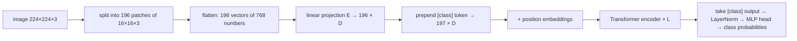

# An Image is Worth 16x16 Words: Transformers for Image Recognition at Scale (2020)

**Alexey Dosovitskiy, Lucas Beyer, Alexander Kolesnikov, Dirk Weissenborn, Xiaohua Zhai, Thomas Unterthiner, Mostafa Dehghani, Matthias Minderer, Georg Heigold, Sylvain Gelly, Jakob Uszkoreit, Neil Houlsby** (Google Research, Brain Team) — ICLR 2021 · [arXiv:2010.11929](https://arxiv.org/abs/2010.11929)

> **In one sentence:** cut an image into 16×16-pixel patches, treat each patch like a word, and feed the sequence to a completely standard Transformer encoder — with enough pre-training data this "Vision Transformer" (ViT) matches or beats the best convolutional networks while needing substantially less compute to train.

---

## Contents

1. [TL;DR](#1-tldr)
2. [The problem: why not just apply attention to pixels?](#2-the-problem-why-not-just-apply-attention-to-pixels)
3. [The big idea in plain words](#3-the-big-idea-in-plain-words)
4. [From image to sequence: patch embeddings](#4-from-image-to-sequence-patch-embeddings)
5. [The class token and position embeddings](#5-the-class-token-and-position-embeddings)
6. [The encoder](#6-the-encoder)
7. [Inductive bias: what ViT does *not* know](#7-inductive-bias-what-vit-does-not-know)
8. [Hybrid architecture and higher-resolution fine-tuning](#8-hybrid-architecture-and-higher-resolution-fine-tuning)
9. [Training setup](#9-training-setup)
10. [Results](#10-results)
11. [Data, compute and scaling](#11-data-compute-and-scaling)
12. [Looking inside ViT](#12-looking-inside-vit)
13. [Limitations and legacy](#13-limitations-and-legacy)
14. [Equation cheat sheet](#14-equation-cheat-sheet)
15. [Check your understanding](#15-check-your-understanding)

ViT reuses the Transformer encoder ([`../01-attention-is-all-you-need/`](../01-attention-is-all-you-need/)) and BERT's `[class]`-token idea ([`../02-bert/`](../02-bert/)). To test yourself, see the [exam questions with answers](exam-questions.md).

---

## 1. TL;DR

* **Image → sequence:** split a $`224\times224`$ image into $`14\times14 = 196`$ patches of $`16\times16`$ pixels, flatten each patch and project it linearly to a $`D`$-dimensional vector — a "visual word".
* **Prepend a learnable `[class]` token** (as in BERT), add learnable **1D position embeddings**, and run a **standard Transformer encoder**. Classify from the final `[class]` vector.
* **Almost no image-specific design:** apart from cutting the image into patches (and resizing position embeddings when the resolution changes), the model knows nothing about 2D structure.
* **Data is everything:** trained on ImageNet alone (1.3 M images), ViT is slightly *worse* than comparable ResNets. Pre-trained on 14 M (ImageNet-21k) or 300 M images (JFT-300M), it **beats** the best CNNs — "large-scale training trumps inductive bias".
* **Best result:** ViT-H/14 pre-trained on JFT-300M reaches **88.55 %** top-1 on ImageNet, matching or beating previous state of the art while using roughly 4× less pre-training compute.

---

## 2. The problem: why not just apply attention to pixels?

By 2020 Transformers dominated NLP, but computer vision still ran on **convolutional neural networks** (ResNets and relatives). Earlier attempts to bring self-attention to images either combined it with convolutions or replaced convolutions with specialised attention patterns (local windows, sparse or axial attention). Those patterns work in theory but need complex engineering to run efficiently on hardware accelerators.

The obvious alternative — treat every pixel as a token — is hopeless because attention compares **every pair** of tokens:

```math
224 \times 224 = 50\,176 \text{ pixels} \quad\Longrightarrow\quad 50\,176^2 \approx 2.5 \times 10^{9} \text{ attention scores per head per layer.}
```

**The question:** can we apply a *standard*, unmodified Transformer directly to images, and use the scalability that made it so successful in NLP?

---

## 3. The big idea in plain words

Make the tokens bigger. Instead of individual pixels, use **patches**: square tiles of $`16\times16`$ pixels. A $`224\times224`$ image becomes a sequence of only **196 tokens**, and the number of attention scores drops to $`196^2 = 38\,416`$ — about 65 000 times fewer.

Each patch plays the role of a word in a sentence. The title's joke: *an image is worth 16×16 words*. From there on, the model is just the Transformer encoder used in BERT; the authors deliberately kept it as close to the original as possible so that efficient, scalable NLP implementations can be used **out of the box**.



---

## 4. From image to sequence: patch embeddings

### 4.1 Cutting the image

An image $`x \in \mathbb R^{H\times W\times C}`$ (height, width, colour channels) is reshaped into a sequence of flattened patches

```math
x_p \in \mathbb R^{N \times (P^2 \cdot C)}, \qquad N = \frac{HW}{P^2},
```

where $`P`$ is the patch size. For the standard setting $`H = W = 224`$, $`C = 3`$, $`P = 16`$:

```math
N = \frac{224 \cdot 224}{16^2} = 14 \cdot 14 = 196 \text{ patches}, \qquad P^2 C = 16\cdot16\cdot3 = 768 \text{ numbers per patch.}
```

**A toy version.** A $`4\times4`$ grey-scale image with $`P = 2`$ becomes $`N = 4`$ patches of $`4`$ numbers each:

```math
\begin{bmatrix} 1 & 2 & 3 & 4 \\ 5 & 6 & 7 & 8 \\ 9 & 10 & 11 & 12 \\ 13 & 14 & 15 & 16 \end{bmatrix}
\;\longrightarrow\;
x_p = \begin{bmatrix} 1 & 2 & 5 & 6 \\ 3 & 4 & 7 & 8 \\ 9 & 10 & 13 & 14 \\ 11 & 12 & 15 & 16 \end{bmatrix}
\quad\text{(one row per patch, read left-to-right, top-to-bottom).}
```

### 4.2 Projecting to the model width

Each flattened patch is mapped to the Transformer width $`D`$ with one learned matrix $`\mathbf E \in \mathbb R^{(P^2 C)\times D}`$:

```math
\text{patch embedding}_i = x_p^i\,\mathbf E
```

This plays the same role as the word-embedding lookup in NLP — except that the "vocabulary" is continuous, so a linear map replaces the table.

**Equivalent view: a convolution.** Multiplying every non-overlapping $`16\times16`$ tile by the same matrix is exactly a convolution with kernel size 16, stride 16 and $`D`$ output channels. So the very first layer of ViT is a (single, large-stride) convolution; everything after it is pure Transformer.

**Why the patch size matters.** The sequence length is inversely proportional to the *square* of the patch size: halving $`P`$ quadruples $`N`$. Attention cost grows with $`N^2`$, so smaller patches are much more expensive but see finer detail:

| Patch size $`P`$ | Tokens at 224×224 | Pairwise attention scores |
|:-:|:-:|:-:|
| 32 | $`7^2 = 49`$ | 2 401 |
| 16 | $`14^2 = 196`$ | 38 416 |
| 14 | $`16^2 = 256`$ | 65 536 |

The naming convention encodes this: **ViT-L/16** is the Large model with $`16\times16`$ patches.

---

## 5. The class token and position embeddings

### 5.1 The `[class]` token

Borrowing from BERT's `[CLS]`, a learnable vector $`x_{\text{class}}`$ is put in front of the patch embeddings. It corresponds to no image region. Through self-attention it gathers information from all patches, and its final state is used as the representation of the whole image. (The appendix shows that averaging all patch outputs works about as well, given a suitably tuned learning rate; the `[class]` token was kept to stay close to the original Transformer.)

### 5.2 Position embeddings

Self-attention treats its input as an unordered set: shuffle the patches and the outputs are shuffled the same way. To tell the model *where* each patch is, a learnable vector is added per position:

```math
\mathbf E_{\text{pos}} \in \mathbb R^{(N+1)\times D}
```

ViT uses simple **1D** position embeddings — positions $`0, 1, \dots, N`$ in reading order — even though the image is 2D. The authors also tried 2D-aware embeddings (separate row and column embeddings) and relative position embeddings: the differences were small, but having *no* position information at all was clearly worse. Section 12 shows that the 1D embeddings *learn* the 2D layout by themselves.

### 5.3 Putting the input together

```math
z_0 = \left[\, x_{\text{class}};\ x_p^1\mathbf E;\ x_p^2\mathbf E;\ \dots;\ x_p^N\mathbf E \,\right] + \mathbf E_{\text{pos}} \qquad z_0 \in \mathbb R^{(N+1)\times D}
```

For ViT-Base at 224×224: $`197`$ tokens of width $`768`$.

---

## 6. The encoder

### 6.1 The equations

The encoder is $`L`$ identical layers, each with multi-head self-attention (MSA) and an MLP, written in the paper as:

```math
\begin{aligned}
z'_\ell &= \operatorname{MSA}\big(\operatorname{LN}(z_{\ell-1})\big) + z_{\ell-1}, && \ell = 1,\dots,L \\
z_\ell &= \operatorname{MLP}\big(\operatorname{LN}(z'_\ell)\big) + z'_\ell, && \ell = 1,\dots,L \\
y &= \operatorname{LN}\big(z_L^0\big)
\end{aligned}
```

Read line by line:

1. normalise the tokens, let them exchange information through multi-head self-attention, add the result back (residual connection);
2. normalise again, process each token with a two-layer MLP (GELU non-linearity), add back;
3. after the last layer, take token 0 — the `[class]` token — and normalise it: $`y`$ is the image representation.

MSA is exactly the multi-head attention of the original Transformer, $`\operatorname{softmax}(QK^\top/\sqrt{d_k})V`$ per head (no mask: every patch sees every patch).

### 6.2 Pre-norm vs post-norm

Notice where the LayerNorm sits. The original Transformer and BERT normalise *after* adding the residual, $`\operatorname{LN}(x + \operatorname{Sublayer}(x))`$ ("post-norm"). ViT normalises *before* the sub-layer, $`x + \operatorname{Sublayer}(\operatorname{LN}(x))`$ ("pre-norm"). With pre-norm the residual path from input to output is a clean sum, untouched by any normalisation, which makes deep stacks easier to optimise.

### 6.3 Classification head

A head on top of $`y`$ produces class scores: an MLP with one hidden layer during pre-training, and a single linear layer during fine-tuning. For fine-tuning, the pre-trained head is removed and a **zero-initialised** $`D \times K`$ layer is attached for the $`K`$ downstream classes.

### 6.4 Model variants

The configurations follow BERT:

| Model | Layers $`L`$ | Hidden size $`D`$ | MLP size | Heads | Parameters |
|:--|:-:|:-:|:-:|:-:|:-:|
| ViT-Base | 12 | 768 | 3072 | 12 | 86 M |
| ViT-Large | 24 | 1024 | 4096 | 16 | 307 M |
| ViT-Huge | 32 | 1280 | 5120 | 16 | 632 M |

---

## 7. Inductive bias: what ViT does *not* know

An **inductive bias** is an assumption built into a model before it sees any data. CNNs have strong ones about images:

| Assumption | CNN | ViT |
|:--|:--|:--|
| **Locality** — nearby pixels belong together | every layer looks at small neighbourhoods | only the patchification; attention is global from layer 1 |
| **2D neighbourhood structure** | built into every convolution | used only when cutting patches and when resizing position embeddings |
| **Translation equivariance** — a cat shifted right gives the same features, shifted right | every layer | only the per-patch MLP and patch projection; position embeddings start random and know nothing about 2D distances |

In other words, ViT must **learn from data** that neighbouring patches are related and that an object means the same thing wherever it appears. Two consequences, both confirmed by the experiments:

* with **little data**, the missing assumptions hurt — CNNs generalise better;
* with **lots of data**, the assumptions become unnecessary, and the more flexible model wins because it is not restricted by them.

A useful mental model: inductive biases are like training wheels — great when you are learning with few examples, a limitation once you have plenty.

---

## 8. Hybrid architecture and higher-resolution fine-tuning

### 8.1 Hybrid: CNN features as patches

Instead of raw pixel patches, the input sequence can be formed from the feature map of a CNN (a ResNet): each spatial position of the feature map ("patches" of size $`1\times1`$) is projected to $`D`$. This re-introduces some convolutional inductive bias. Hybrids are slightly better than pure ViT at small compute budgets, but the difference vanishes for larger models.

### 8.2 Fine-tuning at higher resolution

It often helps to fine-tune at a higher resolution than used for pre-training (e.g. 384 instead of 224). ViT keeps the **patch size** fixed, so the image simply produces more patches:

```math
\frac{384}{16} = 24 \quad\Longrightarrow\quad N = 24^2 = 576 \text{ patches instead of } 196.
```

The Transformer itself handles any sequence length, but the pre-trained position embeddings exist only for the $`14\times14`$ grid. The fix: **2D interpolation** — view the 196 position embeddings as a $`14\times14`$ image of vectors and resize it to $`24\times24`$. Together with patch extraction, this is the only point where knowledge about the 2D structure of images is manually put into the model.

---

## 9. Training setup

### 9.1 Datasets

| Dataset | Images | Classes | Role |
|:--|--:|--:|:--|
| ImageNet (ILSVRC-2012, "ImageNet-1k") | 1.3 M | 1 000 | pre-training (small) and benchmark |
| ImageNet-21k | 14 M | 21 000 | pre-training (medium) |
| JFT-300M (Google internal) | 303 M | 18 000 | pre-training (large) |

Pre-training datasets are de-duplicated against the test sets of the downstream tasks. Downstream: ImageNet (original and "ReaL" re-labelled validation set), CIFAR-10/100, Oxford-IIIT Pets, Oxford Flowers-102, and the **VTAB** suite of 19 tasks with only 1 000 training examples each (natural images, specialised images such as medical/satellite, and structured tasks such as counting and localisation).

### 9.2 Optimisation

* **Pre-training:** Adam ($`\beta_1 = 0.9`$, $`\beta_2 = 0.999`$), batch size 4096, high weight decay 0.1, linear learning-rate warm-up and decay, resolution 224. (Adam worked slightly better than SGD for ResNets in this setting too.)
* **Fine-tuning:** SGD with momentum 0.9, batch size 512, usually at a higher resolution than pre-training (384 by default; 512 for ViT-L/16 and 518 for ViT-H/14 in the headline results of §10).
* **Baselines:** "Big Transfer" (BiT) ResNets, trained on the same datasets, and Noisy Student (EfficientNet-L2, semi-supervised on ImageNet + 300 M unlabelled images), the state of the art at the time.

---

## 10. Results

### 10.1 Comparison with the state of the art

Top-1 accuracy (%) after fine-tuning; TPUv3-core-days of pre-training compute:

| | ViT-H/14 (JFT) | ViT-L/16 (JFT) | ViT-L/16 (I21k) | BiT-L (ResNet152x4, JFT) | Noisy Student (EfficientNet-L2) |
|:--|--:|--:|--:|--:|--:|
| ImageNet | **88.55** | 87.76 | 85.30 | 87.54 | 88.4 / 88.5\* |
| ImageNet ReaL | **90.72** | 90.54 | 88.62 | 90.54 | 90.55 |
| CIFAR-10 | **99.50** | 99.42 | 99.15 | 99.37 | — |
| CIFAR-100 | **94.55** | 93.90 | 93.25 | 93.51 | — |
| Oxford-IIIT Pets | **97.56** | 97.32 | 94.67 | 96.62 | — |
| Oxford Flowers-102 | 99.68 | **99.74** | 99.61 | 99.63 | — |
| VTAB (19 tasks) | **77.63** | 76.28 | 72.72 | 76.29 | — |
| **Pre-training compute** | 2.5 k | 0.68 k | 0.23 k | 9.9 k | 12.3 k |

\* 88.5 reported in later work.

* ViT-H/14 matches or beats the CNN state of the art on every benchmark with **about 4× less** pre-training compute than BiT-L.
* ViT-L/16 on JFT beats BiT-L on all tasks with **about 15× less** compute.
* ViT-L/16 pre-trained on the **public** ImageNet-21k still performs well and could be trained on a standard cloud TPUv3 with 8 cores in about 30 days.

### 10.2 VTAB breakdown

On the VTAB groups, ViT-H/14 beats BiT-R152x4 and other methods on *Natural* and *Structured* tasks and is on par on *Specialized* — showing the learned representations transfer well even with only 1 000 examples per task.

---

## 11. Data, compute and scaling

This is the heart of the paper: **when** does a model without vision-specific biases win?

### 11.1 Pre-training dataset size

Fine-tuned on ImageNet after pre-training on increasingly large datasets:

* **ImageNet-1k (1.3 M):** ViT-Large is *worse* than ViT-Base despite heavy regularisation (weight decay, dropout, label smoothing), and both are below BiT ResNets.
* **ImageNet-21k (14 M):** ViT models are roughly on par with ResNets.
* **JFT-300M:** the larger ViTs pull ahead, and bigger is clearly better.

A cleaner experiment trains on random subsets of JFT (9 M, 30 M, 90 M, 300 M images), without extra regularisation, and measures few-shot linear accuracy. ResNets win on the 9 M subset, ViT wins from about 90 M upward. The convolutional bias is useful for small data; for large data, learning the relevant patterns directly is sufficient — even beneficial.

### 11.2 Performance per unit of compute

Comparing many models by transfer accuracy versus pre-training compute (on JFT):

1. **ViT dominates ResNets on the performance/compute trade-off**: it needs roughly **2–4× less compute** to reach the same accuracy (averaged over five datasets).
2. **Hybrids** beat pure ViT slightly at small compute budgets, but the gap disappears for larger models.
3. **ViT does not seem to saturate** within the range tried — a strong motivation to scale further.

---

## 12. Looking inside ViT

### 12.1 Patch-embedding filters

The principal components of the learned projection $`\mathbf E`$ resemble plausible basis functions for describing the fine structure inside a patch — edges, colour blobs, gradients — similar to the first-layer filters of a CNN.

### 12.2 Position embeddings learn the 2D layout

Comparing the learned position embeddings by cosine similarity reveals that, without being told anything about 2D:

* nearby patches get **similar** position embeddings (distance is encoded);
* there is a clear **row-and-column structure**: patches in the same row or column have similar embeddings;
* for larger grids a **sinusoidal** pattern sometimes appears — reminiscent of the original Transformer's hand-designed encodings.

This explains why hand-crafted 2D position embeddings brought no improvement.

### 12.3 Attention distance: a "receptive field" for Transformers

For each attention head, the authors compute the **mean attention distance**: the average image distance between a query patch and the patches it attends to, weighted by the attention weights. It is the analogue of a CNN's receptive field size.

* Some heads attend to **most of the image already in the lowest layers** — something a CNN cannot do, since its receptive field grows only gradually with depth. The model *uses* its ability to integrate global information early.
* Other low-layer heads stay **local**, behaving like convolutions. Such localised heads are less pronounced in hybrid models (where a CNN already provides local features), suggesting they do a similar job to early convolutional layers.
* With depth, attention distance increases for all heads.
* Attention maps (computed with "attention rollout") show the model attends to the image regions that are **semantically relevant** for classification.

### 12.4 A first look at self-supervision

Imitating BERT's masked language modelling, the authors tried **masked patch prediction**: corrupt 50 % of the patch embeddings and predict (a coarse version of) the mean colour of each corrupted patch. ViT-B/16 pre-trained this way reaches **79.9 %** on ImageNet — about 2 % better than training from scratch, but still about 4 % behind supervised pre-training. They leave contrastive pre-training to future work.

---

## 13. Limitations and legacy

**Limitations noted by the paper or apparent from it:**

* **Data hunger:** without huge pre-training datasets ViT underperforms CNNs; the best results rely on the private JFT-300M.
* **Quadratic cost** in the number of patches limits resolution and patch size; dense tasks (detection, segmentation) were left for future work.
* **Self-supervised pre-training** was only explored briefly and lagged behind supervised pre-training.

**Legacy.** ViT showed that a general-purpose architecture plus scale can replace hand-designed visual priors, and it unified vision and language around one architecture. Notable follow-ups:

* **DeiT** — training recipes and distillation that make ViT competitive when trained on ImageNet-1k alone;
* **Swin Transformer** and similar hierarchical models that re-introduce locality (windowed attention) for dense prediction;
* **MAE** and **BEiT** — BERT-style masked image modelling that made self-supervised ViT pre-training highly effective;
* **CLIP** and most later vision-language models, which use ViT image encoders.

---

## 14. Equation cheat sheet

| Concept | Equation |
|:--|:--|
| Number of patches | $`N = HW/P^2`$ (e.g. 224, 16 → 196) |
| Patch vector length | $`P^2 \cdot C`$ (e.g. 16, 3 → 768) |
| Input sequence | $`z_0 = [x_{\text{class}};\, x_p^1\mathbf E;\, \dots;\, x_p^N\mathbf E] + \mathbf E_{\text{pos}}`$ |
| Attention block (pre-norm) | $`z'_\ell = \operatorname{MSA}(\operatorname{LN}(z_{\ell-1})) + z_{\ell-1}`$ |
| MLP block (pre-norm) | $`z_\ell = \operatorname{MLP}(\operatorname{LN}(z'_\ell)) + z'_\ell`$ |
| Image representation | $`y = \operatorname{LN}(z_L^0)`$ |
| Attention per head | $`\operatorname{softmax}(QK^\top/\sqrt{d_k})\,V`$ |
| Higher resolution | keep $`P`$, more patches, 2D-interpolate $`\mathbf E_{\text{pos}}`$ |

---

## 15. Check your understanding

1. How many patches does a $`384\times384`$ RGB image produce with $`P = 32`$? How many numbers are in each flattened patch?
2. Show that the patch projection is equivalent to a convolution. What are its kernel size, stride and number of output channels for ViT-B/16?
3. Why is pixel-level self-attention impractical, and by what factor does using 16×16 patches reduce the number of attention scores at 224×224?
4. Name the three inductive biases of CNNs discussed in the paper. Which of them does ViT have, and where?
5. Why does ViT-Large perform *worse* than ViT-Base when pre-trained only on ImageNet-1k, but better on JFT-300M?
6. When fine-tuning at a higher resolution, why must the position embeddings be interpolated, and why in 2D rather than 1D?
7. Write the two equations of a ViT encoder layer and explain how they differ from the original Transformer's post-norm layer.
8. What does "mean attention distance" measure, and what did it reveal about the lowest layers of ViT compared with CNNs?
