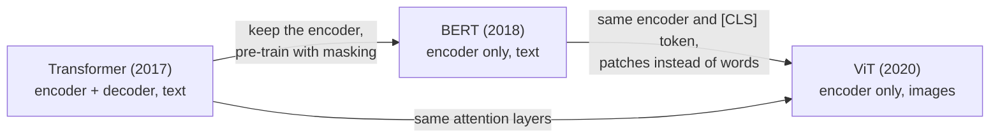

# Paper summaries

Detailed, intuition-first summaries of three foundational papers. Each one explains the maths the paper uses step by step, with small worked examples, and ends with an equation cheat sheet and self-test questions. Each folder also has an `exam-questions.md`: exam-style questions with answers and short explanations, collapsed so you can try them first.

| # | Paper | Year | One-line idea | Exam questions |
|:-:|:--|:-:|:--|:--|
| 1 | [**Attention Is All You Need**](01-attention-is-all-you-need/) (Vaswani et al.) | 2017 | Replace recurrence with attention: an encoder–decoder built from multi-head self-attention, feed-forward layers and positional encodings | [64 Q&A](01-attention-is-all-you-need/exam-questions.md) |
| 2 | [**BERT**](02-bert/) (Devlin et al.) | 2018 | Pre-train a Transformer *encoder* bidirectionally with masked language modelling and next sentence prediction, then fine-tune it for any task | [64 Q&A](02-bert/exam-questions.md) |
| 3 | [**An Image is Worth 16x16 Words (ViT)**](03-vit/) (Dosovitskiy et al.) | 2020 | Cut an image into patches, treat them as tokens, and use a standard Transformer encoder; with enough data it beats CNNs | [58 Q&A](03-vit/exam-questions.md) |

## How the three papers connect

Suggested reading order: 1 → 2 → 3. To see every computation with real numbers, pair them with the pen-and-paper examples:

* [`../transformer-pen-and-paper/`](../transformer-pen-and-paper/): every step of an encoder–decoder Transformer;
* [`../bert-pen-and-paper/`](../bert-pen-and-paper/): BERT's MLM and NSP tasks.
