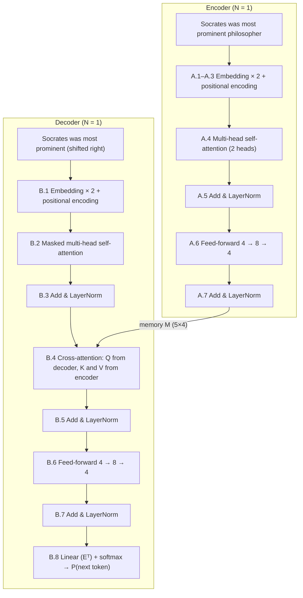

# A Pen-and-Paper Transformer

*A complete numerical walk-through of the encoder–decoder Transformer of Vaswani et al., “Attention Is All You Need” (2017), with a vocabulary of only five tokens and the sentence* **“Socrates was most prominent philosopher”.**

> Every number in this document is produced by [`transformer_pen_and_paper.py`](transformer_pen_and_paper.py). Each intermediate result is rounded to **4 decimals** and the rounded value is what the next step uses, so you can reproduce every entry with a calculator. (Run `python3 transformer_pen_and_paper.py --check` to see that rounding changes the final probabilities only in the 4th decimal.)

## Contents

0. [Setup](#0-setup)
1. **Encoder** — [A.1 Embeddings](#a1-token-embeddings) · [A.2 Positional encoding](#a2-positional-encoding) · [A.3 Encoder input](#a3-encoder-input-x--embedding--positional-encoding) · [A.4 Multi-head self-attention](#a4-multi-head-self-attention) · [A.5 Add & Norm](#a5-add--norm-1) · [A.6 Feed-forward](#a6-position-wise-feed-forward-network) · [A.7 Add & Norm → encoder output](#a7-add--norm-2--encoder-output-m)
2. **Decoder** — [B.1 Decoder input](#b1-decoder-input-shifted-right-embeddings-and-positions) · [B.2 Masked self-attention](#b2-masked-multi-head-self-attention) · [B.3 Add & Norm](#b3-add--norm-1) · [B.4 Cross-attention](#b4-encoderdecoder-cross-attention) · [B.5 Add & Norm](#b5-add--norm-2) · [B.6 Feed-forward](#b6-position-wise-feed-forward-network) · [B.7 Add & Norm](#b7-add--norm-3--decoder-output) · [B.8 Linear + softmax](#b8-final-linear-layer-and-softmax) · [B.9 Loss](#b9-training-loss-cross-entropy) · [B.10 Inference](#b10-inference-autoregressive-generation)
3. [Summary of shapes](#summary-of-shapes) · [Exercises](#exercises)

## 0. Setup

### 0.1 Vocabulary

Word-level tokenisation, $`|V| = 5`$:

| Token id | 0 | 1 | 2 | 3 | 4 |
|:--|:-:|:-:|:-:|:-:|:-:|
| **Token** | Socrates | was | most | prominent | philosopher |

### 0.2 Hyperparameters

| Symbol | Meaning | Paper (base model) | This example |
|:--|:--|--:|--:|
| $`d_{\text{model}}`$ | width of every token vector | 512 | **4** |
| $`h`$ | number of attention heads | 8 | **2** |
| $`d_k = d_v = d_{\text{model}}/h`$ | width of one head | 64 | **2** |
| $`d_{ff}`$ | hidden width of the feed-forward network | 2048 | **8** |
| $`N`$ | layers in encoder and in decoder | 6 | **1** |
| $`\lvert V\rvert`$ | vocabulary size | 37 000 | **5** |

Further simplifications (none of them changes the mechanics): no dropout; the Q/K/V/O projections have no bias; LayerNorm uses $`\gamma = 1, \beta = 0`$ and $`\epsilon \approx 0`$. As in the paper (§3.4) one embedding matrix $`E`$ is shared by the encoder input, the decoder input and the final pre-softmax linear layer. All weights are made-up “untrained” values with one decimal so that multiplications stay easy.

### 0.3 The task

A Transformer is a sequence-to-sequence model: the **encoder** reads a source sentence and the **decoder** generates a target sentence one token at a time. With only five tokens there is no room for special tokens (`<bos>`, `<eos>`, `<pad>`), so we use a toy task: the encoder reads the whole sentence and the decoder learns to (re)generate it. During training the decoder sees the target *shifted right by one* (teacher forcing) and must predict the next token at every position; the first word “Socrates” plays the role of the start token.

| | pos 0 | pos 1 | pos 2 | pos 3 | pos 4 |
|:--|:-:|:-:|:-:|:-:|:-:|
| **Encoder input** | Socrates | was | most | prominent | philosopher |
| **Decoder input** | Socrates | was | most | prominent | — |
| **Decoder target** | was | most | prominent | philosopher | — |

In a real system (e.g. translation) the decoder input would be `<bos> Socrates … philosopher` and the target `Socrates … philosopher <eos>`; every computation below stays exactly the same.

### 0.4 Conventions

* **Row vectors.** Each token is a row; a sentence of $`n`$ tokens is an $`n \times d`$ matrix, and a linear layer is $`XW`$ (as in the paper's formulas).
* Positions, dimensions and token ids are counted from 0; heads from 1.
* $`\operatorname{softmax}(z)_j = e^{z_j} / \sum_k e^{z_k}`$, applied to each row separately.
* Weight-matrix tables: rows = input dimension (“in 0…3”), columns = output dimension.

### 0.5 Architecture at a glance



Every “Add & LayerNorm” adds the sub-layer's input back to its output (a residual connection) before normalising.

### 0.6 Shared embedding matrix $`E`$ (5×4)

| | dim 0 | dim 1 | dim 2 | dim 3 |
|:--|--:|--:|--:|--:|
| **0: Socrates** | 0.9 | -0.9 | 0.2 | 0.0 |
| **1: was** | -0.6 | 0.0 | 0.3 | -0.5 |
| **2: most** | 0.2 | -0.8 | 0.9 | -1.0 |
| **3: prominent** | -0.2 | -0.2 | -0.9 | -0.3 |
| **4: philosopher** | 0.3 | -1.0 | -1.0 | -0.5 |

---

# Part A — Encoder

### A.1 Token embeddings

Each token id selects one row of the shared embedding matrix $`E`$ (equivalently: one-hot vector × $`E`$). For **Socrates** (id 0):

```math
e_{\text{Socrates}} = \underbrace{\begin{bmatrix}1 & 0 & 0 & 0 & 0\end{bmatrix}}_{\text{one-hot}}\, E = \begin{bmatrix}0.9 & -0.9 & 0.2 & 0.0\end{bmatrix}\quad(\text{row 0 of } E)
```

The paper multiplies embeddings by $`\sqrt{d_{\text{model}}} = \sqrt 4 = 2`$ so that they are not drowned out by the positional encodings. Scaled embeddings $`\times 2`$:

| | dim 0 | dim 1 | dim 2 | dim 3 |
|:--|--:|--:|--:|--:|
| **Socrates** | 1.8000 | -1.8000 | 0.4000 | 0.0000 |
| **was** | -1.2000 | 0.0000 | 0.6000 | -1.0000 |
| **most** | 0.4000 | -1.6000 | 1.8000 | -2.0000 |
| **prominent** | -0.4000 | -0.4000 | -1.8000 | -0.6000 |
| **philosopher** | 0.6000 | -2.0000 | -2.0000 | -1.0000 |

### A.2 Positional encoding

Self-attention treats its input as a *set*, so word order must be injected explicitly. The paper adds a fixed sinusoidal vector to each position:

```math
PE_{(pos,\,2i)} = \sin\!\left(\frac{pos}{10000^{2i/d_{\text{model}}}}\right),\qquad PE_{(pos,\,2i+1)} = \cos\!\left(\frac{pos}{10000^{2i/d_{\text{model}}}}\right)
```

With $`d_{\text{model}} = 4`$ there are two frequency pairs:

```math
\begin{aligned}i = 0 &: \; 10000^{0/4} = 1 &&\Rightarrow (\text{dim }0, \text{dim }1) = (\sin(pos),\; \cos(pos)) \\
i = 1 &: \; 10000^{2/4} = 100 &&\Rightarrow (\text{dim }2, \text{dim }3) = \left(\sin\tfrac{pos}{100},\; \cos\tfrac{pos}{100}\right)\end{aligned}
```

Angles are in **radians**. Dimensions 0–1 oscillate quickly (period $`2\pi`$ ≈ 6.3 positions), dimensions 2–3 very slowly (period ≈ 628 positions).

| pos | token | angle $`pos/1`$ | angle $`pos/100`$ |
|:-:|:--|--:|--:|
| 0 | Socrates | 0.00 | 0.00 |
| 1 | was | 1.00 | 0.01 |
| 2 | most | 2.00 | 0.02 |
| 3 | prominent | 3.00 | 0.03 |
| 4 | philosopher | 4.00 | 0.04 |

Worked example, **pos 2 (“most”)**:

```math
PE_2 = \left[\sin 2,\; \cos 2,\; \sin 0.02,\; \cos 0.02\right] = \begin{bmatrix}0.9093 & -0.4161 & 0.0200 & 0.9998\end{bmatrix}
```

**Positional encodings**

| | dim 0 | dim 1 | dim 2 | dim 3 |
|:--|--:|--:|--:|--:|
| **pos 0** | 0.0000 | 1.0000 | 0.0000 | 1.0000 |
| **pos 1** | 0.8415 | 0.5403 | 0.0100 | 1.0000 |
| **pos 2** | 0.9093 | -0.4161 | 0.0200 | 0.9998 |
| **pos 3** | 0.1411 | -0.9900 | 0.0300 | 0.9996 |
| **pos 4** | -0.7568 | -0.6536 | 0.0400 | 0.9992 |

Because $`\sin(a+b)`$ and $`\cos(a+b)`$ are linear combinations of $`\sin a`$ and $`\cos a`$, the encoding of position $`pos + k`$ is a fixed linear function (a rotation) of the encoding of $`pos`$; this makes relative positions easy for attention to pick up.

### A.3 Encoder input $`X`$ = embedding + positional encoding

```math
X = \sqrt{d_{\text{model}}}\; E[\text{tokens}] + PE
```

Worked row **most**: $`\begin{bmatrix}0.4000 & -1.6000 & 1.8000 & -2.0000\end{bmatrix} + \begin{bmatrix}0.9093 & -0.4161 & 0.0200 & 0.9998\end{bmatrix} = \begin{bmatrix}1.3093 & -2.0161 & 1.8200 & -1.0002\end{bmatrix}`$

**X** (5×4) — the input to the encoder layer:

| | dim 0 | dim 1 | dim 2 | dim 3 |
|:--|--:|--:|--:|--:|
| **Socrates** | 1.8000 | -0.8000 | 0.4000 | 1.0000 |
| **was** | -0.3585 | 0.5403 | 0.6100 | 0.0000 |
| **most** | 1.3093 | -2.0161 | 1.8200 | -1.0002 |
| **prominent** | -0.2589 | -1.3900 | -1.7700 | 0.3996 |
| **philosopher** | -0.1568 | -2.6536 | -1.9600 | -0.0008 |

### A.4 Multi-head self-attention

In **self**-attention queries, keys and values all come from the same sequence $`X`$: every token asks (query) “which other tokens are relevant to me?”, compares itself against every token's key, and gathers a weighted mix of their values.

```math
\operatorname{Attention}(Q, K, V) = \operatorname{softmax}\!\left(\frac{QK^{\top}}{\sqrt{d_k}}\right) V
```

#### A.4.1 Parameters

$`W^Q`$ (4×4)

| | dim 0 (head 1) | dim 1 (head 1) | dim 2 (head 2) | dim 3 (head 2) |
|:--|--:|--:|--:|--:|
| **in 0** | -0.8 | 0.6 | -0.8 | 0.2 |
| **in 1** | 0.7 | 1.0 | -0.8 | 0.8 |
| **in 2** | 1.0 | 0.3 | -0.3 | -0.7 |
| **in 3** | -0.9 | 0.7 | 0.6 | -0.2 |

$`W^K`$ (4×4)

| | dim 0 (head 1) | dim 1 (head 1) | dim 2 (head 2) | dim 3 (head 2) |
|:--|--:|--:|--:|--:|
| **in 0** | 0.0 | -1.0 | -0.2 | 0.9 |
| **in 1** | -0.1 | 0.9 | -0.2 | -0.4 |
| **in 2** | 0.5 | 0.0 | -0.3 | -0.5 |
| **in 3** | 0.3 | 0.5 | 0.5 | 1.0 |

$`W^V`$ (4×4)

| | dim 0 (head 1) | dim 1 (head 1) | dim 2 (head 2) | dim 3 (head 2) |
|:--|--:|--:|--:|--:|
| **in 0** | -0.5 | 0.2 | -1.0 | 0.2 |
| **in 1** | 0.0 | -0.6 | -0.7 | -0.5 |
| **in 2** | 1.0 | -0.2 | -0.1 | 0.1 |
| **in 3** | 1.0 | 0.5 | 0.1 | -1.0 |

$`W^O`$ (4×4)

| | dim 0 | dim 1 | dim 2 | dim 3 |
|:--|--:|--:|--:|--:|
| **in 0** | 0.0 | 0.1 | -0.8 | 1.0 |
| **in 1** | 0.3 | -0.6 | -1.0 | -0.2 |
| **in 2** | -0.9 | -1.0 | 0.4 | 0.6 |
| **in 3** | 0.6 | -0.7 | -1.0 | 0.3 |

#### A.4.2 Project to queries, keys and values

```math
Q = X\,W^Q,\qquad K = X\,W^K,\qquad V = X\,W^V
```

Shapes: $`Q`$ is 5×4, $`K`$ and $`V`$ are 5×4. Worked example: row **Socrates** of $`Q`$ and row **Socrates** of $`K`$ and $`V`$ (row of the input times each column of the weight matrix):

```math
\begin{aligned}
q_{\text{Socrates},0} &= 1.8000\cdot (-0.8) + (-0.8000)\cdot 0.7 + 0.4000\cdot 1.0 + 1.0000\cdot (-0.9) = -2.5000 \\
q_{\text{Socrates},1} &= 1.8000\cdot 0.6 + (-0.8000)\cdot 1.0 + 0.4000\cdot 0.3 + 1.0000\cdot 0.7 = 1.1000 \\
q_{\text{Socrates},2} &= 1.8000\cdot (-0.8) + (-0.8000)\cdot (-0.8) + 0.4000\cdot (-0.3) + 1.0000\cdot 0.6 = -0.3200 \\
q_{\text{Socrates},3} &= 1.8000\cdot 0.2 + (-0.8000)\cdot 0.8 + 0.4000\cdot (-0.7) + 1.0000\cdot (-0.2) = -0.7600 \\
k_{\text{Socrates},0} &= 1.8000\cdot 0.0 + (-0.8000)\cdot (-0.1) + 0.4000\cdot 0.5 + 1.0000\cdot 0.3 = 0.5800 \\
k_{\text{Socrates},1} &= 1.8000\cdot (-1.0) + (-0.8000)\cdot 0.9 + 0.4000\cdot 0.0 + 1.0000\cdot 0.5 = -2.0200 \\
k_{\text{Socrates},2} &= 1.8000\cdot (-0.2) + (-0.8000)\cdot (-0.2) + 0.4000\cdot (-0.3) + 1.0000\cdot 0.5 = 0.1800 \\
k_{\text{Socrates},3} &= 1.8000\cdot 0.9 + (-0.8000)\cdot (-0.4) + 0.4000\cdot (-0.5) + 1.0000\cdot 1.0 = 2.7400 \\
v_{\text{Socrates},0} &= 1.8000\cdot (-0.5) + (-0.8000)\cdot 0.0 + 0.4000\cdot 1.0 + 1.0000\cdot 1.0 = 0.5000 \\
v_{\text{Socrates},1} &= 1.8000\cdot 0.2 + (-0.8000)\cdot (-0.6) + 0.4000\cdot (-0.2) + 1.0000\cdot 0.5 = 1.2600 \\
v_{\text{Socrates},2} &= 1.8000\cdot (-1.0) + (-0.8000)\cdot (-0.7) + 0.4000\cdot (-0.1) + 1.0000\cdot 0.1 = -1.1800 \\
v_{\text{Socrates},3} &= 1.8000\cdot 0.2 + (-0.8000)\cdot (-0.5) + 0.4000\cdot 0.1 + 1.0000\cdot (-1.0) = -0.2000
\end{aligned}
```

**Q**

| | dim 0 (head 1) | dim 1 (head 1) | dim 2 (head 2) | dim 3 (head 2) |
|:--|--:|--:|--:|--:|
| **Socrates** | -2.5000 | 1.1000 | -0.3200 | -0.7600 |
| **was** | 1.2750 | 0.5082 | -0.3284 | -0.0665 |
| **most** | 0.2615 | -1.3847 | -0.5807 | -2.4250 |
| **prominent** | -2.8955 | -1.7966 | 2.0899 | -0.0047 |
| **philosopher** | -3.6914 | -3.3362 | 2.8358 | -0.7821 |

**K**

| | dim 0 (head 1) | dim 1 (head 1) | dim 2 (head 2) | dim 3 (head 2) |
|:--|--:|--:|--:|--:|
| **Socrates** | 0.5800 | -2.0200 | 0.1800 | 2.7400 |
| **was** | 0.2510 | 0.8448 | -0.2194 | -0.8438 |
| **most** | 0.8116 | -3.6239 | -0.9047 | 0.0746 |
| **prominent** | -0.6261 | -0.7923 | 1.0606 | 1.6076 |
| **philosopher** | -0.7149 | -2.2318 | 1.1497 | 1.8995 |

**V**

| | dim 0 (head 1) | dim 1 (head 1) | dim 2 (head 2) | dim 3 (head 2) |
|:--|--:|--:|--:|--:|
| **Socrates** | 0.5000 | 1.2600 | -1.1800 | -0.2000 |
| **was** | 0.7892 | -0.5179 | -0.0807 | -0.2808 |
| **most** | 0.1652 | 0.6074 | -0.1801 | 2.4521 |
| **prominent** | -1.2410 | 1.3360 | 1.4489 | 0.0666 |
| **philosopher** | -1.8824 | 1.9524 | 2.2102 | 1.1002 |

#### A.4.3 Split into 2 heads

Multi-head attention does not need separate weight matrices per head: head 1 simply uses columns 0–1 of $`Q, K, V`$ and head 2 uses columns 2–3 (i.e. $`W^Q_1`$ = columns 0–1 of $`W^Q`$, etc.). Each head works in a $`d_k = d_{\text{model}}/h = 2`$-dimensional subspace.

```math
\text{head}_i = \operatorname{softmax}\!\left(\frac{Q_i K_i^{\top}}{\sqrt{d_k}}\right) V_i,\qquad \sqrt{d_k} = \sqrt{2} \approx 1.4142
```

#### A.4.4 Head 1

**Inputs of head 1** — $`Q_1`$, $`K_1`$, $`V_1`$ (columns 0–1 of $`Q, K, V`$):

| | Q1[0] | Q1[1] | K1[0] | K1[1] | V1[0] | V1[1] |
|:--|--:|--:|--:|--:|--:|--:|
| **Socrates** | -2.5000 | 1.1000 | 0.5800 | -2.0200 | 0.5000 | 1.2600 |
| **was** | 1.2750 | 0.5082 | 0.2510 | 0.8448 | 0.7892 | -0.5179 |
| **most** | 0.2615 | -1.3847 | 0.8116 | -3.6239 | 0.1652 | 0.6074 |
| **prominent** | -2.8955 | -1.7966 | -0.6261 | -0.7923 | -1.2410 | 1.3360 |
| **philosopher** | -3.6914 | -3.3362 | -0.7149 | -2.2318 | -1.8824 | 1.9524 |

**Step 1 – raw scores** $`S_1 = Q_1 K_1^{\top}`$ (5×5). Entry $`(i, j)`$ is the dot product of query $`i`$ with key $`j`$. Worked row **Socrates**:

```math
\begin{aligned}
s_{\text{Socrates},\text{Socrates}} &= (-2.5000)\cdot 0.5800 + 1.1000\cdot (-2.0200) = -3.6720 \\
s_{\text{Socrates},\text{was}} &= (-2.5000)\cdot 0.2510 + 1.1000\cdot 0.8448 = 0.3018 \\
s_{\text{Socrates},\text{most}} &= (-2.5000)\cdot 0.8116 + 1.1000\cdot (-3.6239) = -6.0153 \\
s_{\text{Socrates},\text{prominent}} &= (-2.5000)\cdot (-0.6261) + 1.1000\cdot (-0.7923) = 0.6937 \\
s_{\text{Socrates},\text{philosopher}} &= (-2.5000)\cdot (-0.7149) + 1.1000\cdot (-2.2318) = -0.6677
\end{aligned}
```

| | Socrates | was | most | prominent | philosopher |
|:--|--:|--:|--:|--:|--:|
| **Socrates** | -3.6720 | 0.3018 | -6.0153 | 0.6937 | -0.6677 |
| **was** | -0.2871 | 0.7494 | -0.8069 | -1.2009 | -2.0457 |
| **most** | 2.9488 | -1.1042 | 5.2302 | 0.9334 | 2.9034 |
| **prominent** | 1.9497 | -2.2445 | 4.1607 | 3.2363 | 6.0796 |
| **philosopher** | 4.5981 | -3.7450 | 9.0941 | 4.9545 | 10.0847 |

**Step 2 – scale** by $`\sqrt{d_k} = 1.4142`$ (e.g. $`(-3.6720) / 1.4142 = -2.5965`$):

| | Socrates | was | most | prominent | philosopher |
|:--|--:|--:|--:|--:|--:|
| **Socrates** | -2.5965 | 0.2134 | -4.2535 | 0.4905 | -0.4721 |
| **was** | -0.2030 | 0.5299 | -0.5706 | -0.8492 | -1.4465 |
| **most** | 2.0851 | -0.7808 | 3.6983 | 0.6600 | 2.0530 |
| **prominent** | 1.3787 | -1.5871 | 2.9421 | 2.2884 | 4.2990 |
| **philosopher** | 3.2514 | -2.6481 | 6.4306 | 3.5034 | 7.1310 |

**Step 3 – softmax over each row.** Worked row **Socrates**:

```math
\begin{aligned}
&e^{-2.5965} = 0.0745,\quad e^{0.2134} = 1.2379,\quad e^{-4.2535} = 0.0142, \\
&e^{0.4905} = 1.6331,\quad e^{-0.4721} = 0.6237 \\
&\textstyle\sum = 0.0745 + 1.2379 + 0.0142 + 1.6331 + 0.6237 = 3.5834 \\
&a_{\text{Socrates},\cdot} = \frac{1}{3.5834}\begin{bmatrix}0.0745 & 1.2379 & 0.0142 & 1.6331 & 0.6237\end{bmatrix} = \begin{bmatrix}0.0208 & 0.3455 & 0.0040 & 0.4557 & 0.1741\end{bmatrix}
\end{aligned}
```

**Attention weights** $`A_1`$ (each row sums to 1, up to rounding; row = query, column = key):

| | Socrates | was | most | prominent | philosopher |
|:--|--:|--:|--:|--:|--:|
| **Socrates** | 0.0208 | 0.3455 | 0.0040 | 0.4557 | 0.1741 |
| **was** | 0.2181 | 0.4538 | 0.1510 | 0.1143 | 0.0629 |
| **most** | 0.1373 | 0.0078 | 0.6890 | 0.0330 | 0.1329 |
| **prominent** | 0.0372 | 0.0019 | 0.1778 | 0.0925 | 0.6906 |
| **philosopher** | 0.0134 | 0.0000 | 0.3216 | 0.0172 | 0.6478 |

Strongest link per query: Socrates → **prominent** (0.4557); was → **was** (0.4538); most → **most** (0.6890); prominent → **philosopher** (0.6906); philosopher → **philosopher** (0.6478).

**Step 4 – weighted sum of values** $`Z_1 = A_1 V_1`$ (5×2). Worked row **Socrates**:

```math
\begin{aligned}
z_{\text{Socrates},0} &= 0.0208\cdot 0.5000 + 0.3455\cdot 0.7892 + 0.0040\cdot 0.1652 + 0.4557\cdot (-1.2410) + 0.1741\cdot (-1.8824) = -0.6095 \\
z_{\text{Socrates},1} &= 0.0208\cdot 1.2600 + 0.3455\cdot (-0.5179) + 0.0040\cdot 0.6074 + 0.4557\cdot 1.3360 + 0.1741\cdot 1.9524 = 0.7984
\end{aligned}
```

| | dim 0 | dim 1 |
|:--|--:|--:|
| **Socrates** | -0.6095 | 0.7984 |
| **was** | 0.2319 | 0.4070 |
| **most** | -0.1025 | 0.8910 |
| **prominent** | -1.3653 | 1.6258 |
| **philosopher** | -1.1809 | 1.5000 |

#### A.4.5 Head 2

**Inputs of head 2** — $`Q_2`$, $`K_2`$, $`V_2`$ (columns 2–3 of $`Q, K, V`$):

| | Q2[0] | Q2[1] | K2[0] | K2[1] | V2[0] | V2[1] |
|:--|--:|--:|--:|--:|--:|--:|
| **Socrates** | -0.3200 | -0.7600 | 0.1800 | 2.7400 | -1.1800 | -0.2000 |
| **was** | -0.3284 | -0.0665 | -0.2194 | -0.8438 | -0.0807 | -0.2808 |
| **most** | -0.5807 | -2.4250 | -0.9047 | 0.0746 | -0.1801 | 2.4521 |
| **prominent** | 2.0899 | -0.0047 | 1.0606 | 1.6076 | 1.4489 | 0.0666 |
| **philosopher** | 2.8358 | -0.7821 | 1.1497 | 1.8995 | 2.2102 | 1.1002 |

**Step 1 – raw scores** $`S_2 = Q_2 K_2^{\top}`$ (5×5). Entry $`(i, j)`$ is the dot product of query $`i`$ with key $`j`$. Worked row **Socrates**:

```math
\begin{aligned}
s_{\text{Socrates},\text{Socrates}} &= (-0.3200)\cdot 0.1800 + (-0.7600)\cdot 2.7400 = -2.1400 \\
s_{\text{Socrates},\text{was}} &= (-0.3200)\cdot (-0.2194) + (-0.7600)\cdot (-0.8438) = 0.7115 \\
s_{\text{Socrates},\text{most}} &= (-0.3200)\cdot (-0.9047) + (-0.7600)\cdot 0.0746 = 0.2328 \\
s_{\text{Socrates},\text{prominent}} &= (-0.3200)\cdot 1.0606 + (-0.7600)\cdot 1.6076 = -1.5612 \\
s_{\text{Socrates},\text{philosopher}} &= (-0.3200)\cdot 1.1497 + (-0.7600)\cdot 1.8995 = -1.8115
\end{aligned}
```

| | Socrates | was | most | prominent | philosopher |
|:--|--:|--:|--:|--:|--:|
| **Socrates** | -2.1400 | 0.7115 | 0.2328 | -1.5612 | -1.8115 |
| **was** | -0.2413 | 0.1282 | 0.2921 | -0.4552 | -0.5039 |
| **most** | -6.7490 | 2.1736 | 0.3445 | -4.5143 | -5.2739 |
| **prominent** | 0.3633 | -0.4546 | -1.8911 | 2.2090 | 2.3938 |
| **philosopher** | -1.6325 | 0.0378 | -2.6239 | 1.7503 | 1.7747 |

**Step 2 – scale** by $`\sqrt{d_k} = 1.4142`$ (e.g. $`(-2.1400) / 1.4142 = -1.5132`$):

| | Socrates | was | most | prominent | philosopher |
|:--|--:|--:|--:|--:|--:|
| **Socrates** | -1.5132 | 0.5031 | 0.1646 | -1.1039 | -1.2809 |
| **was** | -0.1706 | 0.0907 | 0.2065 | -0.3219 | -0.3563 |
| **most** | -4.7723 | 1.5370 | 0.2436 | -3.1921 | -3.7292 |
| **prominent** | 0.2569 | -0.3215 | -1.3372 | 1.5620 | 1.6927 |
| **philosopher** | -1.1544 | 0.0267 | -1.8554 | 1.2377 | 1.2549 |

**Step 3 – softmax over each row.** Worked row **Socrates**:

```math
\begin{aligned}
&e^{-1.5132} = 0.2202,\quad e^{0.5031} = 1.6538,\quad e^{0.1646} = 1.1789, \\
&e^{-1.1039} = 0.3316,\quad e^{-1.2809} = 0.2778 \\
&\textstyle\sum = 0.2202 + 1.6538 + 1.1789 + 0.3316 + 0.2778 = 3.6623 \\
&a_{\text{Socrates},\cdot} = \frac{1}{3.6623}\begin{bmatrix}0.2202 & 1.6538 & 1.1789 & 0.3316 & 0.2778\end{bmatrix} = \begin{bmatrix}0.0601 & 0.4516 & 0.3219 & 0.0905 & 0.0759\end{bmatrix}
\end{aligned}
```

**Attention weights** $`A_2`$ (each row sums to 1, up to rounding; row = query, column = key):

| | Socrates | was | most | prominent | philosopher |
|:--|--:|--:|--:|--:|--:|
| **Socrates** | 0.0601 | 0.4516 | 0.3219 | 0.0905 | 0.0759 |
| **was** | 0.1836 | 0.2384 | 0.2677 | 0.1578 | 0.1525 |
| **most** | 0.0014 | 0.7751 | 0.2126 | 0.0068 | 0.0040 |
| **prominent** | 0.1036 | 0.0581 | 0.0210 | 0.3820 | 0.4353 |
| **philosopher** | 0.0373 | 0.1215 | 0.0185 | 0.4078 | 0.4149 |

Strongest link per query: Socrates → **was** (0.4516); was → **most** (0.2677); most → **was** (0.7751); prominent → **philosopher** (0.4353); philosopher → **philosopher** (0.4149).

**Step 4 – weighted sum of values** $`Z_2 = A_2 V_2`$ (5×2). Worked row **Socrates**:

```math
\begin{aligned}
z_{\text{Socrates},0} &= 0.0601\cdot (-1.1800) + 0.4516\cdot (-0.0807) + 0.3219\cdot (-0.1801) + 0.0905\cdot 1.4489 + 0.0759\cdot 2.2102 = 0.1335 \\
z_{\text{Socrates},1} &= 0.0601\cdot (-0.2000) + 0.4516\cdot (-0.2808) + 0.3219\cdot 2.4521 + 0.0905\cdot 0.0666 + 0.0759\cdot 1.1002 = 0.7400
\end{aligned}
```

| | dim 0 | dim 1 |
|:--|--:|--:|
| **Socrates** | 0.1335 | 0.7400 |
| **was** | 0.2816 | 0.7311 |
| **most** | -0.0838 | 0.3082 |
| **prominent** | 1.3849 | 0.5188 |
| **philosopher** | 1.4507 | 0.4874 |

#### A.4.6 Concatenate heads and apply the output projection

```math
\operatorname{MultiHead} = \operatorname{Concat}(\text{head}_1, \text{head}_2)\, W^O
```

**Concat**$`(Z_1, Z_2)`$ (columns 0–1 from head 1, 2–3 from head 2):

| | dim 0 (head 1) | dim 1 (head 1) | dim 2 (head 2) | dim 3 (head 2) |
|:--|--:|--:|--:|--:|
| **Socrates** | -0.6095 | 0.7984 | 0.1335 | 0.7400 |
| **was** | 0.2319 | 0.4070 | 0.2816 | 0.7311 |
| **most** | -0.1025 | 0.8910 | -0.0838 | 0.3082 |
| **prominent** | -1.3653 | 1.6258 | 1.3849 | 0.5188 |
| **philosopher** | -1.1809 | 1.5000 | 1.4507 | 0.4874 |

Worked row **Socrates**:

```math
\begin{aligned}
o_{\text{Socrates},0} &= (-0.6095)\cdot 0.0 + 0.7984\cdot 0.3 + 0.1335\cdot (-0.9) + 0.7400\cdot 0.6 = 0.5634 \\
o_{\text{Socrates},1} &= (-0.6095)\cdot 0.1 + 0.7984\cdot (-0.6) + 0.1335\cdot (-1.0) + 0.7400\cdot (-0.7) = -1.1915 \\
o_{\text{Socrates},2} &= (-0.6095)\cdot (-0.8) + 0.7984\cdot (-1.0) + 0.1335\cdot 0.4 + 0.7400\cdot (-1.0) = -0.9974 \\
o_{\text{Socrates},3} &= (-0.6095)\cdot 1.0 + 0.7984\cdot (-0.2) + 0.1335\cdot 0.6 + 0.7400\cdot 0.3 = -0.4671
\end{aligned}
```

**Multi-head attention output**

| | dim 0 | dim 1 | dim 2 | dim 3 |
|:--|--:|--:|--:|--:|
| **Socrates** | 0.5634 | -1.1915 | -0.9974 | -0.4671 |
| **was** | 0.3073 | -1.0144 | -1.2110 | 0.5388 |
| **most** | 0.5276 | -0.6768 | -1.1507 | -0.2385 |
| **prominent** | -0.4474 | -2.8601 | -0.4984 | -0.7039 |
| **philosopher** | -0.5632 | -2.8100 | -0.4624 | -0.4643 |

Each output row is a new representation of a token that blends in information from the tokens it attended to — with **two heads** looking at different subspaces, each token can attend to different partners for different reasons (compare the strongest links of head 1 and head 2 above).

### A.5 Add & Norm (1)

```math
X_1 = \operatorname{LayerNorm}(X + \operatorname{MultiHead}(X)),\qquad \operatorname{LayerNorm}(r) = \gamma \odot \frac{r - \mu}{\sqrt{\sigma^2 + \epsilon}} + \beta
```

with $`\mu`$ and $`\sigma^2`$ the mean and (population) variance of the 4 entries **of each row** (each token is normalised on its own), $`\gamma = \mathbf 1`$, $`\beta = \mathbf 0`$, $`\epsilon \approx 0`$.

**Residual sum** (element-wise):

| | dim 0 | dim 1 | dim 2 | dim 3 |
|:--|--:|--:|--:|--:|
| **Socrates** | 2.3634 | -1.9915 | -0.5974 | 0.5329 |
| **was** | -0.0512 | -0.4741 | -0.6010 | 0.5388 |
| **most** | 1.8369 | -2.6929 | 0.6693 | -1.2387 |
| **prominent** | -0.7063 | -4.2501 | -2.2684 | -0.3043 |
| **philosopher** | -0.7200 | -5.4636 | -2.4224 | -0.4651 |

Worked row **Socrates**:

```math
\begin{aligned}
r &= \begin{bmatrix}1.8000 & -0.8000 & 0.4000 & 1.0000\end{bmatrix} + \begin{bmatrix}0.5634 & -1.1915 & -0.9974 & -0.4671\end{bmatrix} = \begin{bmatrix}2.3634 & -1.9915 & -0.5974 & 0.5329\end{bmatrix} \\
\mu &= \tfrac14(2.3634 + (-1.9915) + (-0.5974) + 0.5329) = 0.0768 \\
\sigma^2 &= \tfrac14\left(2.2866^2 + (-2.0683)^2 + (-0.6742)^2 + 0.4561^2\right) = 2.5422 \\
\sigma &= \sqrt{2.5422} = 1.5944 \\
\hat r &= \frac{r - 0.0768}{1.5944} = \begin{bmatrix}1.4341 & -1.2972 & -0.4229 & 0.2861\end{bmatrix}
\end{aligned}
```

| | μ | σ² | σ |
|:--|--:|--:|--:|
| **Socrates** | 0.0768 | 2.5422 | 1.5944 |
| **was** | -0.1469 | 0.1982 | 0.4452 |
| **most** | -0.3563 | 3.0251 | 1.7393 |
| **prominent** | -1.8823 | 2.4072 | 1.5515 |
| **philosopher** | -2.2678 | 3.9706 | 1.9926 |

$`X_1`$ (every row now has mean 0 and variance 1):

| | dim 0 | dim 1 | dim 2 | dim 3 |
|:--|--:|--:|--:|--:|
| **Socrates** | 1.4341 | -1.2972 | -0.4229 | 0.2861 |
| **was** | 0.2150 | -0.7350 | -1.0200 | 1.5402 |
| **most** | 1.2610 | -1.3434 | 0.5897 | -0.5073 |
| **prominent** | 0.7580 | -1.5261 | -0.2489 | 1.0171 |
| **philosopher** | 0.7768 | -1.6038 | -0.0776 | 0.9047 |

### A.6 Position-wise feed-forward network

```math
\operatorname{FFN}(x) = \max(0,\; x W_1 + b_1)\, W_2 + b_2,\qquad W_1 \in \mathbb R^{4\times8},\; W_2 \in \mathbb R^{8\times4}
```

The same two-layer network is applied to every position separately (“position-wise”); it expands to $`d_{ff} = 8`$ and projects back to 4.

**Parameters**

$`W_1`$ (4×8)

| | u0 | u1 | u2 | u3 | u4 | u5 | u6 | u7 |
|:--|--:|--:|--:|--:|--:|--:|--:|--:|
| **in 0** | -0.6 | -0.6 | -0.1 | 0.9 | 0.7 | 0.8 | 0.4 | 0.1 |
| **in 1** | 0.5 | 0.3 | 1.0 | 0.7 | -0.2 | -0.7 | 0.4 | -0.7 |
| **in 2** | 0.7 | -1.0 | 0.4 | 0.0 | -0.9 | -0.1 | -0.3 | -0.6 |
| **in 3** | -0.9 | 0.9 | 0.2 | 1.0 | -1.0 | 1.0 | -0.5 | 0.8 |

$`b_1`$

| | u0 | u1 | u2 | u3 | u4 | u5 | u6 | u7 |
|:--|--:|--:|--:|--:|--:|--:|--:|--:|
| **b1** | 0.5 | -0.1 | 0.1 | -0.4 | 0.7 | 0.0 | -0.2 | -0.8 |

$`W_2`$ (8×4)

| | dim 0 | dim 1 | dim 2 | dim 3 |
|:--|--:|--:|--:|--:|
| **u0** | -0.8 | -0.9 | -0.6 | -0.4 |
| **u1** | 0.6 | 0.0 | 1.0 | -0.8 |
| **u2** | 0.8 | 1.0 | 0.5 | -0.9 |
| **u3** | -0.9 | -0.5 | 0.3 | 0.5 |
| **u4** | -0.6 | -0.7 | -1.0 | -0.7 |
| **u5** | 0.9 | -0.5 | 0.2 | -0.8 |
| **u6** | 1.0 | 0.1 | 0.2 | 0.0 |
| **u7** | -0.4 | 0.3 | -0.8 | 0.9 |

$`b_2`$

| | dim 0 | dim 1 | dim 2 | dim 3 |
|:--|--:|--:|--:|--:|
| **b2** | 0.7 | 0.2 | 1.0 | 0.2 |

**Step 1 – expand:** $`U = X_1 W_1 + b_1`$. Worked row **Socrates**:

```math
\begin{aligned}
u_{0} &= 1.4341\cdot (-0.6) + (-1.2972)\cdot 0.5 + (-0.4229)\cdot 0.7 + 0.2861\cdot (-0.9) + 0.5 = -1.5626 \\
u_{1} &= 1.4341\cdot (-0.6) + (-1.2972)\cdot 0.3 + (-0.4229)\cdot (-1.0) + 0.2861\cdot 0.9 + (-0.1) = -0.6692 \\
u_{2} &= 1.4341\cdot (-0.1) + (-1.2972)\cdot 1.0 + (-0.4229)\cdot 0.4 + 0.2861\cdot 0.2 + 0.1 = -1.4525 \\
u_{3} &= 1.4341\cdot 0.9 + (-1.2972)\cdot 0.7 + (-0.4229)\cdot 0.0 + 0.2861\cdot 1.0 + (-0.4) = 0.2687 \\
u_{4} &= 1.4341\cdot 0.7 + (-1.2972)\cdot (-0.2) + (-0.4229)\cdot (-0.9) + 0.2861\cdot (-1.0) + 0.7 = 2.0578 \\
u_{5} &= 1.4341\cdot 0.8 + (-1.2972)\cdot (-0.7) + (-0.4229)\cdot (-0.1) + 0.2861\cdot 1.0 + 0.0 = 2.3837 \\
u_{6} &= 1.4341\cdot 0.4 + (-1.2972)\cdot 0.4 + (-0.4229)\cdot (-0.3) + 0.2861\cdot (-0.5) + (-0.2) = -0.1614 \\
u_{7} &= 1.4341\cdot 0.1 + (-1.2972)\cdot (-0.7) + (-0.4229)\cdot (-0.6) + 0.2861\cdot 0.8 + (-0.8) = 0.7341
\end{aligned}
```

| | u0 | u1 | u2 | u3 | u4 | u5 | u6 | u7 |
|:--|--:|--:|--:|--:|--:|--:|--:|--:|
| **Socrates** | -1.5626 | -0.6692 | -1.4525 | 0.2687 | 2.0578 | 2.3837 | -0.1614 | 0.7341 |
| **was** | -2.0967 | 1.9567 | -0.7565 | 0.8192 | 0.3753 | 2.3287 | -0.8721 | 1.5802 |
| **most** | -0.0589 | -2.3059 | -1.2351 | -0.7128 | 1.8279 | 1.3829 | -0.1562 | -0.4932 |
| **prominent** | -1.8075 | 0.1517 | -1.3980 | 0.2310 | 0.7427 | 2.7167 | -0.9411 | 1.3071 |
| **philosopher** | -1.6365 | -0.1554 | -1.4316 | 0.0812 | 0.7297 | 2.6566 | -0.9599 | 1.1707 |

**Step 2 – ReLU:** negative entries become 0.

| | u0 | u1 | u2 | u3 | u4 | u5 | u6 | u7 |
|:--|--:|--:|--:|--:|--:|--:|--:|--:|
| **Socrates** | 0.0000 | 0.0000 | 0.0000 | 0.2687 | 2.0578 | 2.3837 | 0.0000 | 0.7341 |
| **was** | 0.0000 | 1.9567 | 0.0000 | 0.8192 | 0.3753 | 2.3287 | 0.0000 | 1.5802 |
| **most** | 0.0000 | 0.0000 | 0.0000 | 0.0000 | 1.8279 | 1.3829 | 0.0000 | 0.0000 |
| **prominent** | 0.0000 | 0.1517 | 0.0000 | 0.2310 | 0.7427 | 2.7167 | 0.0000 | 1.3071 |
| **philosopher** | 0.0000 | 0.0000 | 0.0000 | 0.0812 | 0.7297 | 2.6566 | 0.0000 | 1.1707 |

**Step 3 – project back:** $`\operatorname{FFN} = \operatorname{ReLU}(U) W_2 + b_2`$. Worked row **Socrates** — only the active units (u3, u4, u5, u7) contribute, the zeros drop out:

```math
\begin{aligned}
\text{ffn}_{0} &= 0.2687\cdot (-0.9) + 2.0578\cdot (-0.6) + 2.3837\cdot 0.9 + 0.7341\cdot (-0.4) + 0.7 = 1.0752 \\
\text{ffn}_{1} &= 0.2687\cdot (-0.5) + 2.0578\cdot (-0.7) + 2.3837\cdot (-0.5) + 0.7341\cdot 0.3 + 0.2 = -2.3464 \\
\text{ffn}_{2} &= 0.2687\cdot 0.3 + 2.0578\cdot (-1.0) + 2.3837\cdot 0.2 + 0.7341\cdot (-0.8) + 1.0 = -1.0877 \\
\text{ffn}_{3} &= 0.2687\cdot 0.5 + 2.0578\cdot (-0.7) + 2.3837\cdot (-0.8) + 0.7341\cdot 0.9 + 0.2 = -2.3524
\end{aligned}
```

**FFN output**

| | dim 0 | dim 1 | dim 2 | dim 3 |
|:--|--:|--:|--:|--:|
| **Socrates** | 1.0752 | -2.3464 | -1.0877 | -2.3524 |
| **was** | 2.3753 | -1.1626 | 2.0287 | -1.6593 |
| **most** | 0.8479 | -1.7710 | -0.5513 | -2.1858 |
| **prominent** | 2.0597 | -1.4016 | -0.0240 | -1.3227 |
| **philosopher** | 2.1118 | -1.3285 | -0.1106 | -1.3418 |

### A.7 Add & Norm (2) → encoder output $`M`$

```math
M = \operatorname{LayerNorm}(X_1 + \operatorname{FFN}(X_1)),\qquad \operatorname{LayerNorm}(r) = \gamma \odot \frac{r - \mu}{\sqrt{\sigma^2 + \epsilon}} + \beta
```

with $`\mu`$ and $`\sigma^2`$ the mean and (population) variance of the 4 entries **of each row** (each token is normalised on its own), $`\gamma = \mathbf 1`$, $`\beta = \mathbf 0`$, $`\epsilon \approx 0`$.

**Residual sum** (element-wise):

| | dim 0 | dim 1 | dim 2 | dim 3 |
|:--|--:|--:|--:|--:|
| **Socrates** | 2.5093 | -3.6436 | -1.5106 | -2.0663 |
| **was** | 2.5903 | -1.8976 | 1.0087 | -0.1191 |
| **most** | 2.1089 | -3.1144 | 0.0384 | -2.6931 |
| **prominent** | 2.8177 | -2.9277 | -0.2729 | -0.3056 |
| **philosopher** | 2.8886 | -2.9323 | -0.1882 | -0.4371 |

Worked row **Socrates**:

```math
\begin{aligned}
r &= \begin{bmatrix}1.4341 & -1.2972 & -0.4229 & 0.2861\end{bmatrix} + \begin{bmatrix}1.0752 & -2.3464 & -1.0877 & -2.3524\end{bmatrix} = \begin{bmatrix}2.5093 & -3.6436 & -1.5106 & -2.0663\end{bmatrix} \\
\mu &= \tfrac14(2.5093 + (-3.6436) + (-1.5106) + (-2.0663)) = -1.1778 \\
\sigma^2 &= \tfrac14\left(3.6871^2 + (-2.4658)^2 + (-0.3328)^2 + (-0.8885)^2\right) = 5.1438 \\
\sigma &= \sqrt{5.1438} = 2.2680 \\
\hat r &= \frac{r - (-1.1778)}{2.2680} = \begin{bmatrix}1.6257 & -1.0872 & -0.1467 & -0.3918\end{bmatrix}
\end{aligned}
```

| | μ | σ² | σ |
|:--|--:|--:|--:|
| **Socrates** | -1.1778 | 5.1438 | 2.2680 |
| **was** | 0.3956 | 2.6791 | 1.6368 |
| **most** | -0.9150 | 4.5130 | 2.1244 |
| **prominent** | -0.1721 | 4.1401 | 2.0347 |
| **philosopher** | -0.1673 | 4.2642 | 2.0650 |

$`M`$ (every row now has mean 0 and variance 1):

| | dim 0 | dim 1 | dim 2 | dim 3 |
|:--|--:|--:|--:|--:|
| **Socrates** | 1.6257 | -1.0872 | -0.1467 | -0.3918 |
| **was** | 1.3408 | -1.4010 | 0.3746 | -0.3145 |
| **most** | 1.4234 | -1.0353 | 0.4488 | -0.8370 |
| **prominent** | 1.4694 | -1.3543 | -0.0495 | -0.0656 |
| **philosopher** | 1.4799 | -1.3390 | -0.0101 | -0.1307 |

$`M`$ is the encoder output, often called the **memory**: one context-aware 4-dimensional vector per source token. With $`N = 6`$ layers (as in the paper) $`M`$ would be fed into an identical layer with its own weights, five more times. Every decoder layer reads this same $`M`$ through cross-attention.

---

# Part B — Decoder

### B.1 Decoder input (shifted right), embeddings and positions

The decoder input is “Socrates was most prominent” (positions 0–3). Embedding and positional encoding work exactly as in A.1–A.3, with the same shared $`E`$ and the same $`PE`$ formula.

Each token id selects one row of the shared embedding matrix $`E`$ (equivalently: one-hot vector × $`E`$). For **was** (id 1):

```math
e_{\text{was}} = \underbrace{\begin{bmatrix}0 & 1 & 0 & 0 & 0\end{bmatrix}}_{\text{one-hot}}\, E = \begin{bmatrix}-0.6 & 0.0 & 0.3 & -0.5\end{bmatrix}\quad(\text{row 1 of } E)
```

The paper multiplies embeddings by $`\sqrt{d_{\text{model}}} = \sqrt 4 = 2`$ so that they are not drowned out by the positional encodings. Scaled decoder embeddings $`\times 2`$:

| | dim 0 | dim 1 | dim 2 | dim 3 |
|:--|--:|--:|--:|--:|
| **Socrates** | 1.8000 | -1.8000 | 0.4000 | 0.0000 |
| **was** | -1.2000 | 0.0000 | 0.6000 | -1.0000 |
| **most** | 0.4000 | -1.6000 | 1.8000 | -2.0000 |
| **prominent** | -0.4000 | -0.4000 | -1.8000 | -0.6000 |

Adding $`PE`$ for positions 0–3 (first four rows of the table in A.2):

```math
Y = \sqrt{d_{\text{model}}}\; E[\text{decoder tokens}] + PE
```

**Y** (4×4):

| | dim 0 | dim 1 | dim 2 | dim 3 |
|:--|--:|--:|--:|--:|
| **Socrates** | 1.8000 | -0.8000 | 0.4000 | 1.0000 |
| **was** | -0.3585 | 0.5403 | 0.6100 | 0.0000 |
| **most** | 1.3093 | -2.0161 | 1.8200 | -1.0002 |
| **prominent** | -0.2589 | -1.3900 | -1.7700 | 0.3996 |

(Because the decoder input here consists of the same words at the same positions as the first four encoder tokens, $`Y`$ equals the first four rows of $`X`$ — a coincidence of our toy task, not a property of Transformers.)

### B.2 Masked multi-head self-attention

Decoder self-attention is computed exactly like encoder self-attention, but with **its own weights** and a **causal mask**: position $`i`$ may only attend to positions $`j \le i`$. Otherwise, during training, the token at position 1 could simply look at position 2 and copy the word it is supposed to predict. The mask is added to the scaled scores before the softmax:

| | Socrates | was | most | prominent |
|:--|--:|--:|--:|--:|
| **Socrates** | 0 | −∞ | −∞ | −∞ |
| **was** | 0 | 0 | −∞ | −∞ |
| **most** | 0 | 0 | 0 | −∞ |
| **prominent** | 0 | 0 | 0 | 0 |

Since $`e^{-\infty} = 0`$, masked positions receive exactly zero attention.

#### B.2.1 Parameters

$`W^Q_{\text{self}}`$ (4×4)

| | dim 0 (head 1) | dim 1 (head 1) | dim 2 (head 2) | dim 3 (head 2) |
|:--|--:|--:|--:|--:|
| **in 0** | 0.1 | 0.5 | 0.6 | -0.4 |
| **in 1** | 1.0 | -0.3 | -0.9 | 0.5 |
| **in 2** | 1.0 | -0.3 | 0.3 | -0.2 |
| **in 3** | 0.1 | -0.3 | -0.2 | 0.1 |

$`W^K_{\text{self}}`$ (4×4)

| | dim 0 (head 1) | dim 1 (head 1) | dim 2 (head 2) | dim 3 (head 2) |
|:--|--:|--:|--:|--:|
| **in 0** | -0.3 | -0.4 | -0.2 | 0.9 |
| **in 1** | 0.1 | 0.1 | 1.0 | 0.0 |
| **in 2** | 0.8 | -0.8 | -1.0 | 0.2 |
| **in 3** | -0.8 | 0.0 | 0.7 | 0.7 |

$`W^V_{\text{self}}`$ (4×4)

| | dim 0 (head 1) | dim 1 (head 1) | dim 2 (head 2) | dim 3 (head 2) |
|:--|--:|--:|--:|--:|
| **in 0** | -0.8 | -0.6 | 0.4 | -0.7 |
| **in 1** | -0.9 | -1.0 | 0.4 | 1.0 |
| **in 2** | -0.9 | 0.7 | -0.1 | 0.8 |
| **in 3** | -0.1 | -0.6 | -0.5 | -0.9 |

$`W^O_{\text{self}}`$ (4×4)

| | dim 0 | dim 1 | dim 2 | dim 3 |
|:--|--:|--:|--:|--:|
| **in 0** | -0.5 | 1.0 | 0.0 | 0.7 |
| **in 1** | 0.8 | 0.5 | -0.4 | 0.1 |
| **in 2** | 0.2 | 0.3 | -0.8 | 0.6 |
| **in 3** | -0.6 | 0.1 | 1.0 | 0.4 |

#### B.2.2 Project to queries, keys and values

```math
Q = Y\,W^Q,\qquad K = Y\,W^K,\qquad V = Y\,W^V
```

Shapes: $`Q`$ is 4×4, $`K`$ and $`V`$ are 4×4. Worked example: row **most** of $`Q`$ and row **Socrates** of $`K`$ and $`V`$ (row of the input times each column of the weight matrix):

```math
\begin{aligned}
q_{\text{most},0} &= 1.3093\cdot 0.1 + (-2.0161)\cdot 1.0 + 1.8200\cdot 1.0 + (-1.0002)\cdot 0.1 = -0.1652 \\
q_{\text{most},1} &= 1.3093\cdot 0.5 + (-2.0161)\cdot (-0.3) + 1.8200\cdot (-0.3) + (-1.0002)\cdot (-0.3) = 1.0135 \\
q_{\text{most},2} &= 1.3093\cdot 0.6 + (-2.0161)\cdot (-0.9) + 1.8200\cdot 0.3 + (-1.0002)\cdot (-0.2) = 3.3461 \\
q_{\text{most},3} &= 1.3093\cdot (-0.4) + (-2.0161)\cdot 0.5 + 1.8200\cdot (-0.2) + (-1.0002)\cdot 0.1 = -1.9958 \\
k_{\text{Socrates},0} &= 1.8000\cdot (-0.3) + (-0.8000)\cdot 0.1 + 0.4000\cdot 0.8 + 1.0000\cdot (-0.8) = -1.1000 \\
k_{\text{Socrates},1} &= 1.8000\cdot (-0.4) + (-0.8000)\cdot 0.1 + 0.4000\cdot (-0.8) + 1.0000\cdot 0.0 = -1.1200 \\
k_{\text{Socrates},2} &= 1.8000\cdot (-0.2) + (-0.8000)\cdot 1.0 + 0.4000\cdot (-1.0) + 1.0000\cdot 0.7 = -0.8600 \\
k_{\text{Socrates},3} &= 1.8000\cdot 0.9 + (-0.8000)\cdot 0.0 + 0.4000\cdot 0.2 + 1.0000\cdot 0.7 = 2.4000 \\
v_{\text{Socrates},0} &= 1.8000\cdot (-0.8) + (-0.8000)\cdot (-0.9) + 0.4000\cdot (-0.9) + 1.0000\cdot (-0.1) = -1.1800 \\
v_{\text{Socrates},1} &= 1.8000\cdot (-0.6) + (-0.8000)\cdot (-1.0) + 0.4000\cdot 0.7 + 1.0000\cdot (-0.6) = -0.6000 \\
v_{\text{Socrates},2} &= 1.8000\cdot 0.4 + (-0.8000)\cdot 0.4 + 0.4000\cdot (-0.1) + 1.0000\cdot (-0.5) = -0.1400 \\
v_{\text{Socrates},3} &= 1.8000\cdot (-0.7) + (-0.8000)\cdot 1.0 + 0.4000\cdot 0.8 + 1.0000\cdot (-0.9) = -2.6400
\end{aligned}
```

**Q**

| | dim 0 (head 1) | dim 1 (head 1) | dim 2 (head 2) | dim 3 (head 2) |
|:--|--:|--:|--:|--:|
| **Socrates** | -0.1200 | 0.7200 | 1.7200 | -1.1000 |
| **was** | 1.1144 | -0.5243 | -0.5184 | 0.2915 |
| **most** | -0.1652 | 1.0135 | 3.3461 | -1.9958 |
| **prominent** | -3.1459 | 0.6987 | 0.4847 | -0.1975 |

**K**

| | dim 0 (head 1) | dim 1 (head 1) | dim 2 (head 2) | dim 3 (head 2) |
|:--|--:|--:|--:|--:|
| **Socrates** | -1.1000 | -1.1200 | -0.8600 | 2.4000 |
| **was** | 0.6496 | -0.2906 | 0.0020 | -0.2006 |
| **most** | 1.6618 | -2.1813 | -4.7981 | 0.8422 |
| **prominent** | -1.7970 | 1.3806 | 0.7115 | -0.3073 |

**V**

| | dim 0 (head 1) | dim 1 (head 1) | dim 2 (head 2) | dim 3 (head 2) |
|:--|--:|--:|--:|--:|
| **Socrates** | -1.1800 | -0.6000 | -0.1400 | -2.6400 |
| **was** | -0.7485 | 0.1018 | 0.0117 | 1.2792 |
| **most** | -0.7709 | 3.1046 | 0.0354 | -0.5764 |
| **prominent** | 3.0112 | 0.0666 | -0.6824 | -2.9844 |

#### B.2.3 Split into 2 heads

Multi-head attention does not need separate weight matrices per head: head 1 simply uses columns 0–1 of $`Q, K, V`$ and head 2 uses columns 2–3 (i.e. $`W^Q_1`$ = columns 0–1 of $`W^Q`$, etc.). Each head works in a $`d_k = d_{\text{model}}/h = 2`$-dimensional subspace.

```math
\text{head}_i = \operatorname{softmax}\!\left(\frac{Q_i K_i^{\top}}{\sqrt{d_k}} + \text{Mask}\right) V_i,\qquad \sqrt{d_k} = \sqrt{2} \approx 1.4142
```

#### B.2.4 Head 1

**Inputs of head 1** — $`Q_1`$, $`K_1`$, $`V_1`$ (columns 0–1 of $`Q, K, V`$):

| | Q1[0] | Q1[1] | K1[0] | K1[1] | V1[0] | V1[1] |
|:--|--:|--:|--:|--:|--:|--:|
| **Socrates** | -0.1200 | 0.7200 | -1.1000 | -1.1200 | -1.1800 | -0.6000 |
| **was** | 1.1144 | -0.5243 | 0.6496 | -0.2906 | -0.7485 | 0.1018 |
| **most** | -0.1652 | 1.0135 | 1.6618 | -2.1813 | -0.7709 | 3.1046 |
| **prominent** | -3.1459 | 0.6987 | -1.7970 | 1.3806 | 3.0112 | 0.0666 |

**Step 1 – raw scores** $`S_1 = Q_1 K_1^{\top}`$ (4×4). Entry $`(i, j)`$ is the dot product of query $`i`$ with key $`j`$. Worked row **most**:

```math
\begin{aligned}
s_{\text{most},\text{Socrates}} &= (-0.1652)\cdot (-1.1000) + 1.0135\cdot (-1.1200) = -0.9534 \\
s_{\text{most},\text{was}} &= (-0.1652)\cdot 0.6496 + 1.0135\cdot (-0.2906) = -0.4018 \\
s_{\text{most},\text{most}} &= (-0.1652)\cdot 1.6618 + 1.0135\cdot (-2.1813) = -2.4853 \\
s_{\text{most},\text{prominent}} &= (-0.1652)\cdot (-1.7970) + 1.0135\cdot 1.3806 = 1.6961
\end{aligned}
```

| | Socrates | was | most | prominent |
|:--|--:|--:|--:|--:|
| **Socrates** | -0.6744 | -0.2872 | -1.7700 | 1.2097 |
| **was** | -0.6386 | 0.8763 | 2.9956 | -2.7264 |
| **most** | -0.9534 | -0.4018 | -2.4853 | 1.6961 |
| **prominent** | 2.6779 | -2.2466 | -6.7519 | 6.6178 |

**Step 2 – scale** by $`\sqrt{d_k} = 1.4142`$ (e.g. $`(-0.9534) / 1.4142 = -0.6742`$), then **apply the causal mask** (add $`-\infty`$ wherever the key is in the future, $`j > i`$):

| | Socrates | was | most | prominent |
|:--|--:|--:|--:|--:|
| **Socrates** | -0.4769 | −∞ | −∞ | −∞ |
| **was** | -0.4516 | 0.6196 | −∞ | −∞ |
| **most** | -0.6742 | -0.2841 | -1.7574 | −∞ |
| **prominent** | 1.8936 | -1.5886 | -4.7744 | 4.6795 |

**Step 3 – softmax over each row.** Worked row **most** (only the first 3 keys are visible; $`e^{-\infty} = 0`$):

```math
\begin{aligned}
&e^{-0.6742} = 0.5096,\quad e^{-0.2841} = 0.7527,\quad e^{-1.7574} = 0.1725, \\
&e^{-\infty} = 0.0000 \\
&\textstyle\sum = 0.5096 + 0.7527 + 0.1725 + 0.0000 = 1.4348 \\
&a_{\text{most},\cdot} = \frac{1}{1.4348}\begin{bmatrix}0.5096 & 0.7527 & 0.1725 & 0.0000\end{bmatrix} = \begin{bmatrix}0.3552 & 0.5246 & 0.1202 & 0.0000\end{bmatrix}
\end{aligned}
```

**Attention weights** $`A_1`$ (each row sums to 1, up to rounding; row = query, column = key):

| | Socrates | was | most | prominent |
|:--|--:|--:|--:|--:|
| **Socrates** | 1.0000 | 0.0000 | 0.0000 | 0.0000 |
| **was** | 0.2552 | 0.7448 | 0.0000 | 0.0000 |
| **most** | 0.3552 | 0.5246 | 0.1202 | 0.0000 |
| **prominent** | 0.0580 | 0.0018 | 0.0001 | 0.9402 |

Strongest link per query: Socrates → **Socrates** (1.0000); was → **was** (0.7448); most → **was** (0.5246); prominent → **prominent** (0.9402).

**Step 4 – weighted sum of values** $`Z_1 = A_1 V_1`$ (4×2). Worked row **most**:

```math
\begin{aligned}
z_{\text{most},0} &= 0.3552\cdot (-1.1800) + 0.5246\cdot (-0.7485) + 0.1202\cdot (-0.7709) + 0.0000\cdot 3.0112 = -0.9045 \\
z_{\text{most},1} &= 0.3552\cdot (-0.6000) + 0.5246\cdot 0.1018 + 0.1202\cdot 3.1046 + 0.0000\cdot 0.0666 = 0.2135
\end{aligned}
```

| | dim 0 | dim 1 |
|:--|--:|--:|
| **Socrates** | -1.1800 | -0.6000 |
| **was** | -0.8586 | -0.0773 |
| **most** | -0.9045 | 0.2135 |
| **prominent** | 2.7613 | 0.0283 |

#### B.2.5 Head 2

**Inputs of head 2** — $`Q_2`$, $`K_2`$, $`V_2`$ (columns 2–3 of $`Q, K, V`$):

| | Q2[0] | Q2[1] | K2[0] | K2[1] | V2[0] | V2[1] |
|:--|--:|--:|--:|--:|--:|--:|
| **Socrates** | 1.7200 | -1.1000 | -0.8600 | 2.4000 | -0.1400 | -2.6400 |
| **was** | -0.5184 | 0.2915 | 0.0020 | -0.2006 | 0.0117 | 1.2792 |
| **most** | 3.3461 | -1.9958 | -4.7981 | 0.8422 | 0.0354 | -0.5764 |
| **prominent** | 0.4847 | -0.1975 | 0.7115 | -0.3073 | -0.6824 | -2.9844 |

**Step 1 – raw scores** $`S_2 = Q_2 K_2^{\top}`$ (4×4). Entry $`(i, j)`$ is the dot product of query $`i`$ with key $`j`$. Worked row **most**:

```math
\begin{aligned}
s_{\text{most},\text{Socrates}} &= 3.3461\cdot (-0.8600) + (-1.9958)\cdot 2.4000 = -7.6676 \\
s_{\text{most},\text{was}} &= 3.3461\cdot 0.0020 + (-1.9958)\cdot (-0.2006) = 0.4070 \\
s_{\text{most},\text{most}} &= 3.3461\cdot (-4.7981) + (-1.9958)\cdot 0.8422 = -17.7358 \\
s_{\text{most},\text{prominent}} &= 3.3461\cdot 0.7115 + (-1.9958)\cdot (-0.3073) = 2.9941
\end{aligned}
```

| | Socrates | was | most | prominent |
|:--|--:|--:|--:|--:|
| **Socrates** | -4.1192 | 0.2241 | -9.1792 | 1.5618 |
| **was** | 1.1454 | -0.0595 | 2.7328 | -0.4584 |
| **most** | -7.6676 | 0.4070 | -17.7358 | 2.9941 |
| **prominent** | -0.8908 | 0.0406 | -2.4920 | 0.4056 |

**Step 2 – scale** by $`\sqrt{d_k} = 1.4142`$ (e.g. $`(-7.6676) / 1.4142 = -5.4219`$), then **apply the causal mask** (add $`-\infty`$ wherever the key is in the future, $`j > i`$):

| | Socrates | was | most | prominent |
|:--|--:|--:|--:|--:|
| **Socrates** | -2.9127 | −∞ | −∞ | −∞ |
| **was** | 0.8099 | -0.0421 | −∞ | −∞ |
| **most** | -5.4219 | 0.2878 | -12.5412 | −∞ |
| **prominent** | -0.6299 | 0.0287 | -1.7621 | 0.2868 |

**Step 3 – softmax over each row.** Worked row **most** (only the first 3 keys are visible; $`e^{-\infty} = 0`$):

```math
\begin{aligned}
&e^{-5.4219} = 0.0044,\quad e^{0.2878} = 1.3335,\quad e^{-12.5412} = 0.0000, \\
&e^{-\infty} = 0.0000 \\
&\textstyle\sum = 0.0044 + 1.3335 + 0.0000 + 0.0000 = 1.3379 \\
&a_{\text{most},\cdot} = \frac{1}{1.3379}\begin{bmatrix}0.0044 & 1.3335 & 0.0000 & 0.0000\end{bmatrix} = \begin{bmatrix}0.0033 & 0.9967 & 0.0000 & 0.0000\end{bmatrix}
\end{aligned}
```

**Attention weights** $`A_2`$ (each row sums to 1, up to rounding; row = query, column = key):

| | Socrates | was | most | prominent |
|:--|--:|--:|--:|--:|
| **Socrates** | 1.0000 | 0.0000 | 0.0000 | 0.0000 |
| **was** | 0.7010 | 0.2990 | 0.0000 | 0.0000 |
| **most** | 0.0033 | 0.9967 | 0.0000 | 0.0000 |
| **prominent** | 0.1737 | 0.3357 | 0.0560 | 0.4346 |

Strongest link per query: Socrates → **Socrates** (1.0000); was → **Socrates** (0.7010); most → **was** (0.9967); prominent → **prominent** (0.4346).

**Step 4 – weighted sum of values** $`Z_2 = A_2 V_2`$ (4×2). Worked row **most**:

```math
\begin{aligned}
z_{\text{most},0} &= 0.0033\cdot (-0.1400) + 0.9967\cdot 0.0117 + 0.0000\cdot 0.0354 + 0.0000\cdot (-0.6824) = 0.0112 \\
z_{\text{most},1} &= 0.0033\cdot (-2.6400) + 0.9967\cdot 1.2792 + 0.0000\cdot (-0.5764) + 0.0000\cdot (-2.9844) = 1.2663
\end{aligned}
```

| | dim 0 | dim 1 |
|:--|--:|--:|
| **Socrates** | -0.1400 | -2.6400 |
| **was** | -0.0946 | -1.4682 |
| **most** | 0.0112 | 1.2663 |
| **prominent** | -0.3150 | -1.3584 |

#### B.2.6 Concatenate heads and apply the output projection

```math
\operatorname{MultiHead} = \operatorname{Concat}(\text{head}_1, \text{head}_2)\, W^O
```

**Concat**$`(Z_1, Z_2)`$ (columns 0–1 from head 1, 2–3 from head 2):

| | dim 0 (head 1) | dim 1 (head 1) | dim 2 (head 2) | dim 3 (head 2) |
|:--|--:|--:|--:|--:|
| **Socrates** | -1.1800 | -0.6000 | -0.1400 | -2.6400 |
| **was** | -0.8586 | -0.0773 | -0.0946 | -1.4682 |
| **most** | -0.9045 | 0.2135 | 0.0112 | 1.2663 |
| **prominent** | 2.7613 | 0.0283 | -0.3150 | -1.3584 |

Worked row **most**:

```math
\begin{aligned}
o_{\text{most},0} &= (-0.9045)\cdot (-0.5) + 0.2135\cdot 0.8 + 0.0112\cdot 0.2 + 1.2663\cdot (-0.6) = -0.1345 \\
o_{\text{most},1} &= (-0.9045)\cdot 1.0 + 0.2135\cdot 0.5 + 0.0112\cdot 0.3 + 1.2663\cdot 0.1 = -0.6678 \\
o_{\text{most},2} &= (-0.9045)\cdot 0.0 + 0.2135\cdot (-0.4) + 0.0112\cdot (-0.8) + 1.2663\cdot 1.0 = 1.1719 \\
o_{\text{most},3} &= (-0.9045)\cdot 0.7 + 0.2135\cdot 0.1 + 0.0112\cdot 0.6 + 1.2663\cdot 0.4 = -0.0986
\end{aligned}
```

**Multi-head attention output**

| | dim 0 | dim 1 | dim 2 | dim 3 |
|:--|--:|--:|--:|--:|
| **Socrates** | 1.6660 | -1.7860 | -2.2880 | -2.0260 |
| **was** | 1.2295 | -1.0724 | -1.3616 | -1.2528 |
| **most** | -0.1345 | -0.6678 | 1.1719 | -0.0986 |
| **prominent** | -0.6060 | 2.5451 | -1.1177 | 1.2034 |

Note that the first row (“Socrates”) always puts weight 1 on itself — it can see nothing else.

### B.3 Add & Norm (1)

```math
Y_1 = \operatorname{LayerNorm}(Y + \operatorname{MaskedMultiHead}(Y)),\qquad \operatorname{LayerNorm}(r) = \gamma \odot \frac{r - \mu}{\sqrt{\sigma^2 + \epsilon}} + \beta
```

with $`\mu`$ and $`\sigma^2`$ the mean and (population) variance of the 4 entries **of each row** (each token is normalised on its own), $`\gamma = \mathbf 1`$, $`\beta = \mathbf 0`$, $`\epsilon \approx 0`$.

**Residual sum** (element-wise):

| | dim 0 | dim 1 | dim 2 | dim 3 |
|:--|--:|--:|--:|--:|
| **Socrates** | 3.4660 | -2.5860 | -1.8880 | -1.0260 |
| **was** | 0.8710 | -0.5321 | -0.7516 | -1.2528 |
| **most** | 1.1748 | -2.6839 | 2.9919 | -1.0988 |
| **prominent** | -0.8649 | 1.1551 | -2.8877 | 1.6030 |

Worked row **most**:

```math
\begin{aligned}
r &= \begin{bmatrix}1.3093 & -2.0161 & 1.8200 & -1.0002\end{bmatrix} + \begin{bmatrix}-0.1345 & -0.6678 & 1.1719 & -0.0986\end{bmatrix} = \begin{bmatrix}1.1748 & -2.6839 & 2.9919 & -1.0988\end{bmatrix} \\
\mu &= \tfrac14(1.1748 + (-2.6839) + 2.9919 + (-1.0988)) = 0.0960 \\
\sigma^2 &= \tfrac14\left(1.0788^2 + (-2.7799)^2 + 2.8959^2 + (-1.1948)^2\right) = 4.6764 \\
\sigma &= \sqrt{4.6764} = 2.1625 \\
\hat r &= \frac{r - 0.0960}{2.1625} = \begin{bmatrix}0.4989 & -1.2855 & 1.3391 & -0.5525\end{bmatrix}
\end{aligned}
```

| | μ | σ² | σ |
|:--|--:|--:|--:|
| **Socrates** | -0.5085 | 5.5709 | 2.3603 |
| **was** | -0.4164 | 0.6207 | 0.7878 |
| **most** | 0.0960 | 4.6764 | 2.1625 |
| **prominent** | -0.2486 | 3.1859 | 1.7849 |

$`Y_1`$ (every row now has mean 0 and variance 1):

| | dim 0 | dim 1 | dim 2 | dim 3 |
|:--|--:|--:|--:|--:|
| **Socrates** | 1.6839 | -0.8802 | -0.5845 | -0.2193 |
| **was** | 1.6342 | -0.1469 | -0.4255 | -1.0617 |
| **most** | 0.4989 | -1.2855 | 1.3391 | -0.5525 |
| **prominent** | -0.3453 | 0.7864 | -1.4786 | 1.0374 |

### B.4 Encoder–decoder (cross) attention

This is where the decoder reads the source sentence. The **queries come from the decoder** ($`Y_1`$), the **keys and values come from the encoder output** $`M`$. No mask is needed: the whole source sentence is known. The score matrix is therefore 4×5 (4 decoder positions × 5 encoder positions).

```math
Q = Y_1 W^Q,\qquad K = M\, W^K,\qquad V = M\, W^V
```

Reminder — encoder output **M** (from A.7):

| | dim 0 | dim 1 | dim 2 | dim 3 |
|:--|--:|--:|--:|--:|
| **Socrates** | 1.6257 | -1.0872 | -0.1467 | -0.3918 |
| **was** | 1.3408 | -1.4010 | 0.3746 | -0.3145 |
| **most** | 1.4234 | -1.0353 | 0.4488 | -0.8370 |
| **prominent** | 1.4694 | -1.3543 | -0.0495 | -0.0656 |
| **philosopher** | 1.4799 | -1.3390 | -0.0101 | -0.1307 |

#### B.4.1 Parameters

$`W^Q_{\text{cross}}`$ (4×4)

| | dim 0 (head 1) | dim 1 (head 1) | dim 2 (head 2) | dim 3 (head 2) |
|:--|--:|--:|--:|--:|
| **in 0** | 0.7 | -0.6 | -0.4 | 0.1 |
| **in 1** | 0.1 | 0.4 | 0.6 | -0.7 |
| **in 2** | 0.8 | -0.4 | 0.2 | -1.0 |
| **in 3** | -0.2 | 0.7 | -0.8 | -0.6 |

$`W^K_{\text{cross}}`$ (4×4)

| | dim 0 (head 1) | dim 1 (head 1) | dim 2 (head 2) | dim 3 (head 2) |
|:--|--:|--:|--:|--:|
| **in 0** | -0.5 | -0.1 | 0.9 | 0.5 |
| **in 1** | -0.2 | -0.9 | 0.7 | -0.9 |
| **in 2** | 0.3 | 0.4 | 0.3 | 0.5 |
| **in 3** | -0.3 | 0.1 | -0.1 | -1.0 |

$`W^V_{\text{cross}}`$ (4×4)

| | dim 0 (head 1) | dim 1 (head 1) | dim 2 (head 2) | dim 3 (head 2) |
|:--|--:|--:|--:|--:|
| **in 0** | 1.0 | 0.0 | 0.8 | 1.0 |
| **in 1** | -0.6 | 0.1 | 1.0 | -0.9 |
| **in 2** | 0.3 | 0.0 | 0.3 | 0.1 |
| **in 3** | 0.4 | 0.4 | -0.6 | 0.2 |

$`W^O_{\text{cross}}`$ (4×4)

| | dim 0 | dim 1 | dim 2 | dim 3 |
|:--|--:|--:|--:|--:|
| **in 0** | -0.9 | 0.2 | 0.7 | 0.2 |
| **in 1** | 1.0 | -0.5 | -0.7 | -0.3 |
| **in 2** | 0.3 | -0.4 | 0.2 | -0.5 |
| **in 3** | 1.0 | 0.2 | -0.3 | 0.9 |

#### B.4.2 Project to queries, keys and values

```math
Q = Y_1\,W^Q,\qquad K = M\,W^K,\qquad V = M\,W^V
```

Shapes: $`Q`$ is 4×4, $`K`$ and $`V`$ are 5×4. Worked example: row **prominent** of $`Q`$ and row **Socrates** of $`K`$ and $`V`$ (row of the input times each column of the weight matrix):

```math
\begin{aligned}
q_{\text{prominent},0} &= (-0.3453)\cdot 0.7 + 0.7864\cdot 0.1 + (-1.4786)\cdot 0.8 + 1.0374\cdot (-0.2) = -1.5534 \\
q_{\text{prominent},1} &= (-0.3453)\cdot (-0.6) + 0.7864\cdot 0.4 + (-1.4786)\cdot (-0.4) + 1.0374\cdot 0.7 = 1.8394 \\
q_{\text{prominent},2} &= (-0.3453)\cdot (-0.4) + 0.7864\cdot 0.6 + (-1.4786)\cdot 0.2 + 1.0374\cdot (-0.8) = -0.5157 \\
q_{\text{prominent},3} &= (-0.3453)\cdot 0.1 + 0.7864\cdot (-0.7) + (-1.4786)\cdot (-1.0) + 1.0374\cdot (-0.6) = 0.2711 \\
k_{\text{Socrates},0} &= 1.6257\cdot (-0.5) + (-1.0872)\cdot (-0.2) + (-0.1467)\cdot 0.3 + (-0.3918)\cdot (-0.3) = -0.5219 \\
k_{\text{Socrates},1} &= 1.6257\cdot (-0.1) + (-1.0872)\cdot (-0.9) + (-0.1467)\cdot 0.4 + (-0.3918)\cdot 0.1 = 0.7181 \\
k_{\text{Socrates},2} &= 1.6257\cdot 0.9 + (-1.0872)\cdot 0.7 + (-0.1467)\cdot 0.3 + (-0.3918)\cdot (-0.1) = 0.6973 \\
k_{\text{Socrates},3} &= 1.6257\cdot 0.5 + (-1.0872)\cdot (-0.9) + (-0.1467)\cdot 0.5 + (-0.3918)\cdot (-1.0) = 2.1098 \\
v_{\text{Socrates},0} &= 1.6257\cdot 1.0 + (-1.0872)\cdot (-0.6) + (-0.1467)\cdot 0.3 + (-0.3918)\cdot 0.4 = 2.0773 \\
v_{\text{Socrates},1} &= 1.6257\cdot 0.0 + (-1.0872)\cdot 0.1 + (-0.1467)\cdot 0.0 + (-0.3918)\cdot 0.4 = -0.2654 \\
v_{\text{Socrates},2} &= 1.6257\cdot 0.8 + (-1.0872)\cdot 1.0 + (-0.1467)\cdot 0.3 + (-0.3918)\cdot (-0.6) = 0.4044 \\
v_{\text{Socrates},3} &= 1.6257\cdot 1.0 + (-1.0872)\cdot (-0.9) + (-0.1467)\cdot 0.1 + (-0.3918)\cdot 0.2 = 2.5111
\end{aligned}
```

**Q**

| | dim 0 (head 1) | dim 1 (head 1) | dim 2 (head 2) | dim 3 (head 2) |
|:--|--:|--:|--:|--:|
| **Socrates** | 0.6670 | -1.2821 | -1.1431 | 1.5006 |
| **was** | 1.0012 | -1.6123 | 0.0224 | 1.3288 |
| **most** | 1.4025 | -1.7359 | -0.2610 | -0.0579 |
| **prominent** | -1.5534 | 1.8394 | -0.5157 | 0.2711 |

**K**

| | dim 0 (head 1) | dim 1 (head 1) | dim 2 (head 2) | dim 3 (head 2) |
|:--|--:|--:|--:|--:|
| **Socrates** | -0.5219 | 0.7181 | 0.6973 | 2.1098 |
| **was** | -0.1835 | 1.2452 | 0.3698 | 2.4331 |
| **most** | -0.1189 | 0.8853 | 0.7747 | 2.7049 |
| **prominent** | -0.4590 | 1.0456 | 0.3662 | 1.9944 |
| **philosopher** | -0.4360 | 1.0400 | 0.4047 | 2.0707 |

**V**

| | dim 0 (head 1) | dim 1 (head 1) | dim 2 (head 2) | dim 3 (head 2) |
|:--|--:|--:|--:|--:|
| **Socrates** | 2.0773 | -0.2654 | 0.4044 | 2.5111 |
| **was** | 2.1680 | -0.2659 | -0.0273 | 2.5763 |
| **most** | 1.8444 | -0.4383 | 0.7403 | 2.2326 |
| **prominent** | 2.2409 | -0.1617 | -0.1543 | 2.6702 |
| **philosopher** | 2.2280 | -0.1862 | -0.0797 | 2.6579 |

#### B.4.3 Split into 2 heads

Multi-head attention does not need separate weight matrices per head: head 1 simply uses columns 0–1 of $`Q, K, V`$ and head 2 uses columns 2–3 (i.e. $`W^Q_1`$ = columns 0–1 of $`W^Q`$, etc.). Each head works in a $`d_k = d_{\text{model}}/h = 2`$-dimensional subspace.

```math
\text{head}_i = \operatorname{softmax}\!\left(\frac{Q_i K_i^{\top}}{\sqrt{d_k}}\right) V_i,\qquad \sqrt{d_k} = \sqrt{2} \approx 1.4142
```

#### B.4.4 Head 1

**Inputs of head 1** — $`Q_1`$, $`K_1`$, $`V_1`$ (columns 0–1 of $`Q, K, V`$):

Queries (one per decoder position):

| | Q1[0] | Q1[1] |
|:--|--:|--:|
| **Socrates** | 0.6670 | -1.2821 |
| **was** | 1.0012 | -1.6123 |
| **most** | 1.4025 | -1.7359 |
| **prominent** | -1.5534 | 1.8394 |

Keys and values (one per encoder position):

| | K1[0] | K1[1] | V1[0] | V1[1] |
|:--|--:|--:|--:|--:|
| **Socrates** | -0.5219 | 0.7181 | 2.0773 | -0.2654 |
| **was** | -0.1835 | 1.2452 | 2.1680 | -0.2659 |
| **most** | -0.1189 | 0.8853 | 1.8444 | -0.4383 |
| **prominent** | -0.4590 | 1.0456 | 2.2409 | -0.1617 |
| **philosopher** | -0.4360 | 1.0400 | 2.2280 | -0.1862 |

**Step 1 – raw scores** $`S_1 = Q_1 K_1^{\top}`$ (4×5). Entry $`(i, j)`$ is the dot product of query $`i`$ with key $`j`$. Worked row **prominent**:

```math
\begin{aligned}
s_{\text{prominent},\text{Socrates}} &= (-1.5534)\cdot (-0.5219) + 1.8394\cdot 0.7181 = 2.1316 \\
s_{\text{prominent},\text{was}} &= (-1.5534)\cdot (-0.1835) + 1.8394\cdot 1.2452 = 2.5755 \\
s_{\text{prominent},\text{most}} &= (-1.5534)\cdot (-0.1189) + 1.8394\cdot 0.8853 = 1.8131 \\
s_{\text{prominent},\text{prominent}} &= (-1.5534)\cdot (-0.4590) + 1.8394\cdot 1.0456 = 2.6363 \\
s_{\text{prominent},\text{philosopher}} &= (-1.5534)\cdot (-0.4360) + 1.8394\cdot 1.0400 = 2.5903
\end{aligned}
```

| | Socrates | was | most | prominent | philosopher |
|:--|--:|--:|--:|--:|--:|
| **Socrates** | -1.2688 | -1.7189 | -1.2143 | -1.6467 | -1.6242 |
| **was** | -1.6803 | -2.1914 | -1.5464 | -2.1454 | -2.1133 |
| **most** | -1.9785 | -2.4189 | -1.7035 | -2.4588 | -2.4168 |
| **prominent** | 2.1316 | 2.5755 | 1.8131 | 2.6363 | 2.5903 |

**Step 2 – scale** by $`\sqrt{d_k} = 1.4142`$ (e.g. $`2.1316 / 1.4142 = 1.5073`$):

| | Socrates | was | most | prominent | philosopher |
|:--|--:|--:|--:|--:|--:|
| **Socrates** | -0.8972 | -1.2155 | -0.8586 | -1.1644 | -1.1485 |
| **was** | -1.1882 | -1.5496 | -1.0935 | -1.5170 | -1.4943 |
| **most** | -1.3990 | -1.7104 | -1.2046 | -1.7387 | -1.7090 |
| **prominent** | 1.5073 | 1.8212 | 1.2821 | 1.8642 | 1.8316 |

**Step 3 – softmax over each row.** Worked row **prominent**:

```math
\begin{aligned}
&e^{1.5073} = 4.5145,\quad e^{1.8212} = 6.1793,\quad e^{1.2821} = 3.6042, \\
&e^{1.8642} = 6.4508,\quad e^{1.8316} = 6.2439 \\
&\textstyle\sum = 4.5145 + 6.1793 + 3.6042 + 6.4508 + 6.2439 = 26.9927 \\
&a_{\text{prominent},\cdot} = \frac{1}{26.9927}\begin{bmatrix}4.5145 & 6.1793 & 3.6042 & 6.4508 & 6.2439\end{bmatrix} = \begin{bmatrix}0.1672 & 0.2289 & 0.1335 & 0.2390 & 0.2313\end{bmatrix}
\end{aligned}
```

**Attention weights** $`A_1`$ (each row sums to 1, up to rounding; row = query, column = key):

| | Socrates | was | most | prominent | philosopher |
|:--|--:|--:|--:|--:|--:|
| **Socrates** | 0.2320 | 0.1688 | 0.2412 | 0.1776 | 0.1804 |
| **was** | 0.2352 | 0.1638 | 0.2585 | 0.1693 | 0.1732 |
| **most** | 0.2277 | 0.1668 | 0.2765 | 0.1621 | 0.1670 |
| **prominent** | 0.1672 | 0.2289 | 0.1335 | 0.2390 | 0.2313 |

Strongest link per query: Socrates → **most** (0.2412); was → **most** (0.2585); most → **most** (0.2765); prominent → **prominent** (0.2390).

**Step 4 – weighted sum of values** $`Z_1 = A_1 V_1`$ (4×2). Worked row **prominent**:

```math
\begin{aligned}
z_{\text{prominent},0} &= 0.1672\cdot 2.0773 + 0.2289\cdot 2.1680 + 0.1335\cdot 1.8444 + 0.2390\cdot 2.2409 + 0.2313\cdot 2.2280 = 2.1407 \\
z_{\text{prominent},1} &= 0.1672\cdot (-0.2654) + 0.2289\cdot (-0.2659) + 0.1335\cdot (-0.4383) + 0.2390\cdot (-0.1617) + 0.2313\cdot (-0.1862) = -0.2455
\end{aligned}
```

| | dim 0 | dim 1 |
|:--|--:|--:|
| **Socrates** | 2.0927 | -0.2745 |
| **was** | 2.0858 | -0.2789 |
| **most** | 2.0799 | -0.2833 |
| **prominent** | 2.1407 | -0.2455 |

#### B.4.5 Head 2

**Inputs of head 2** — $`Q_2`$, $`K_2`$, $`V_2`$ (columns 2–3 of $`Q, K, V`$):

Queries (one per decoder position):

| | Q2[0] | Q2[1] |
|:--|--:|--:|
| **Socrates** | -1.1431 | 1.5006 |
| **was** | 0.0224 | 1.3288 |
| **most** | -0.2610 | -0.0579 |
| **prominent** | -0.5157 | 0.2711 |

Keys and values (one per encoder position):

| | K2[0] | K2[1] | V2[0] | V2[1] |
|:--|--:|--:|--:|--:|
| **Socrates** | 0.6973 | 2.1098 | 0.4044 | 2.5111 |
| **was** | 0.3698 | 2.4331 | -0.0273 | 2.5763 |
| **most** | 0.7747 | 2.7049 | 0.7403 | 2.2326 |
| **prominent** | 0.3662 | 1.9944 | -0.1543 | 2.6702 |
| **philosopher** | 0.4047 | 2.0707 | -0.0797 | 2.6579 |

**Step 1 – raw scores** $`S_2 = Q_2 K_2^{\top}`$ (4×5). Entry $`(i, j)`$ is the dot product of query $`i`$ with key $`j`$. Worked row **prominent**:

```math
\begin{aligned}
s_{\text{prominent},\text{Socrates}} &= (-0.5157)\cdot 0.6973 + 0.2711\cdot 2.1098 = 0.2124 \\
s_{\text{prominent},\text{was}} &= (-0.5157)\cdot 0.3698 + 0.2711\cdot 2.4331 = 0.4689 \\
s_{\text{prominent},\text{most}} &= (-0.5157)\cdot 0.7747 + 0.2711\cdot 2.7049 = 0.3338 \\
s_{\text{prominent},\text{prominent}} &= (-0.5157)\cdot 0.3662 + 0.2711\cdot 1.9944 = 0.3518 \\
s_{\text{prominent},\text{philosopher}} &= (-0.5157)\cdot 0.4047 + 0.2711\cdot 2.0707 = 0.3527
\end{aligned}
```

| | Socrates | was | most | prominent | philosopher |
|:--|--:|--:|--:|--:|--:|
| **Socrates** | 2.3689 | 3.2284 | 3.1734 | 2.5742 | 2.6447 |
| **was** | 2.8191 | 3.2414 | 3.6116 | 2.6584 | 2.7606 |
| **most** | -0.3042 | -0.2374 | -0.3588 | -0.2111 | -0.2255 |
| **prominent** | 0.2124 | 0.4689 | 0.3338 | 0.3518 | 0.3527 |

**Step 2 – scale** by $`\sqrt{d_k} = 1.4142`$ (e.g. $`0.2124 / 1.4142 = 0.1502`$):

| | Socrates | was | most | prominent | philosopher |
|:--|--:|--:|--:|--:|--:|
| **Socrates** | 1.6751 | 2.2828 | 2.2440 | 1.8203 | 1.8701 |
| **was** | 1.9934 | 2.2920 | 2.5538 | 1.8798 | 1.9521 |
| **most** | -0.2151 | -0.1679 | -0.2537 | -0.1493 | -0.1595 |
| **prominent** | 0.1502 | 0.3316 | 0.2360 | 0.2488 | 0.2494 |

**Step 3 – softmax over each row.** Worked row **prominent**:

```math
\begin{aligned}
&e^{0.1502} = 1.1621,\quad e^{0.3316} = 1.3932,\quad e^{0.2360} = 1.2662, \\
&e^{0.2488} = 1.2825,\quad e^{0.2494} = 1.2833 \\
&\textstyle\sum = 1.1621 + 1.3932 + 1.2662 + 1.2825 + 1.2833 = 6.3873 \\
&a_{\text{prominent},\cdot} = \frac{1}{6.3873}\begin{bmatrix}1.1621 & 1.3932 & 1.2662 & 1.2825 & 1.2833\end{bmatrix} = \begin{bmatrix}0.1819 & 0.2181 & 0.1982 & 0.2008 & 0.2009\end{bmatrix}
\end{aligned}
```

**Attention weights** $`A_2`$ (each row sums to 1, up to rounding; row = query, column = key):

| | Socrates | was | most | prominent | philosopher |
|:--|--:|--:|--:|--:|--:|
| **Socrates** | 0.1434 | 0.2633 | 0.2533 | 0.1658 | 0.1743 |
| **was** | 0.1680 | 0.2265 | 0.2943 | 0.1500 | 0.1612 |
| **most** | 0.1947 | 0.2041 | 0.1873 | 0.2080 | 0.2059 |
| **prominent** | 0.1819 | 0.2181 | 0.1982 | 0.2008 | 0.2009 |

Strongest link per query: Socrates → **was** (0.2633); was → **most** (0.2943); most → **prominent** (0.2080); prominent → **was** (0.2181).

**Step 4 – weighted sum of values** $`Z_2 = A_2 V_2`$ (4×2). Worked row **prominent**:

```math
\begin{aligned}
z_{\text{prominent},0} &= 0.1819\cdot 0.4044 + 0.2181\cdot (-0.0273) + 0.1982\cdot 0.7403 + 0.2008\cdot (-0.1543) + 0.2009\cdot (-0.0797) = 0.1673 \\
z_{\text{prominent},1} &= 0.1819\cdot 2.5111 + 0.2181\cdot 2.5763 + 0.1982\cdot 2.2326 + 0.2008\cdot 2.6702 + 0.2009\cdot 2.6579 = 2.5313
\end{aligned}
```

| | dim 0 | dim 1 |
|:--|--:|--:|
| **Socrates** | 0.1988 | 2.5099 |
| **was** | 0.2436 | 2.4914 |
| **most** | 0.1633 | 2.5356 |
| **prominent** | 0.1673 | 2.5313 |

#### B.4.6 Concatenate heads and apply the output projection

```math
\operatorname{MultiHead} = \operatorname{Concat}(\text{head}_1, \text{head}_2)\, W^O
```

**Concat**$`(Z_1, Z_2)`$ (columns 0–1 from head 1, 2–3 from head 2):

| | dim 0 (head 1) | dim 1 (head 1) | dim 2 (head 2) | dim 3 (head 2) |
|:--|--:|--:|--:|--:|
| **Socrates** | 2.0927 | -0.2745 | 0.1988 | 2.5099 |
| **was** | 2.0858 | -0.2789 | 0.2436 | 2.4914 |
| **most** | 2.0799 | -0.2833 | 0.1633 | 2.5356 |
| **prominent** | 2.1407 | -0.2455 | 0.1673 | 2.5313 |

Worked row **prominent**:

```math
\begin{aligned}
o_{\text{prominent},0} &= 2.1407\cdot (-0.9) + (-0.2455)\cdot 1.0 + 0.1673\cdot 0.3 + 2.5313\cdot 1.0 = 0.4094 \\
o_{\text{prominent},1} &= 2.1407\cdot 0.2 + (-0.2455)\cdot (-0.5) + 0.1673\cdot (-0.4) + 2.5313\cdot 0.2 = 0.9902 \\
o_{\text{prominent},2} &= 2.1407\cdot 0.7 + (-0.2455)\cdot (-0.7) + 0.1673\cdot 0.2 + 2.5313\cdot (-0.3) = 0.9444 \\
o_{\text{prominent},3} &= 2.1407\cdot 0.2 + (-0.2455)\cdot (-0.3) + 0.1673\cdot (-0.5) + 2.5313\cdot 0.9 = 2.6963
\end{aligned}
```

**Multi-head attention output**

| | dim 0 | dim 1 | dim 2 | dim 3 |
|:--|--:|--:|--:|--:|
| **Socrates** | 0.4116 | 0.9782 | 0.9438 | 2.6604 |
| **was** | 0.4084 | 0.9574 | 0.9566 | 2.6213 |
| **most** | 0.4294 | 0.9994 | 0.9262 | 2.7014 |
| **prominent** | 0.4094 | 0.9902 | 0.9444 | 2.6963 |

The cross-attention weights are much flatter than in self-attention: the rows of $`M`$ are similar to each other (an untrained encoder has not yet learned to make the tokens distinguishable), so the keys are similar too. Training would sharpen these weights so that, e.g., the position that must output “philosopher” attends to “philosopher” in the source.

$`K`$ and $`V`$ depend only on the encoder, so at inference time they are computed once per source sentence and reused for every generated token.

### B.5 Add & Norm (2)

```math
Y_2 = \operatorname{LayerNorm}(Y_1 + \operatorname{CrossAttn}(Y_1, M)),\qquad \operatorname{LayerNorm}(r) = \gamma \odot \frac{r - \mu}{\sqrt{\sigma^2 + \epsilon}} + \beta
```

with $`\mu`$ and $`\sigma^2`$ the mean and (population) variance of the 4 entries **of each row** (each token is normalised on its own), $`\gamma = \mathbf 1`$, $`\beta = \mathbf 0`$, $`\epsilon \approx 0`$.

**Residual sum** (element-wise):

| | dim 0 | dim 1 | dim 2 | dim 3 |
|:--|--:|--:|--:|--:|
| **Socrates** | 2.0955 | 0.0980 | 0.3593 | 2.4411 |
| **was** | 2.0426 | 0.8105 | 0.5311 | 1.5596 |
| **most** | 0.9283 | -0.2861 | 2.2653 | 2.1489 |
| **prominent** | 0.0641 | 1.7766 | -0.5342 | 3.7337 |

Worked row **prominent**:

```math
\begin{aligned}
r &= \begin{bmatrix}-0.3453 & 0.7864 & -1.4786 & 1.0374\end{bmatrix} + \begin{bmatrix}0.4094 & 0.9902 & 0.9444 & 2.6963\end{bmatrix} = \begin{bmatrix}0.0641 & 1.7766 & -0.5342 & 3.7337\end{bmatrix} \\
\mu &= \tfrac14(0.0641 + 1.7766 + (-0.5342) + 3.7337) = 1.2600 \\
\sigma^2 &= \tfrac14\left((-1.1959)^2 + 0.5166^2 + (-1.7942)^2 + 2.4737^2\right) = 2.7588 \\
\sigma &= \sqrt{2.7588} = 1.6610 \\
\hat r &= \frac{r - 1.2600}{1.6610} = \begin{bmatrix}-0.7200 & 0.3110 & -1.0802 & 1.4893\end{bmatrix}
\end{aligned}
```

| | μ | σ² | σ |
|:--|--:|--:|--:|
| **Socrates** | 1.2485 | 1.0635 | 1.0313 |
| **was** | 1.2360 | 0.3583 | 0.5986 |
| **most** | 1.2641 | 1.0753 | 1.0370 |
| **prominent** | 1.2600 | 2.7588 | 1.6610 |

$`Y_2`$ (every row now has mean 0 and variance 1):

| | dim 0 | dim 1 | dim 2 | dim 3 |
|:--|--:|--:|--:|--:|
| **Socrates** | 0.8213 | -1.1156 | -0.8622 | 1.1564 |
| **was** | 1.3475 | -0.7108 | -1.1776 | 0.5406 |
| **most** | -0.3238 | -1.4949 | 0.9655 | 0.8532 |
| **prominent** | -0.7200 | 0.3110 | -1.0802 | 1.4893 |

### B.6 Position-wise feed-forward network

Same structure as A.6, with the decoder's own weights.

```math
\operatorname{FFN}(x) = \max(0,\; x W_1 + b_1)\, W_2 + b_2,\qquad W_1 \in \mathbb R^{4\times8},\; W_2 \in \mathbb R^{8\times4}
```

The same two-layer network is applied to every position separately (“position-wise”); it expands to $`d_{ff} = 8`$ and projects back to 4.

**Parameters**

$`W_1`$ (4×8)

| | u0 | u1 | u2 | u3 | u4 | u5 | u6 | u7 |
|:--|--:|--:|--:|--:|--:|--:|--:|--:|
| **in 0** | 0.5 | 0.1 | 0.8 | -0.5 | 0.7 | 0.3 | 0.7 | 0.1 |
| **in 1** | 0.8 | -1.0 | -0.3 | -0.6 | -0.1 | -0.8 | 0.0 | 0.6 |
| **in 2** | 0.8 | -0.4 | -0.1 | 0.9 | 0.2 | -0.5 | 0.1 | 0.0 |
| **in 3** | -1.0 | -0.1 | -0.8 | 0.4 | 0.8 | -0.5 | -0.9 | -0.5 |

$`b_1`$

| | u0 | u1 | u2 | u3 | u4 | u5 | u6 | u7 |
|:--|--:|--:|--:|--:|--:|--:|--:|--:|
| **b1** | 1.0 | 0.6 | -0.9 | -0.6 | 0.9 | 0.5 | -1.0 | -0.5 |

$`W_2`$ (8×4)

| | dim 0 | dim 1 | dim 2 | dim 3 |
|:--|--:|--:|--:|--:|
| **u0** | 0.7 | -1.0 | -0.2 | -0.3 |
| **u1** | 0.1 | -0.5 | 0.6 | -0.1 |
| **u2** | -1.0 | -0.6 | 0.4 | 0.2 |
| **u3** | -0.8 | 0.1 | -0.4 | 0.6 |
| **u4** | -0.8 | 0.4 | -0.2 | 0.4 |
| **u5** | 0.3 | 0.3 | 0.8 | -0.6 |
| **u6** | 0.1 | 0.9 | 0.2 | 0.1 |
| **u7** | 0.1 | -0.4 | -0.7 | 0.6 |

$`b_2`$

| | dim 0 | dim 1 | dim 2 | dim 3 |
|:--|--:|--:|--:|--:|
| **b2** | 0.9 | 0.2 | 0.4 | 0.3 |

**Step 1 – expand:** $`U = Y_2 W_1 + b_1`$. Worked row **prominent**:

```math
\begin{aligned}
u_{0} &= (-0.7200)\cdot 0.5 + 0.3110\cdot 0.8 + (-1.0802)\cdot 0.8 + 1.4893\cdot (-1.0) + 1.0 = -1.4647 \\
u_{1} &= (-0.7200)\cdot 0.1 + 0.3110\cdot (-1.0) + (-1.0802)\cdot (-0.4) + 1.4893\cdot (-0.1) + 0.6 = 0.5002 \\
u_{2} &= (-0.7200)\cdot 0.8 + 0.3110\cdot (-0.3) + (-1.0802)\cdot (-0.1) + 1.4893\cdot (-0.8) + (-0.9) = -2.6527 \\
u_{3} &= (-0.7200)\cdot (-0.5) + 0.3110\cdot (-0.6) + (-1.0802)\cdot 0.9 + 1.4893\cdot 0.4 + (-0.6) = -0.8031 \\
u_{4} &= (-0.7200)\cdot 0.7 + 0.3110\cdot (-0.1) + (-1.0802)\cdot 0.2 + 1.4893\cdot 0.8 + 0.9 = 1.3403 \\
u_{5} &= (-0.7200)\cdot 0.3 + 0.3110\cdot (-0.8) + (-1.0802)\cdot (-0.5) + 1.4893\cdot (-0.5) + 0.5 = -0.1694 \\
u_{6} &= (-0.7200)\cdot 0.7 + 0.3110\cdot 0.0 + (-1.0802)\cdot 0.1 + 1.4893\cdot (-0.9) + (-1.0) = -2.9524 \\
u_{7} &= (-0.7200)\cdot 0.1 + 0.3110\cdot 0.6 + (-1.0802)\cdot 0.0 + 1.4893\cdot (-0.5) + (-0.5) = -1.1300
\end{aligned}
```

| | u0 | u1 | u2 | u3 | u4 | u5 | u6 | u7 |
|:--|--:|--:|--:|--:|--:|--:|--:|--:|
| **Socrates** | -1.3280 | 2.0270 | -0.7472 | -0.6547 | 2.3392 | 1.4918 | -1.5521 | -1.6654 |
| **was** | -0.3776 | 1.8625 | 0.0765 | -1.6909 | 2.1113 | 1.7914 | -0.6610 | -1.0620 |
| **most** | -0.4386 | 1.5910 | -1.4897 | 1.6691 | 1.6985 | 0.6894 | -1.8980 | -1.8559 |
| **prominent** | -1.4647 | 0.5002 | -2.6527 | -0.8031 | 1.3403 | -0.1694 | -2.9524 | -1.1300 |

**Step 2 – ReLU:** negative entries become 0.

| | u0 | u1 | u2 | u3 | u4 | u5 | u6 | u7 |
|:--|--:|--:|--:|--:|--:|--:|--:|--:|
| **Socrates** | 0.0000 | 2.0270 | 0.0000 | 0.0000 | 2.3392 | 1.4918 | 0.0000 | 0.0000 |
| **was** | 0.0000 | 1.8625 | 0.0765 | 0.0000 | 2.1113 | 1.7914 | 0.0000 | 0.0000 |
| **most** | 0.0000 | 1.5910 | 0.0000 | 1.6691 | 1.6985 | 0.6894 | 0.0000 | 0.0000 |
| **prominent** | 0.0000 | 0.5002 | 0.0000 | 0.0000 | 1.3403 | 0.0000 | 0.0000 | 0.0000 |

**Step 3 – project back:** $`\operatorname{FFN} = \operatorname{ReLU}(U) W_2 + b_2`$. Worked row **prominent** — only the active units (u1, u4) contribute, the zeros drop out:

```math
\begin{aligned}
\text{ffn}_{0} &= 0.5002\cdot 0.1 + 1.3403\cdot (-0.8) + 0.9 = -0.1222 \\
\text{ffn}_{1} &= 0.5002\cdot (-0.5) + 1.3403\cdot 0.4 + 0.2 = 0.4860 \\
\text{ffn}_{2} &= 0.5002\cdot 0.6 + 1.3403\cdot (-0.2) + 0.4 = 0.4321 \\
\text{ffn}_{3} &= 0.5002\cdot (-0.1) + 1.3403\cdot 0.4 + 0.3 = 0.7861
\end{aligned}
```

**FFN output**

| | dim 0 | dim 1 | dim 2 | dim 3 |
|:--|--:|--:|--:|--:|
| **Socrates** | -0.3211 | 0.5697 | 2.3418 | 0.1379 |
| **was** | -0.1419 | 0.6048 | 2.5590 | -0.1013 |
| **most** | -1.4282 | 0.4576 | 0.8988 | 1.4081 |
| **prominent** | -0.1222 | 0.4860 | 0.4321 | 0.7861 |

### B.7 Add & Norm (3) → decoder output

```math
Y_3 = \operatorname{LayerNorm}(Y_2 + \operatorname{FFN}(Y_2)),\qquad \operatorname{LayerNorm}(r) = \gamma \odot \frac{r - \mu}{\sqrt{\sigma^2 + \epsilon}} + \beta
```

with $`\mu`$ and $`\sigma^2`$ the mean and (population) variance of the 4 entries **of each row** (each token is normalised on its own), $`\gamma = \mathbf 1`$, $`\beta = \mathbf 0`$, $`\epsilon \approx 0`$.

**Residual sum** (element-wise):

| | dim 0 | dim 1 | dim 2 | dim 3 |
|:--|--:|--:|--:|--:|
| **Socrates** | 0.5002 | -0.5459 | 1.4796 | 1.2943 |
| **was** | 1.2056 | -0.1060 | 1.3814 | 0.4393 |
| **most** | -1.7520 | -1.0373 | 1.8643 | 2.2613 |
| **prominent** | -0.8422 | 0.7970 | -0.6481 | 2.2754 |

Worked row **prominent**:

```math
\begin{aligned}
r &= \begin{bmatrix}-0.7200 & 0.3110 & -1.0802 & 1.4893\end{bmatrix} + \begin{bmatrix}-0.1222 & 0.4860 & 0.4321 & 0.7861\end{bmatrix} = \begin{bmatrix}-0.8422 & 0.7970 & -0.6481 & 2.2754\end{bmatrix} \\
\mu &= \tfrac14((-0.8422) + 0.7970 + (-0.6481) + 2.2754) = 0.3955 \\
\sigma^2 &= \tfrac14\left((-1.2377)^2 + 0.4015^2 + (-1.0436)^2 + 1.8799^2\right) = 1.5791 \\
\sigma &= \sqrt{1.5791} = 1.2566 \\
\hat r &= \frac{r - 0.3955}{1.2566} = \begin{bmatrix}-0.9850 & 0.3195 & -0.8305 & 1.4960\end{bmatrix}
\end{aligned}
```

| | μ | σ² | σ |
|:--|--:|--:|--:|
| **Socrates** | 0.6820 | 0.6380 | 0.7987 |
| **was** | 0.7301 | 0.3585 | 0.5987 |
| **most** | 0.3341 | 3.0720 | 1.7527 |
| **prominent** | 0.3955 | 1.5791 | 1.2566 |

$`Y_3`$ (every row now has mean 0 and variance 1):

| | dim 0 | dim 1 | dim 2 | dim 3 |
|:--|--:|--:|--:|--:|
| **Socrates** | -0.2276 | -1.5374 | 0.9986 | 0.7666 |
| **was** | 0.7942 | -1.3965 | 1.0879 | -0.4857 |
| **most** | -1.1902 | -0.7824 | 0.8731 | 1.0996 |
| **prominent** | -0.9850 | 0.3195 | -0.8305 | 1.4960 |

### B.8 Final linear layer and softmax

The decoder output is mapped to one score (**logit**) per vocabulary word. With weight tying the projection matrix is $`E^{\top}`$ (4×5), so the logit of word $`w`$ is simply the dot product of the decoder vector with the embedding of $`w`$:

```math
\text{logits} = Y_3\, E^{\top},\qquad P = \operatorname{softmax}(\text{logits})
```

Worked row **prominent** (position 3; it should predict “philosopher”):

```math
\begin{aligned}
\ell_{\text{Socrates}} &= (-0.9850)\cdot 0.9 + 0.3195\cdot (-0.9) + (-0.8305)\cdot 0.2 + 1.4960\cdot 0.0 = -1.3402 \\
\ell_{\text{was}} &= (-0.9850)\cdot (-0.6) + 0.3195\cdot 0.0 + (-0.8305)\cdot 0.3 + 1.4960\cdot (-0.5) = -0.4062 \\
\ell_{\text{most}} &= (-0.9850)\cdot 0.2 + 0.3195\cdot (-0.8) + (-0.8305)\cdot 0.9 + 1.4960\cdot (-1.0) = -2.6960 \\
\ell_{\text{prominent}} &= (-0.9850)\cdot (-0.2) + 0.3195\cdot (-0.2) + (-0.8305)\cdot (-0.9) + 1.4960\cdot (-0.3) = 0.4318 \\
\ell_{\text{philosopher}} &= (-0.9850)\cdot 0.3 + 0.3195\cdot (-1.0) + (-0.8305)\cdot (-1.0) + 1.4960\cdot (-0.5) = -0.5325
\end{aligned}
```

**Logits** (4×5):

| | Socrates | was | most | prominent | philosopher |
|:--|--:|--:|--:|--:|--:|
| **Socrates** | 1.3785 | 0.0528 | 1.3165 | -0.7757 | 0.0872 |
| **was** | 2.1892 | 0.0927 | 2.7408 | -0.7129 | 0.7897 |
| **most** | -0.1924 | 0.4262 | 0.0741 | -0.7212 | -0.9976 |
| **prominent** | -1.3402 | -0.4062 | -2.6960 | 0.4318 | -0.5325 |

Softmax, worked row **prominent**:

```math
\begin{aligned}
&e^{-1.3402} = 0.2618,\quad e^{-0.4062} = 0.6662,\quad e^{-2.6960} = 0.0675, \\
&e^{0.4318} = 1.5400,\quad e^{-0.5325} = 0.5871 \\
&\textstyle\sum = 3.1226,\qquad P_{\text{prominent}} = \begin{bmatrix}0.0838 & 0.2133 & 0.0216 & 0.4932 & 0.1880\end{bmatrix}
\end{aligned}
```

**Predicted next-token distribution** $`P`$ (row = decoder position, column = candidate word):

| | Socrates | was | most | prominent | philosopher |
|:--|--:|--:|--:|--:|--:|
| **after “Socrates”** | 0.3851 | 0.1023 | 0.3620 | 0.0447 | 0.1059 |
| **after “was”** | 0.3164 | 0.0389 | 0.5493 | 0.0174 | 0.0781 |
| **after “most”** | 0.1924 | 0.3571 | 0.2511 | 0.1134 | 0.0860 |
| **after “prominent”** | 0.0838 | 0.2133 | 0.0216 | 0.4932 | 0.1880 |

| position | input token | target | argmax prediction | correct? |
|:-:|:--|:--|:--|:-:|
| 0 | Socrates | was | Socrates | ✗ |
| 1 | was | most | most | ✓ |
| 2 | most | prominent | was | ✗ |
| 3 | prominent | philosopher | prominent | ✗ |

With random, untrained weights the predictions are mostly wrong — which is exactly why we need a loss and training.

### B.9 Training loss (cross-entropy)

For each decoder position the loss is the negative log-probability assigned to the correct next token; the sentence loss is the average:

```math
\mathcal L = -\frac{1}{T}\sum_{t=0}^{T-1} \log P_t(y_t), \qquad T = 4
```

```math
\begin{aligned}
-\ln P_{0}(\text{was}) &= -\ln 0.1023 = 2.2798 \\
-\ln P_{1}(\text{most}) &= -\ln 0.5493 = 0.5991 \\
-\ln P_{2}(\text{prominent}) &= -\ln 0.1134 = 2.1768 \\
-\ln P_{3}(\text{philosopher}) &= -\ln 0.1880 = 1.6713 \\
\mathcal L &= \tfrac14(2.2798 + 0.5991 + 2.1768 + 1.6713) = 1.6818
\end{aligned}
```

For comparison, a model that guesses uniformly has loss $`\ln 5 = 1.6094`$. Back-propagation computes the gradient of $`\mathcal L`$ with respect to every weight matrix above and nudges each weight downhill. The gradient enters the network through a famously simple expression — for softmax + cross-entropy, $`\partial \mathcal L_t / \partial\, \text{logits}_t = P_t - \text{onehot}(y_t)`$:

```math
\frac{\partial \mathcal L_{3}}{\partial\,\text{logits}_{3}} = \begin{bmatrix}0.0838 & 0.2133 & 0.0216 & 0.4932 & 0.1880\end{bmatrix} - \begin{bmatrix}0 & 0 & 0 & 0 & 1\end{bmatrix} = \begin{bmatrix}0.0838 & 0.2133 & 0.0216 & 0.4932 & -0.8120\end{bmatrix}
```

Training pushes the logit of the correct word up (negative gradient entry) and all other logits down.

### B.10 Inference: autoregressive generation

At training time all four decoder positions are processed **in parallel** (teacher forcing). At inference time there is no target, so the decoder generates one token at a time:

1. Run the encoder **once** → $`M`$ (Part A).
2. Start the decoder with the start token (here “Socrates”), compute $`P`$ for the last position, pick the next token (greedy: argmax; or sample).
3. Append that token to the decoder input and repeat until `<eos>` (or a length limit).

Thanks to the causal mask, position $`i`$ never sees positions $`> i`$, so the row computed for a prefix is identical whether or not later tokens are present. Running the decoder on the one-token input “Socrates” alone gives:

| | Socrates | was | most | prominent | philosopher |
|:--|--:|--:|--:|--:|--:|
| **decoder input = “Socrates”** | 0.3851 | 0.1023 | 0.3620 | 0.0447 | 0.1059 |

— exactly the first row of $`P`$ in B.8. Greedy decoding would output **“Socrates”** as the first generated word (the target is “was”). This equivalence is what lets a Transformer train on all positions at once while still being a valid left-to-right generator; it also means the keys and values of earlier positions can be cached (the **KV cache**) instead of being recomputed for every new token.

---

## Summary of shapes

| Step | Formula | Shape |
|:--|:--|:-:|
| Encoder input | $`X = 2E[\text{src}] + PE`$ | 5×4 |
| Q, K, V (encoder) | $`XW^Q,\; XW^K,\; XW^V`$ | 5×4 each |
| Per-head scores | $`Q_iK_i^{\top}/\sqrt{2}`$ | 5×5 |
| Per-head output | $`\operatorname{softmax}(\cdot)\,V_i`$ | 5×2 |
| Multi-head output | $`[Z_1\,Z_2]\,W^O`$ | 5×4 |
| Add & Norm | $`\operatorname{LN}(X + \cdot)`$ | 5×4 |
| FFN hidden / output | $`\operatorname{ReLU}(X_1W_1 + b_1)`$ / $`\cdot\, W_2 + b_2`$ | 5×8 / 5×4 |
| Encoder output $`M`$ | | 5×4 |
| Decoder input | $`Y = 2E[\text{tgt}] + PE`$ | 4×4 |
| Masked self-attn scores | $`Q_iK_i^{\top}/\sqrt 2 + \text{Mask}`$ | 4×4 |
| Cross-attn scores | $`(Y_1W^Q)_i (MW^K)_i^{\top}/\sqrt 2`$ | 4×5 |
| Decoder output | $`Y_3`$ | 4×4 |
| Logits / probabilities | $`Y_3E^{\top}`$, softmax | 4×5 |

Total trainable parameters in this toy model: **364** (the base model in the paper has about 65 million).

## Exercises

1. Verify row “was” of the encoder attention weights $`A_1`$ (A.4.4) by hand.
2. Compute $`PE`$ for position 5. Show that $`PE_5`$ can be obtained from $`PE_4`$ by a rotation in the (dim 0, dim 1) plane by 1 radian.
3. Remove the $`1/\sqrt{d_k}`$ scaling in head 1 of the encoder. Are the attention weights more or less peaked? Why does the paper scale (think of $`d_k = 64`$)?
4. In B.2, what would the attention weights of position 0 be without the mask? Explain why training without the mask would make the model useless at inference time.
5. Permute the encoder input (e.g. swap “most” and “prominent”) but keep $`PE`$ off. Show that the encoder outputs are permuted the same way (permutation equivariance). What changes once $`PE`$ is added?
6. Count the multiplications in one encoder layer as a function of the sequence length $`n`$. Which term grows as $`n^2`$?
7. Treat the logits of position 3 as free parameters and take one gradient-descent step with learning rate 1 using the gradient in B.9. Recompute $`P_3`$ and the loss: did “philosopher” become more likely?

